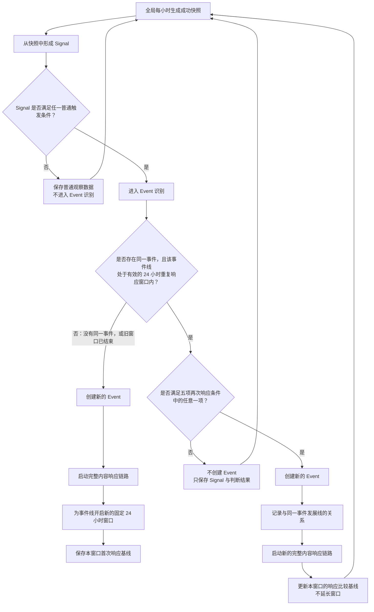

# Event 重复响应详细规则

> 状态：终版
>
> 日期：2026-08-21
>
> 适用范围：已由小时快照形成的热点 Signal，以及同一事件发展线在首次响应后 24 小时内的多次响应。

## 1. 规则目标

本规则只解决一个问题：一个热点已经触发过一次内容响应后，什么情况下值得再次创建 Event 并启动新的内容响应链路。

核心目标：

- 过滤持续上榜但没有有效增量的重复 Signal；
- 在事件快速发展或热度显著增长时允许持续响应；
- 将单个事件的专项增量追踪限制在固定 24 小时内，避免无限追踪历史热点；
- 每次值得再次响应时直接创建新的 Event，底层保留它与此前 Event 的事件线关系。

## 2. 核心原则

1. 全局榜单按小时持续采集，只有成功快照参与规则判断。
2. Signal 必须先满足普通触发条件，才进入 Event 识别。
3. Event 识别只用于判断是否存在同一事件，以及该事件线是否处于有效的 24 小时重复响应窗口内。
4. 没有同一事件，或者同一事件的旧窗口已经结束时，合格 Signal 按普通响应处理。
5. 同一事件处于有效窗口内时，满足五项再次响应条件中的任意一项即可再次响应。
6. 每次再次响应都直接创建新的 Event，并启动新的完整内容响应链路。
7. 窗口属于事件发展线，从该轮第一次普通响应开始固定计算 24 小时；窗口内创建新的 Event 不延长窗口。

## 3. 总体流程



自动判断漏斗为：

```text
全部 Signal
→ 普通触发条件过滤
→ Event 识别与 24 小时窗口判断
→ 窗口外：普通响应
→ 窗口内：五项再次响应条件任一满足即可响应
```

## 4. 第一层：普通触发条件

只有满足下列任意一项的 Signal，才进入 Event 识别：

| 编号 | 普通触发条件 | 指标 |
|---|---|---|
| T1 | 当前位于目标榜单前 5 | 当前成功快照排名为 1—5 |
| T2 | 排名快速上升 | 相邻两次成功小时快照之间上升至少 10 位 |
| T3 | 命中重点主题 | Signal 命中当前生效的重点主题配置 |
| T4 | 跨地区传播 | 同一 Signal 对应的具体事件同时出现在至少两个目标地区榜单 |
| T5 | 人工触发 | 运营人员主动发起响应 |

未满足普通触发条件时：

- 不进入 Event 识别；
- 不查询 24 小时窗口；
- 不执行专项事实、状态、互动量或传播范围增量判断；
- 只保存普通 Signal 与快照数据。

人工触发不依赖自动 Signal 门槛，可直接进入响应处理，但必须记录操作者和原因。

## 5. 第二层：同一事件与窗口判断

合格 Signal 进入 Event 识别后，只判断：

> 是否存在同一事件，且该事件发展线当前处于有效的 24 小时重复响应窗口内？

| 判断结果 | 处理方式 |
|---|---|
| 不存在同一事件 | 创建新 Event，执行普通响应，开启新的 24 小时窗口 |
| 存在同一事件，但旧窗口已经结束 | 创建新 Event，执行普通响应，开启新的 24 小时窗口 |
| 存在同一事件，且窗口仍然有效 | 进入五项再次响应条件判断 |

### 5.1 窗口口径

- 窗口从该轮第一次普通响应创建 Event 的时间开始；
- 窗口固定持续 24 小时；
- 窗口属于整条事件发展线，不属于窗口内某一个单独 Event；
- 窗口内再次创建 Event 不重置、不顺延结束时间；
- 24 小时结束后，上一窗口的增量门槛不再限制新一轮普通响应；
- 下一张合格 Signal 可以创建新 Event，并开启全新的 24 小时窗口；
- 如果事件连续处于 Top 5，窗口结束后的下一张成功快照仍满足 T1，可以按普通响应开启新窗口。

示例：

| 时间 | 动作 |
|---|---|
| 第一天 10:00 | 普通触发，创建 Event A，窗口从 10:00 开始 |
| 第一天 12:00 | 出现实质增量，创建 Event B，窗口结束时间仍为次日 10:00 |
| 第一天 16:00 | 再次出现实质增量，创建 Event C，窗口仍不顺延 |
| 次日 10:00 | 原窗口结束 |
| 次日下一张合格快照 | 按普通触发规则创建 Event D，并开启新窗口 |

## 6. 第三层：24 小时内的再次响应条件

同一事件处于有效窗口内时，满足下列五项中的任意一项，即可创建新的 Event 并再次响应：

| 编号 | 再次响应条件 | 判断标准 |
|---|---|---|
| R1 | 实质新事实 | 事实增量得分达到 15 分 |
| R2 | 事件状态实质变化 | 命中任一标准状态迁移 |
| R3 | 互动量显著增长 | 相邻成功快照互动总量增长至少 2 倍 |
| R4 | 传播范围实质扩张 | 新增重点地区、进入 Worldwide 或新增独立渠道 |
| R5 | 运营人员主动触发 | 运营人员明确要求再次响应 |

逻辑关系：

```text
R1 OR R2 OR R3 OR R4 OR R5
```

自动重复响应的完整条件：

```text
Signal 已满足任一普通触发条件
AND
存在同一事件且处于有效的 24 小时窗口内
AND
R1、R2、R3、R4 中任意一项成立
→ 创建新的 Event
→ 启动新的完整内容响应链路
```

R5 为人工覆盖规则，不要求自动增量指标成立。

## 7. R1：实质新事实

### 7.1 比较基线

当前事实与上一次被系统接受并创建响应 Event 时保存的 Fact Set 比较，而不是与最终发布文案比较。

某条事实如果已经存在于上一次 Fact Set，只是没有写入最终文案，本次不能认定为新事实。

### 7.2 事实增量指标

| 指标 | 定义 | 示例 | 分值 |
|---|---|---|---:|
| 核心动作或结果 | 新增现实动作或正式结果 | 发布、批准、拒绝、签署、完成 | 25 |
| 关键主体或参与方 | 新增改变事件结构的重要参与方 | 监管机构介入、新公司加入 | 15 |
| 核心对象或适用范围 | 对象、人群、产品或范围发生重要变化 | 从部分用户扩大到全部用户 | 15 |
| 关键时间 | 发布、实施、截止或结果时间发生变化 | 确定 9 月 1 日上线 | 15 |
| 关键数值 | 新增价格、金额、票数、规模或结果性数字 | 定价 99 美元 | 15 |
| 地点或司法辖区 | 新增会改变事件意义的地区 | 禁令扩大至欧盟 | 5 |
| 直接后果 | 新增可验证的直接后果 | 服务暂停、交易终止 | 10 |

### 7.3 字段变化状态

| 状态 | 含义 | 是否计分 |
|---|---|---|
| `unchanged` | 与上一次响应相同 | 否 |
| `added` | 上次未知，本次新增 | 是 |
| `changed` | 上次已有，本次发生变化 | 是 |
| `removed` | 原事实被撤回 | 转入状态变化或更正规则 |
| `conflicting` | 当前来源之间存在冲突 | 不计分，进入核验 |

### 7.4 处理区间

| 得分 | 处理方式 |
|---:|---|
| `≥ 15` | 认定存在实质新事实，允许再次响应 |
| `5–14` | 进入人工判断 |
| `< 5` | 不构成实质新事实 |
| 存在来源冲突 | 进入事实核验，不自动响应 |

### 7.5 硬规则

下列字段有可靠证据并发生新增或变化时，可以直接认定为实质新事实：

- 核心动作；
- 正式结果；
- 关键时间；
- 关键结果数值；
- 直接后果。

下列内容不能单独认定为实质新事实：

- 普通地点变化；
- 次要参与方变化；
- 新增重复来源；
- 更多媒体报道同一事实；
- 标题、语言或表达方式变化；
- 非关键背景信息；
- 网友观点或未经验证的推测；
- 排名或互动量变化；
- 已经存在于上一次 Fact Set、但未进入最终文案的事实。

## 8. R2：事件状态实质变化

下列状态迁移直接认定为实质变化：

| 原状态 | 新状态 |
|---|---|
| 传闻 | 已确认 |
| 传闻 | 已否认 |
| 计划 | 正式宣布 |
| 即将发生 | 正在发生 |
| 正在发生 | 已完成 |
| 正常推进 | 延期 |
| 正常推进 | 取消 |
| 初始结论 | 正式更正 |
| 初始结论 | 结果反转 |

以下情况不构成状态变化：

- 同一状态下增加来源；
- 同一状态下热度上涨；
- 事件仍在正常进行；
- 没有可靠依据的状态猜测；
- 只是使用不同文字描述相同状态。

状态变化单独判断，不重复计入新事实得分。

## 9. R3：互动量显著增长

### 9.1 互动量口径

```text
互动总量 = 点赞数 + 回复/评论数 + 转发数 + 引用转发数
```

### 9.2 判断公式

```text
互动增长倍数 =
当前成功快照的同一事件关联内容互动总量
÷
上一张成功快照的同一事件关联内容互动总量
```

触发门槛：

```text
互动增长倍数 ≥ 2
```

### 9.3 数据边界

- 只比较相邻两次成功小时快照；
- 失败或数据不完整的快照跳过；
- 两张快照必须采用相同的互动统计口径；
- 互动数据必须属于同一事件发展线；
- 上一张快照互动量为 0 时不计算倍数，不以 R3 自动触发。

## 10. R4：传播范围实质扩张

相较上一次被系统接受并创建响应 Event 时保存的传播范围，满足以下任意一项即成立：

| 指标 | 判断条件 |
|---|---|
| 新增目标地区 | 进入至少一个此前未覆盖的目标地区 |
| 多地区扩散 | 从单一地区扩展到至少两个目标地区 |
| 全球扩散 | 从地区榜单进入 Worldwide |
| 新增渠道 | 进入此前未覆盖的独立监控渠道 |

以下情况不构成传播范围扩张：

- 原有地区再次出现；
- 同一地区新增更多帖子；
- 同一地区新增重复来源；
- 同一内容出现不同语言版本；
- 热搜关键词或标题变化；
- 同一渠道中的账号数量增加。

## 11. R5：运营人员主动触发

运营人员可以主动要求同一事件再次响应。

人工触发时：

- 不要求 R1—R4 成立；
- 不要求自动 Signal 门槛成立；
- 直接创建新的 Event 并启动完整内容响应链路；
- 必须记录操作者、时间和触发原因；
- 如果当前存在有效窗口，新 Event 沿用该窗口，且不延长窗口；
- 如果不存在有效窗口，则为该事件线开启新的固定 24 小时窗口。

## 12. 比较基线与更新规则

| 判断指标 | 比较基线 |
|---|---|
| 排名上涨至少 10 位 | 相邻两次成功小时快照 |
| 互动量增长至少 2 倍 | 相邻两次成功小时快照 |
| 实质新事实 | 上一次创建响应 Event 时的 Fact Set |
| 事件状态变化 | 上一次创建响应 Event 时的事件状态 |
| 传播范围扩张 | 上一次创建响应 Event 时的地区与渠道集合 |

只有系统接受触发并创建了新的 Event，才更新事实、状态和传播范围的响应基线。普通小时快照不会覆盖这些基线。

每次创建新的响应 Event 后至少保存：

| 字段 | 用途 |
|---|---|
| `event_id` | 当前响应 Event 的唯一标识 |
| `event_line_id` | 标识它与此前 Event 属于同一事件发展线 |
| `previous_event_id` | 指向该事件线上一次创建的响应 Event |
| `triggered_at` | 本次触发时间 |
| `trigger_signal_id` | 触发本次响应的 Signal |
| `trigger_reason` | R1—R5 中实际命中的原因 |
| `response_window_started_at` | 当前固定窗口的起点 |
| `response_window_ends_at` | 当前固定窗口的终点 |
| `baseline_snapshot_id` | 本次接受触发时的比较快照 |
| `fact_set_version` | 本次响应使用的事实集合版本 |

## 13. 创建 Event 后的处理

无论是普通响应还是 24 小时内的再次响应，只要规则允许响应，就执行同一条链路：

```text
创建新的 Event
→ 记录事件发展线关系和触发原因
→ 聚合本次最新事实与证据
→ 创建账号内容任务
→ 生成内容候选
→ 进入发布流程
```

上一轮内容是否已经生成、选择或发布，不阻塞新 Event 的创建和新响应链路的启动。

## 14. 决策表

| Signal 状态 | 同一事件状态 | 窗口状态 | 再次响应条件 | 处理方式 |
|---|---|---|---|---|
| 不满足普通触发条件 | 不判断 | 不判断 | 不判断 | 保存观察数据，不进入 Event 识别 |
| 满足普通触发条件 | 不存在同一事件 | 无 | 不要求 | 创建新 Event，普通响应，开启窗口 |
| 满足普通触发条件 | 存在同一事件 | 旧窗口已结束 | 不要求 | 创建新 Event，普通响应，开启新窗口 |
| 满足普通触发条件 | 存在同一事件 | 窗口有效 | R1—R4 均不满足 | 不创建 Event，只保存判断结果 |
| 满足普通触发条件 | 存在同一事件 | 窗口有效 | R1—R4 任意一项满足 | 创建新 Event，再次响应，不延长窗口 |
| 人工主动触发 | 任意 | 任意 | R5 成立 | 创建新 Event并响应；有窗口则沿用，无窗口则新开 |

## 15. 验收场景

### 场景 A：持续高位但没有增量

Event 首次响应后持续处于 Top 5，但在当前 24 小时窗口内没有新事实、状态变化、互动量 2 倍增长或传播扩张。

预期：窗口内不重复创建 Event。

### 场景 B：两小时后互动爆发

Event 首次响应两小时后仍满足普通触发条件，相邻两次成功快照的互动总量增长 2.3 倍。

预期：R3 成立，创建新的 Event，立即启动新的内容响应链路，原窗口结束时间不变。

### 场景 C：新增正式发布时间

Event 首次响应后，官方来源公布此前未知的正式发布时间。

预期：关键时间得 15 分，R1 成立，创建新的 Event。

### 场景 D：窗口结束后仍在 Top 5

原窗口结束后的下一张成功快照仍然处于 Top 5。

预期：按普通触发处理，创建新的 Event并开启新的 24 小时窗口；不要求与上一窗口进行实质增量比较。

### 场景 E：普通 Signal 未达门槛

Signal 排名第 18，相邻快照只上升 3 位，未命中重点主题，也未达到跨区条件。

预期：不进入 Event 识别，不进行专项增量判断。

### 场景 F：人工要求再次响应

运营人员认为需要更换角度再次发布，但 R1—R4 均未成立。

预期：R5 成立，记录人工原因，创建新的 Event 并启动内容响应链路。
