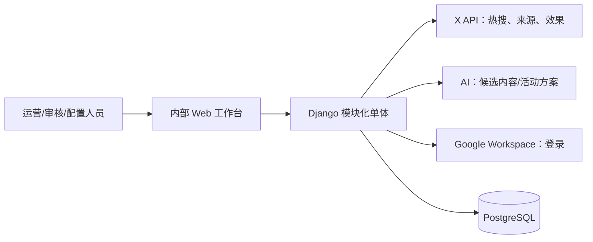

# 01 系统上下文与原则

| 模块 | 拥有对象 | 只能依赖 |
| --- | --- | --- |
| M1 Discovery | Signal、Future Event、Candidate Event、采集运行 | Shared、X 端口 |
| M2 Event Intelligence | Event、Fact、Evidence、Event Relation、Event Card 读模型 | M1 公开服务、Shared |
| M3 Campaign Planning | Marketing Recommendation、Campaign Case、Campaign Proposal | M2 公开服务、Shared、AI 端口 |
| M4 Content Response | Execution Account、Content Skill、Account Response Task、Content Candidate、Publication Record | M2 公开服务、Shared、AI 端口 |
| M5 Outcome & Learning | Performance Result、Evaluation Report、Optimisation Proposal | M3/M4 公开服务、Shared、X 端口 |
| Shared | 用户、角色、审计、版本化配置、Outbox、文件引用 | 无业务模块依赖 |

原则：PostgreSQL 是权威；只拥有模块变更其对象；外部调用与 AI 生成均在提交后异步执行；活动策划与内容响应从 Event Card 并行分支；人工发布是唯一的 Phase 0 发布动作。
