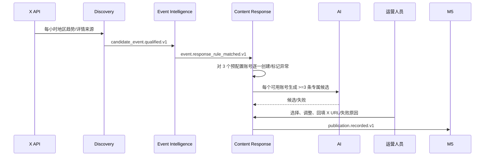

# 02 组件与代码映射



```text
src/hotspot_monitor/apps/
  shared/              # authz, audit, config_versions, outbox
  discovery/           # X polling, source snapshots, candidate events
  event_intelligence/  # Event/Fact/Evidence and Event Card projections
  campaign_planning/   # recommendations, cases, exactly-three proposals
  content_response/    # accounts, skills, ARTs, candidates, publications
  outcome_learning/    # performance, evaluation, proposals
  integrations/        # ports + X/AI/Google adapters
```

浏览器仅调用 Django 应用服务。同步命令只校验、写权威状态、审计和 Outbox；Worker 消费 Outbox 后采集 X、调用 AI 或刷新效果。每个 Worker 命令使用持久幂等键；失败留在可见队列，可重试或人工接管。
