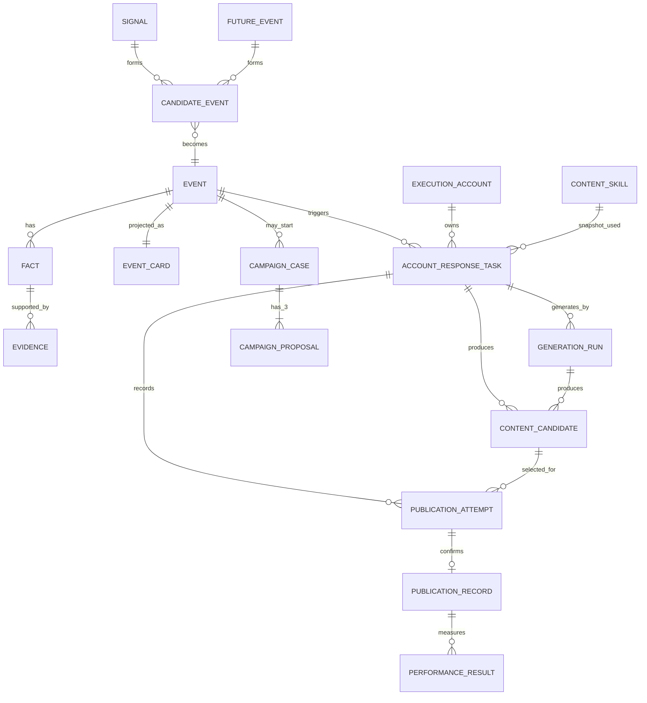

# 03 数据架构

| 数据约束 | 规则 |
| --- | --- |
| 权威与投影 | Event Card 是 Event/Fact/Evidence 的读模型，不是独立可写根对象。 |
| 来源 | 每个出现地区保留最多三个 Phase 0 详情来源快照、原链接、采集时间、实际数量和错误。来源冲突不得自动成为确认事实。 |
| 账号语义 | ART 唯一键为 `event_id + execution_account_id`；账号/Skill/规则版本只作为任务创建时的不可变快照。Phase 0 固定三个预配置 Predx X 账号，每个账号各有 0 或 1 个 ART。 |
| 并发创建 | 创建 ART 使用数据库唯一约束和 `INSERT … ON CONFLICT`；重复事件只返回既有任务，不重复触发生成。 |
| 配置版本 | Execution Account、Content Skill、监测/响应/风险规则为不可变已发布版本；ART、候选和方案保存引用/必要快照。 |
| 生成版本 | 每次生成建立 `Generation Run`，固定 ART、Event Card 版本、账号/Skill/规则快照和输入摘要。Worker 仅当 run 仍为该 ART 当前 run、ART 未冻结且输入版本仍一致时写入候选；否则标为 `discarded_stale`，不能回到待选择。 |
| 候选与发布 | Content Candidate 不跨账号复用。运营选择候选时先创建 `Publication Attempt`（任务、候选版本、操作者、开始时间）；它的终态只能为 `published`（一个校验过的 URL）、`failed`（原因）或 `unknown`。Publication Record 是 Attempt 的不可变确认记录，不代表系统发帖。 |
| 回填并发 | 回填命令携带 Attempt ID 与乐观锁版本；已终态 Attempt 拒绝覆盖。真实已发布但未有 URL 时保留 `unknown`，由运营补回填或受控更正，不能伪造失败。 |
| 结果口径 | 每个 Performance Result 绑定 Publication Record、采样时间、指标/观察窗口版本、数据源和 `complete/partial/unavailable` 状态；不可比较窗口不得聚合为同一结论。 |
| 聚合身份 | Signal 以 `source + region + captured_at + normalized_trend` 指纹去重；高置信度 Candidate/Event 合并可由系统在事务中创建版本化 resolution。自动合并初始阈值为 `0.95`，位于版本化 Event Resolution 配置；自动拆分只生成建议，须人工确认；任一 resolution 均不重写历史引用。 |
| 合并影响分类 | Resolution 比较候选所用 Event Card 版本与合并后关键事实、风险、窗口：无差异为 `unaffected` 并继续；有差异为 `review_required` 并冻结未发布候选；已发布记录仅标记复核。 |
| 活动方案 | Campaign Case 由人工启动；每次生成恰好三份 Proposal，后续编辑创建受审计版本。 |
| 审计 | 关键写入含 actor、时间、原因、前后值、request ID；业务记录不物理删除。 |

Event 的事实、证据、风险或窗口实质变化时，产生 `event_card.materially_changed.v1`。M4 在同一事务冻结尚未终态的 Generation Run 和尚未开始发布的候选；迟到的 Worker 结果按版本比较丢弃。M3 冻结未交接方案；已回填的发布记录和效果结果只标记复核。
