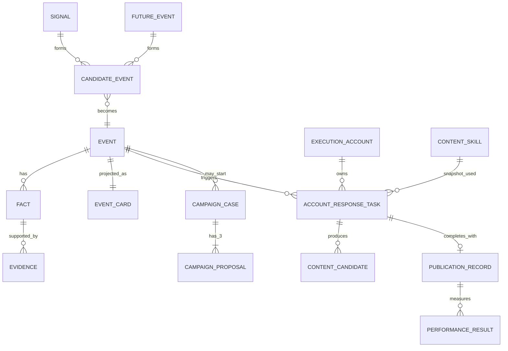

# 03 数据架构

| 数据约束 | 规则 |
| --- | --- |
| 权威与投影 | Event Card 是 Event/Fact/Evidence 的读模型，不是独立可写根对象。 |
| 来源 | 每个出现地区保留最多三个 Phase 0 详情来源快照、原链接、采集时间、实际数量和错误。来源冲突不得自动成为确认事实。 |
| 账号语义 | ART 唯一键为 `event_id + execution_account_id`；账号/Skill/规则版本只作为任务创建时的不可变快照。Phase 0 固定三个预配置 Predx X 账号，每个账号各有 0 或 1 个 ART。 |
| 配置版本 | Execution Account、Content Skill、监测/响应/风险规则为不可变已发布版本；ART、候选和方案保存引用/必要快照。 |
| 候选与发布 | Content Candidate 不跨账号复用；Publication Record 仅保存人工回填的 URL 或失败原因，不代表系统发帖。 |
| 活动方案 | Campaign Case 由人工启动；每次生成恰好三份 Proposal，后续编辑创建受审计版本。 |
| 审计 | 关键写入含 actor、时间、原因、前后值、request ID；业务记录不物理删除。 |

Event 的事实、证据、风险或窗口实质变化时，产生 `event_card.materially_changed.v1`。M4 冻结尚未人工发布的受影响候选并要求重新预检；M3 冻结未交接方案；已回填的发布记录和效果结果只标记复核。
