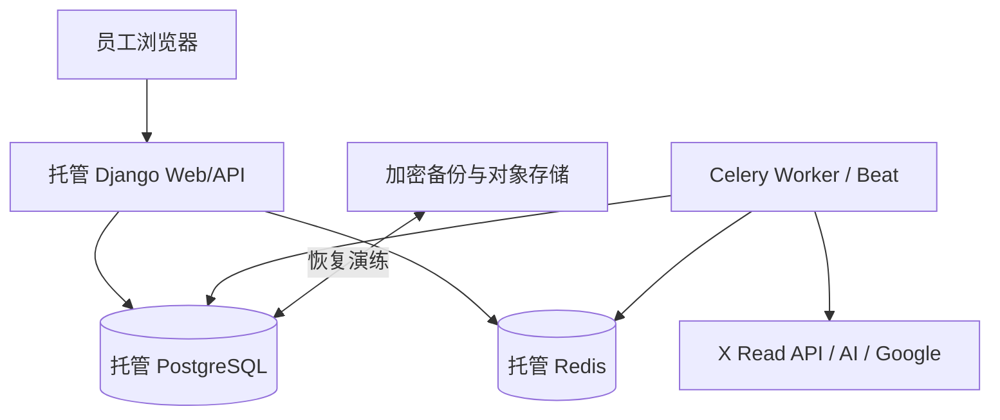

# 06 部署与扩展

| 环境 | 目的 | 最低门禁 |
| --- | --- | --- |
| Local | 本地开发与测试 | 秘密不落库、不连接生产数据。 |
| Staging | 真实集成与恢复验证 | Google 登录、X 读取、AI 生成、限流/失败、备份恢复与审计验证。 |
| Production | 内部运营 | 最小权限、监控告警、自动备份、兼容迁移、回滚计划。 |

初始容量为 5–10 名用户、最多 3 人并发、X 五地区每小时采集。Web 与 Worker 独立扩容；采集、生成和效果读取使用不同队列/并发配额，避免互相饥饿。触发容量复审：活跃用户达到 25、地区/来源/频率增加、队列 P95 延迟持续超标或外部 API 配额成为瓶颈。

生产必须达到 99.5% 月可用性、RTO ≤4小时、RPO ≤1小时。具体云供应商和区域待 Staging 验证中国大陆员工对 Google、X、AI 的连通性、托管能力与成本后绑定。
