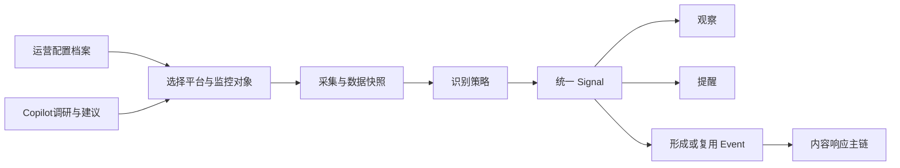
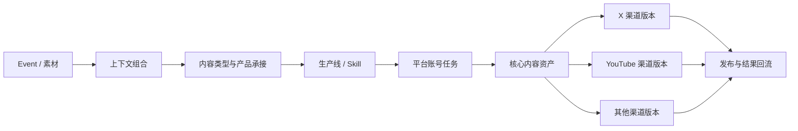

# 热点运营系统扩展性目录与优先级矩阵

> 交付版本：v1.0  
> 日期：2026-08-18  
> 读者：业务负责人、产品、开发  
> 用途：列清系统未来需要支持的变化、业务例子、重要性与落地顺序；不替代既有业务规则 SPEC。

## 0. 结论

系统要服务的不是一条固定路径，而是持续试验不同的获客组合：

```text
发现来源 × 识别方式 × 内容类型 × 表达形式 × 账号 × 发布平台 × 产品承接 × 运营策略
```

开发首期要做的不是一次性实现所有组合，而是让 P0 能跑通、P1 能接入、P2 不被当前结构堵死。

## 1. 分级标准

### 1.1 业务重要性

| 等级 | 定义 |
|---|---|
| Tier 1 | 直接影响热点发现速度、内容质量、流量或新增用户。 |
| Tier 2 | 明显提升效率、覆盖或内容丰富度，但缺少时主链仍可运行。 |
| Tier 3 | 长期平台化方向，当前没有充分的使用场景或效果证据。 |

### 1.2 落地优先级

| 优先级 | 定义 |
|---|---|
| P0 | 当前 X 热点响应主链必须支持。 |
| P1 | 下一阶段优先验证；首期技术结构需允许接入。 |
| P2 | 中长期扩展；当前记录场景和边界即可。 |

### 1.3 配置与开发边界

| 变化 | 应如何处理 |
|---|---|
| 已接入平台内新增账号、关键词、榜单、频道或规则 | 运营配置，不开发。 |
| 复用既有生产线、Skill、账号能力形成新组合 | 运营配置，不开发。 |
| 新平台首次接入、全新媒体能力、平台 API 重大变化 | 开发一次性支持。 |
| 重大运营策略变化 | 新建运营配置档案或实验，不覆盖线上现行策略。 |

## 2. 扩展性总目录

| 编号 | 扩展领域 | 核心问题 | Tier | 当前优先级 |
|---:|---|---|---|---|
| 1 | 监控源与监控对象 | 从哪里发现信息，具体盯什么？ | Tier 1 | P0/P1 |
| 2 | 触发与早期趋势识别 | 什么值得处理，能否比热搜爆发更早发现？ | Tier 1 | P0/P1 |
| 3 | 内容生产类型与形式 | 能生产哪些内容，如何获得速度或新颖观点？ | Tier 1 | P0/P1 |
| 4 | 产品承接 | 如何把热点内容转为品牌曝光、产品点击或使用？ | Tier 1 | P0/P1 |
| 5 | 账号、Skill 与内容路由 | 由谁、以什么人设和动作响应？ | Tier 1 | P0/P1 |
| 6 | 分发渠道与发布方式 | 内容发到哪里，如何适配和回流？ | Tier 1 | P0/P1 |
| 7 | Copilot 与配置 Workflow | 用户如何在系统内完成调研、配置和日常操作？ | Tier 2 | P1 |
| 8 | 效果反馈与优化 | 如何知道什么组合真正有效？ | Tier 1 | P0/P1 |

## 3. 热点监测扩展地图



任何来源都先以统一 Signal 进入系统。来源不同、数据形态不同，但不应各自建立独立的 Event 和内容流程。

## 4. 监控源与监控对象目录

### 4.1 X 平台

| 监控对象 | 用途 | 业务例子 | 配置/开发 | Tier | P |
|---|---|---|---|---|---|
| 地区热搜榜 | 发现广泛热点 | 抓 Worldwide、美国、英国、日本、韩国前 30 | 已接入后配置地区与范围 | 1 | P0 |
| 热搜地区组合 | 发现跨区扩散 | AI Event 同时进入美国和英国榜单 | 配置 | 1 | P0 |
| 指定账号 | 发现早期消息 | 监控 @OpenAI 的新帖 | 配置 | 1 | P0 |
| 账号组 | 监控同类关键来源 | “Crypto 头部媒体”账号组 | 配置、批量导入 | 1 | P0 |
| 重点主题圈 | 发现行业圈层热议 | AI 主题圈内多账号讨论同一发布 | 配置 | 1 | P0 |
| 竞品账号组 | 发现竞品动作 | 竞品发布免手续费活动 | 配置 | 2 | P1 |
| 关键词 / 搜索式 | 发现未上榜话题 | 搜索 “GPT-6 AND API” | 平台搜索能力首次接入后配置 | 1 | P1 |
| Hashtag / Cashtag | 发现特定话题热度 | #Bitcoin、$BTC 讨论变化 | 同上 | 2 | P1 |
| X List / Community | 监控已有社群集合 | 政治记者 List | 平台对象适配 | 2 | P2 |
| 指定帖子 / 引用帖 | 跟踪单条消息扩散 | 官方预告帖被哪些圈层引用 | 平台内容对象适配 | 2 | P1 |
| 回复区 | 发现用户问题和争议 | 新模型发布帖下的高频疑问 | 平台内容对象适配 | 3 | P2 |
| 爆款帖子 | 发现成功表达样本 | 互动超过账号基线的 AI 帖子 | 内容指标能力 | 1 | P1 |

### 4.2 YouTube

| 监控对象 | 用途 | 业务例子 | 配置/开发 | Tier | P |
|---|---|---|---|---|---|
| 指定频道 | 发现官方或KOL新内容 | 监控 Coin Bureau 新视频 | 首次接入后配置 | 1 | P1 |
| 频道组 | 发现垂直领域讨论 | Crypto 头部频道组 | 配置 | 1 | P1 |
| 关键词搜索 | 发现主题内容 | 搜索 “prediction market” | 搜索能力首次接入后配置 | 1 | P1 |
| 热门 / 趋势视频 | 发现正在增长的话题 | 美国区快速上升的 AI Shorts | 趋势数据能力 | 1 | P1 |
| 视频 / Shorts | 获取具体爆款内容样本 | 一条 30 秒 AI 解释视频 | 内容对象适配 | 1 | P1 |
| 视频评论 | 发现用户困惑和观点 | 新模型视频评论中的争议点 | 内容对象适配 | 3 | P2 |
| 直播 / Premiere | 发现预告或实时事件 | 官方产品发布直播 | 直播对象适配 | 2 | P2 |

### 4.3 搜索、新闻与官方来源

| 来源 | 用途 | 业务例子 | 配置/开发 | Tier | P |
|---|---|---|---|---|---|
| Google Trends | 发现搜索需求增长 | “GPT-6”搜索量急升 | 首次接入后配置词与地区 | 1 | P1 |
| Google News / 新闻搜索 | 补充新闻和事实来源 | 搜索多家媒体对同一事件的报道 | 首次接入后配置 | 1 | P1 |
| 新闻网站 / RSS | 持续接收行业快讯 | Reuters 科技栏目新文章 | 首次接入后配置订阅源 | 2 | P1 |
| 官方网站 / Blog | 发现一手公告 | OpenAI 产品公告页更新 | 首次接入后配置页面 | 1 | P1 |
| 产品 Changelog / Status | 发现功能上线或故障 | 某平台正式开放 API | 首次接入后配置页面 | 2 | P2 |
| 政府、监管、宏观机构 | 获取一手政策与数据 | BLS CPI、FOMC 日历 | 当前未来事件来源 P0 | 1 | P0 |
| 体育官方赛程 | 未来事件和活动机会 | 世界杯赛程变化 | 官方连接器 | 2 | P1 |

### 4.4 其他社区、平台与人工来源

| 来源 | 用途 | 业务例子 | 配置/开发 | Tier | P |
|---|---|---|---|---|---|
| Reddit Subreddit / 热门帖 | 发现垂直社区热议 | r/CryptoCurrency 的新话题 | 新平台接入 | 2 | P2 |
| Telegram 频道 | 发现项目或媒体公告 | Crypto 项目公告频道 | 新平台接入 | 2 | P2 |
| Discord 公告 / 社区 | 发现半封闭社群信息 | 项目 Discord Announcements | 新平台接入与权限处理 | 3 | P2 |
| TikTok / 小红书账号与热榜 | 发现爆款形式和大众热点 | 短视频爆款拆解 | 新平台接入 | 2 | P2 |
| 内部产品数据 | 发现产品和用户机会 | 某预测市场交易量异常增长 | 内部数据连接 | 2 | P1 |
| 单条 URL / 文本 | 人工发起研究或响应 | 粘贴一条X帖要求分析 | 当前人工入口 | 1 | P0 |
| CSV / Excel | 批量导入账号、事件或样本 | 导入 50 个主题圈账号 | 当前人工导入 | 1 | P0 |

## 5. 触发与早期趋势识别目录

| 识别策略 | 判断什么 | 例子 | 当前动作 | Tier | P |
|---|---|---|---|---|---|
| 前 5 名 | 已获得高曝光位置 | Event 首次进入某地区榜单 1—5 | 自动响应 | 1 | P0 |
| 排名快速上升 | 话题正在明显爬升 | 相邻成功快照上升至少 10 位 | 自动响应 | 1 | P0 |
| 重点主题命中 | Event 属于高优先主题 | GPT-6 属于 AI 主题 | 自动响应 | 1 | P0 |
| 跨区异动 | 事件开始跨地区传播 | 同一 Event 出现至少两个地区榜单 | 自动响应 | 1 | P0 |
| 主题圈集中讨论 | 多个目标账号聚焦同一 Event | 3 小时内多个 AI 账号讨论同一发布 | 自动响应或提醒 | 1 | P0/P1 |
| 单内容异常增长 | 帖子 / 视频超过自身基线 | 互动量为账号平时的 5 倍 | 提醒或形成素材 | 1 | P1 |
| 讨论量增长 | 相关内容数量异常上升 | 一小时内相关帖数翻倍 | 提醒 | 1 | P1 |
| 增长加速度 | 热度增长越来越快 | 后一小时增速显著高于前一小时 | 提醒 | 1 | P1 |
| 跨圈层扩散 | 从垂直圈进入更多圈层 | Crypto 媒体后科技媒体也开始讨论 | 提醒或自动响应 | 1 | P1 |
| 关键来源出现 | 官方、核心媒体或关键KOL参与 | 官方账号确认预告 | 形成或补充 Event | 1 | P1 |
| AI 综合判断 | 多个弱信号共同指向早期爆发 | 排名尚低但互动、地区和关键账号均上升 | 观察 / 提醒 / 自动响应 | 1 | P1 |
| 人工启动 | 运营确认值得处理 | 用户要求对某贴生成内容 | 进入 Event 或研究 | 1 | P0 |

所有策略必须输出统一、可解释的 Signal，包含来源、输入数据、命中依据、规则/Skill版本和建议动作。建议动作统一为：**观察、提醒、自动响应**。

## 6. 爆款内容拆解扩展目录

爆款内容拆解将高表现内容沉淀为 `Content Insight`，服务后续内容生产；它不直接生成可发布内容，也不复制原内容。

| 可扩展对象 | 必须支持的变化 | 业务例子 | 配置/开发 | Tier | P |
|---|---|---|---|---:|---|
| 自动样本来源 | 首期从 YouTube 榜单获取视频样本；未来可增加其他自动来源 | YouTube 热门 AI 视频进入待拆解列表 | YouTube 首次接入后配置榜单范围 | 1 | P0 |
| 手动样本输入 | 允许输入任意公开内容 URL，不限制平台 | 粘贴 X 帖子、TikTok 视频、新闻页或 YouTube 链接要求拆解 | 通用 URL 输入；按可读取信息解析 | 1 | P0 |
| 样本信息完整度 | 根据可获取的正文、字幕、标题、描述、图片和公开数据进行拆解；信息不全时明确标记 | 无字幕视频仅分析标题、缩略图和公开互动数据 | 统一样本状态 | 1 | P0 |
| Content Insight | 将一次拆解沉淀为可复用洞察，而非一次性分析结果 | “反常识开头 + 三段证据 + 预测提问”的结构洞察 | 通用 Insight 对象 | 1 | P0 |
| 洞察内容 | 拆解选题、开头钩子、结构、表达形式、互动机制、可借鉴点和不可照抄点 | 某 Shorts 的节奏适合做热点解释，但不能复用原话 | 拆解 Skill | 1 | P0 |
| 洞察引用 | 将 Content Insight 作为内容生成的可选上下文 | 生成 YouTube 脚本时引用某条视频的叙事结构 | 内容任务配置 | 1 | P1 |
| 指定内容源 | 增加指定频道、账号组、主题、关键词作为持续样本来源 | 持续拆解 20 个 Crypto YouTube 频道 | 已接入平台内配置 | 1 | P1 |
| 样本筛选策略 | 按播放增长、互动率、账号基线或人工条件筛选值得拆解的内容 | 播放量高于频道均值 5 倍的视频进入候选 | 指标规则配置 | 1 | P1 |
| 样本对比 | 对同主题或同类内容进行结构和表现比较 | 比较不同 AI 视频标题与时长的效果 | 分析 Skill + 指标能力 | 2 | P1 |
| 多平台自动拆解 | 接入 X、TikTok、小红书等平台的自动样本源 | 小红书热门图文进入同一 Insight 库 | 新平台连接器 | 2 | P2 |
| 洞察效果回流 | 比较引用不同 Insight 后内容的实际效果 | 哪类开头结构更能带来关注或点击 | 指标关联与实验 | 2 | P2 |

## 7. 内容生产扩展目录

### 7.1 内容生产组合

```text
核心事实 / 素材
× 内容角度
× 平台
× 内容形式
× 语言 / 地区
× 账号人设
× 产品承接强度
```

内容角度回答“讲什么”，内容形式回答“交付文本、图片还是视频”，语言 / 地区回答“给谁看、如何表达”。不能把“X短帖”“快讯”“快讯账号”视为同一个概念。

### 7.2 内容生产扩展需求

| 可扩展对象 | 必须支持的变化 | 业务例子 | 配置/开发 | Tier | P |
|---|---|---|---|---:|---|
| 内容角度 | 快讯、解释、深度分析、产品承接等基础角度；未来增加观点、历史关联、爆款启发等 | CPI Event 分别生成快讯、解释和产品承接内容 | 生产线 / Skill 配置 | 1 | P0/P1 |
| X 文本形式 | 短帖、长帖、Thread、回复、引用帖等 | 人设账号以评论参与，快讯账号发主帖 | 平台形式配置 | 1 | P0 |
| 语言与地区 | 为不同国家、语言和受众生成独立版本 | 英文面向美国用户，日文面向日本用户 | 账号与内容模板配置 | 1 | P1 |
| 地区本地化 | 调整地区背景、时区、单位、表达习惯和产品入口 | 美国宏观事件与日本用户使用不同解释语境 | 本地化 Skill + 配置 | 2 | P1 |
| 图片内容 | 单图事实卡、数据图、时间线、多图轮播、Meme 等 | 用事实卡解释事件，用概率图承接产品 | 图像 / 图表能力 + 品牌配置 | 1 | P1 |
| 视频内容 | Shorts 脚本、标题、口播稿、字幕、缩略图文案；未来扩展长视频 | 将热点转为 30 秒 YouTube Shorts 脚本 | 视频内容 Skill | 1 | P1 |
| 最终媒体资产 | 从脚本或方案进一步生成图片、视频成片等实际素材 | 自动生成事实卡或带字幕的短视频 | 媒体生成 / 渲染能力 | 2 | P1/P2 |
| 品牌视觉资产 | 配置 Logo、配色、字体、模板、产品截图和禁用元素 | 产品承接内容自动使用 PredX 品牌视觉 | 品牌资产配置 | 1 | P1 |
| 内容模板 | 将有效组合保存为可复用模板 | “英文 X 快讯 + 轻度产品露出”模板 | 运营配置 | 1 | P1 |
| 多平台版本 | 同一核心事实生成 X、YouTube、Telegram 等不同成品 | 同一 Event 同时生成 X Thread 与 Shorts 脚本 | 平台适配 Skill | 1 | P1 |
| 新渠道内容形式 | 接入小红书、TikTok、Newsletter、产品内内容等 | 热点生成小红书图文或周报专题 | 新渠道适配 | 2 | P2 |
| 内容形式效果对比 | 比较文本、图片、视频和不同地区版本的效果 | 同一 Event 的 X 短帖与 Shorts 哪个更有效 | 指标与实验能力 | 2 | P2 |

### 7.3 创作目的与表达方式

| 内容类型 | 具体形式 | 业务例子 | Tier | P |
|---|---|---|---|---|
| 快速响应 | 一句话快讯、标准快讯、预告、进展、结果、反转、多方说法 | “OpenAI确认下周发布新模型” | 1 | P0 |
| 事件解释 | 白话解释、核心要点、背景、时间线、影响、FAQ | “CPI低于预期意味着什么？” | 1 | P0 |
| 深度分析 | 行业、市场、用户、竞争、数据、风险、案例分析 | “新模型发布真正改变了什么？” | 1 | P0 |
| 观点评论 | 快速观点、条件判断、反方观点、反常识观点 | “重点不是参数，而是分发入口” | 1 | P1 |
| 历史关联 | 同主体历史、同类先例、周期对比、跨行业类比 | “历代 GPT 发布节奏对比” | 1 | P1 |
| 产品承接 | 预测问题、市场数据、产品功能、CTA | “市场如何定价下一步结果？” | 1 | P0 |
| 数据可视化 | 事实卡、概率卡、趋势图、时间线、信息图 | “过去24小时概率变化图” | 1 | P1 |
| 互动内容 | 回复、引用帖、投票、提问、讨论题 | “你认为下一步会怎样？” | 2 | 主帖/评论 P0；其他 P1 |
| 爆款启发 | 钩子、结构、节奏、互动机制的再创作 | 用爆款五点结构解释事件 | 1 | P1 |
| 未来事件内容 | 预热、倒计时、情景预案、结果复盘 | CPI 前三种结果的内容预案 | 1 | P1 |
| 活动内容 | 活动概念、海报、规则、KOL Brief、复盘 | 世界杯预测活动文案 | 2 | P2 |
| 娱乐化表达 | Meme、幽默评论、故事化、反应内容 | 对反转事件的轻量评论 | 2 | P2 |

### 7.4 平台与内容载体

| 平台 | 可扩展内容载体 | 业务例子 | Tier | P |
|---|---|---|---|---|
| X | 短帖、长帖、Thread、回复、引用帖、投票、单图、多图、短视频 | 快讯、深度 Thread、评论参与 | 1 | 短帖/长帖/回复 P0；其余 P1 |
| YouTube | Shorts 脚本、视频脚本、标题、缩略图文案、简介、Community 帖子、直播提纲 | 30 秒热点解释视频 | 1 | P1 |
| Telegram | 快讯、长消息、讨论题、链接卡 | 社群内发布结果和市场入口 | 2 | P2 |
| Newsletter | 周报、专题分析、事件合集 | 一周宏观热点复盘 | 2 | P2 |
| 官网 / App | 事件卡、专题页、分析文章 | 产品内事件解释页 | 2 | P2 |
| TikTok / 小红书 | 短视频脚本、图文笔记、标题、字幕 | 用热点制作大众解释内容 | 2 | P2 |
| Reddit / Discord | 长帖、评论、公告、讨论题 | 在社区内解释事件 | 3 | P2 |

### 7.5 语言、地区与媒体资产

| 可扩展对象 | 必须支持的变化 | 业务例子 | 配置/开发 | Tier | P |
|---|---|---|---|---:|---|
| 语言与地区版本 | 为不同国家、语言和受众生成独立版本 | 英文面向美国用户，日文面向日本用户 | 账号与内容模板配置 | 1 | P1 |
| 地区本地化 | 调整地区背景、时区、单位、表达习惯和产品入口 | 美国宏观事件与日本用户使用不同解释语境 | 本地化 Skill + 配置 | 2 | P1 |
| 图片内容 | 单图事实卡、数据图、时间线、多图轮播、Meme 等 | 用事实卡解释事件，用概率图承接产品 | 图像 / 图表能力 + 品牌配置 | 1 | P1 |
| 视频内容 | Shorts 脚本、标题、口播稿、字幕、缩略图文案；未来扩展长视频 | 将热点转为 30 秒 YouTube Shorts 脚本 | 视频内容 Skill | 1 | P1 |
| 最终媒体资产 | 从脚本或方案进一步生成图片、视频成片等实际素材 | 自动生成事实卡或带字幕的短视频 | 媒体生成 / 渲染能力 | 2 | P1/P2 |
| 品牌视觉资产 | 配置 Logo、配色、字体、模板、产品截图和禁用元素 | 产品承接内容自动使用 PredX 品牌视觉 | 品牌资产配置 | 1 | P1 |
| 内容模板 | 将有效组合保存为可复用模板 | “英文 X 快讯 + 轻度产品露出”模板 | 运营配置 | 1 | P1 |

同一 Event 可以共享事实依据，但不同语言或地区版本必须重新生成，不允许机械翻译后直接发布。图表、产品截图、市场概率和功能演示必须引用真实数据或真实产品资产。

### 7.6 有效组合示例

不需要穷举全部笛卡尔组合，但需要把有业务价值的组合沉淀为可配置模板。

| 素材 | 内容类型 | 平台 / 载体 | 产品方式 | 示例 | P |
|---|---|---|---|---|---|
| 实时 Event | 快讯 | X 短帖 | 轻度露出 | 热点事实卡 + Logo | P0 |
| 实时 Event | 解释 | X 长帖 | 标准承接 | 解释事件，结尾附产品链接 | P0 |
| 实时 Event | 深度分析 | X Thread | 深度承接 | 用真实市场概率解释事件影响 | P0/P1 |
| 实时 Event | 历史关联 | X Thread | 标准承接 | 对比历史先例并提出预测问题 | P1 |
| 实时 Event | 评论 | X 回复 | 轻度或标准承接 | 在相关帖下补充数据或产品入口 | P0 |
| 未来 Event | 情景预案 | X 图文 / Thread | 深度承接 | CPI 前展示不同结果对应概率 | P1 |
| 爆款样本 | 结构再创作 | X 图文 | 轻度露出 | 借鉴钩子，不复制原内容 | P1 |
| 实时 Event | 快速解释 | YouTube Shorts | 标准承接 | 30 秒解释 + CTA | P1 |
| 未来 Event | 深度预热 | YouTube 视频 | 深度承接 | 赛前预测与产品市场数据 | P1 |

## 8. 产品承接扩展目录

### 8.1 关联方式

| 关联方式 | 含义 | 例子 | P |
|---|---|---|---|
| 直接事件承接 | Event 与产品页面、市场或数据直接对应 | 大选热点链接大选预测市场 | P0 |
| 产品能力承接 | 用产品能力帮助用户理解或跟进事件 | 查看市场如何定价下一步 | P0 |
| 场景转化承接 | 将事件转为可预测的问题 | “新模型会在本月开放 API 吗？” | P0 |
| 内容角度承接 | 用不确定性、判断或信息差连接产品 | 新闻说明发生什么，市场说明人们相信什么会发生 | P1 |
| 构造型产品关联 | 无直接关系时，用预测问题、未来不确定性、用户判断、品牌视觉或产品入口主动建立露出机会 | 娱乐热点下提出“你认为下一步会怎样？” | P0 |
| 品牌伴随露出 | 内容主体讲热点，只完成品牌曝光 | 事实卡使用品牌配色和 Logo | P0 |

### 8.2 产品露出强度

| 强度 | 定义 | 元素 | P |
|---|---|---|---|
| 轻度露出 | 产品只完成品牌曝光 | Logo、水印、配色、产品名 | P0 |
| 标准承接 | 内容中有明确产品入口 | 产品链接、预测问题、CTA | P0 |
| 深度承接 | 产品数据或功能成为内容核心 | 真实概率、市场截图、功能演示、深链 | P0 |

构造型产品关联可采用轻度露出或标准承接；只有真实产品页面、数据或功能存在时才可深度承接。不得虚构产品和事件的事实、合作或数据关系。

## 9. 账号、Skill 与内容路由目录

| 可变项 | 必须支持的变化 | 业务例子 | Tier | P |
|---|---|---|---|---|
| 内容生产线 | 新增、停用或组合内容能力 | 增加“历史关联型”生产线 | 1 | P0/P1 |
| 通用 Skill | 注册、升级、替换、停用稳定能力 | 事实摘要、历史研究、风险检查 Skill | 1 | P0/P1 |
| 人设 Skill | 新增账号专属表达能力 | Nate Silver 风格分析选举概率 | 1 | P0 |
| 平台账号 | 增加、停用、替换账号 | 增加第二个快讯 X 账号 | 1 | P0/P1 |
| 账号动作 | 主帖、Thread、评论、引用帖、投票、视频内容 | 人设账号仅评论参与 | 1 | P0/P1 |
| 账号产能 | 配置发布频率与容量 | 快讯账号每日 10—15 条 | 1 | P0 |
| 路由策略 | 按主题、Event 类型、产品相关度、风格、产能决定参与账号 | AI Event 分配给快讯、深度与 AI 人设账号 | 1 | P0/P1 |
| 人工覆盖 | 取消、指定或重生成账号任务 | 运营要求产品账号必须参与 | 1 | P0 |
| 多语言 / 地区账号 | 新增语言和地区表达者 | 英文快讯账号与日文解释账号 | 2 | P1 |
| Skill 版本比较 | 比较不同生成逻辑效果 | 新快讯 Skill 是否提升互动 | 2 | P1 |

当前规则保持：每个触发账号 / Skill 生成 3 条候选；同账号对同一 Event 最多选择 1 条发布；某账号或 Skill 异常不阻塞其他账号任务。

## 10. 内容生产与分发扩展地图



账号天然属于平台。一个品牌可以拥有多个平台账号，但应表达为“同一品牌身份下的多个平台账号”，而不是“一个账号跨渠道”。

## 11. 分发渠道与发布方式目录

| 可变项 | 必须支持的变化 | 业务例子 | Tier | P |
|---|---|---|---|---|
| 分发平台 | 新增 X、YouTube、Telegram、Newsletter 等 | 首期 X，第二重点为 YouTube | 1 | X P0；YouTube P1 |
| 平台内发布目标 | 在同平台多个账号、频道或社群间选择 | 两个快讯 X 账号共同分担 | 1 | P1 |
| 内容平台适配 | 生成长度、节奏和载体不同的渠道版本 | CPI Event 同时生成 X 快讯和 Shorts 脚本 | 1 | P1 |
| 发布方式 | 人工复制、跳转、定时、API 自动、批量排期 | 当前 X 复制发布并回填 URL | 1 | P0/P1 |
| 发布时机 | 即时、定时或批量 | 热点立即发，周报定时发 | 1 | P0/P1 |
| 审核门槛 | 不同形式采用不同审核要求 | 视频必须人工确认后发布 | 2 | P1 |
| 发布回执 | 接收 URL、内容 ID、状态与失败原因 | X URL、YouTube 视频 ID | 1 | P0/P1 |
| 渠道数据回流 | 按平台获得不同指标 | X 看转评赞；YouTube 看播放与完播 | 1 | P0/P1 |
| 渠道故障隔离 | 一个渠道失败不影响其他渠道版本 | YouTube 上传失败不影响 X 发布 | 2 | P1 |

新渠道接入后必须复用统一的内容接收、审核、任务状态、失败处理和效果追踪链路；不得为新渠道重写热点发现或内容生产流程。

## 12. Copilot 与配置 Workflow 目录

### 12.1 两阶段定位

| 阶段 | Copilot职责 | 用户控制 | P |
|---|---|---|---|
| 首次搭建 / 新建产品 | 调研并生成运营配置档案草案 | 用户确认后才启用 | P1 |
| 日常运行 | 协助操作、解释和提出建议 | 小改确认后生效；大改新建版本或实验 | P0/P1 |

运营配置档案至少包括：产品与目标、受众、地区语言、主平台、监控源、重点主题、基础触发策略、基础生产线、账号体系、默认产品承接和核心指标。

### 12.2 Copilot能力与Workflow

| 能力 | 业务例子 | 执行方式 | P |
|---|---|---|---|
| 调研发现 | “找出 Crypto 前五大媒体” | 产生候选和依据，用户确认 | P1 |
| 创建监控配置 | 创建账号组、主题圈、关键词监控 | 已确认后调用创建 Workflow | P1 |
| 内容协作 | “更有观点一些，并加产品链接” | 修改或重生成候选 | P0 |
| 规则解释 | 解释为什么 Signal 触发 | 读取当前规则与输入数据 | P1 |
| 异常诊断 | 解释为什么预检三次失败 | 读取异常与风险记录 | P1 |
| 复盘建议 | 建议增加第二个快讯账号 | 形成建议草案或实验 | P1 |
| 配置复制 | 从已有策略复制新实验 | 创建新配置档案 / 版本 | P1 |

Copilot只输出可编辑、可确认、可追溯的草案；Workflow只执行已确认的操作。Copilot不得在运行中自动大改主平台、目标用户、基础账号体系或核心主题。

## 13. 效果反馈与优化目录

| 观察维度 | 要回答的问题 | 指标例子 | Tier | P |
|---|---|---|---|---|
| 监控源 | 哪种来源更早、更有效？ | 有效 Signal 率、发现提前量 | 1 | P0/P1 |
| 触发策略 | 哪种策略噪音更低？ | 命中率、误报率、后续传播 | 1 | P0/P1 |
| Event 类型 | 哪类事件值得响应？ | AI、Crypto、宏观事件的结果差异 | 1 | P1 |
| 内容生产线 | 哪种内容更有效？ | 快讯与深度分析的粉丝增长 | 1 | P0/P1 |
| 产品承接 | 哪种露出强度更有效？ | 链接点击、产品访问、注册 | 1 | P1 |
| Skill版本 | 哪版生成逻辑更好？ | 互动率、人工修改率 | 2 | P1 |
| 账号 | 哪个账号适合什么 Event？ | 账号增长、响应成功率 | 1 | P0/P1 |
| 内容载体 | 哪种形式更适合平台？ | Thread、短帖、视频完播率 | 1 | P1 |
| 发布时机 | 何时发布更有效？ | 事件后 10 分钟与 1 小时对比 | 2 | P1 |
| 产品结果 | 是否带来真实用户？ | 点击、注册、激活、交易 | 1 | P1 |
| 运营效率 | 哪一步拖慢或阻断主链？ | 生成耗时、异常率、人工处理时长 | 2 | P0 |
| 风险表现 | 什么内容常触发风险？ | 预检失败率、下架、负反馈 | 2 | P0/P1 |

系统的结果能力分三层：复盘发生了什么；对比和实验什么更好；提出下一次可以尝试什么。系统可以建议，但重大策略改变必须由人工确认。

## 14. P0、P1、P2 交付重点

| 阶段 | 应交付的关键能力 | 目的 |
|---|---|---|
| P0 | X 五地区热搜、主题圈、官方未来事件、人工输入；既有四类触发；三条基础生产线；3 条候选；X 人工发布和 URL 回填；基础效果追踪 | 验证完整热点响应闭环能否带来有效增长 |
| P1 | 指定账号 / 关键词 / 搜索监控；早期趋势识别；爆款内容拆解；历史关联；第二快讯账号；YouTube 内容版本；Copilot配置；实验比较 | 提升发现提前量、内容质量和平台覆盖 |
| P2 | Reddit、Telegram、TikTok、小红书等更多平台；自动发布；复杂跨平台传播判断；自动实验与低风险自动优化 | 以已验证结果决定后续投入 |

## 15. 验收问题

开发和产品评审时，至少能回答：

1. 新增 10 个已接入平台内的账号，是否无需改代码？
2. 新增一个趋势识别策略，是否能说明输入、命中依据、版本和后续动作？
3. 新增一种内容组合，是否无需创建一次性 Skill？
4. 新增第二个同类型账号，是否能复用生产线并独立建立任务？
5. 新增一个平台，是否只需建设平台适配而不重写上游和下游主链？
6. 用户是否能在系统内通过 Copilot 完成调研、配置草案和确认？
7. 是否能从一条已发布内容反查到来源、规则、内容、Skill、账号、产品露出和结果？

## 16. 一句话定义

热点运营系统的扩展性，是让运营人员在不持续依赖开发的情况下，组合“从哪里发现、如何识别、生产什么、由谁表达、发到哪里、如何优化”，并以新增粉丝、新增用户和有效流量验证这些组合是否有效。

## 附录 A：热点监控执行矩阵

这张表直接指导热点监测页面、监控规则和发现类 Skill。

| 平台/来源 | 可监控对象 | 主要用途 | 典型例子 | 输出 | Tier / P |
|---|---|---|---|---|---|
| X | 地区热搜榜 | 发现广泛热点 | Worldwide、美国、英国、日本、韩国前 30 | Signal → Event | Tier 1 / P0 |
| X | 重点主题 | 发现高优先领域事件 | GPT-6 语义命中 AI 主题 | Signal → Event | Tier 1 / P0 |
| X | 主题圈账号组 | 发现行业圈层热议 | 多个 AI 账号讨论同一模型发布 | Signal → Event | Tier 1 / P0 |
| X | 指定账号 | 更早发现官方或媒体消息 | 监控 @OpenAI、@CoinDesk 新帖 | Signal / 证据 | Tier 1 / P0 |
| X | 竞品账号组 | 发现竞品动作 | 竞品启动免手续费活动 | Signal / 研究素材 | Tier 2 / P1 |
| X | 关键词、搜索式 | 发现尚未上榜话题 | `GPT-6 AND API` | Signal / 研究素材 | Tier 1 / P1 |
| X | 指定帖子、引用帖 | 跟踪单条消息扩散 | 官方预告帖的引用传播 | Signal / 上下文 | Tier 2 / P1 |
| X | 爆款帖子 | 拆解成功内容 | 互动达到账号基线 5 倍的 AI 帖子 | Content Insight | Tier 1 / P1 |
| YouTube | 指定频道、频道组 | 发现视频热点和行业内容 | Crypto 头部频道发布新视频 | Signal / Content Insight | Tier 1 / P1 |
| YouTube | 搜索、趋势视频、Shorts | 发现搜索热度和爆款形式 | AI Shorts 快速增长 | Signal / Content Insight | Tier 1 / P1 |
| Google | Trends、News、搜索 | 发现搜索需求和补充事实 | “GPT-6”搜索量急升 | Signal / 研究资料 | Tier 1 / P1 |
| 官方来源 | 日历、官网、公告、监管页 | 确认事实与管理未来事件 | BLS CPI 日历、OpenAI 公告 | Future Event / 证据 | Tier 1 / P0 |
| 新闻/RSS | 媒体栏目、快讯流 | 补充行业事件 | Reuters 科技快讯 | Signal / 证据 | Tier 2 / P1 |
| Reddit/Telegram | 社区、频道、热门帖 | 发现垂直圈层早期讨论 | r/CryptoCurrency 热帖 | Signal / 研究素材 | Tier 2 / P2 |
| TikTok/小红书 | 热榜、账号、爆款内容 | 发现大众热点和表达形式 | 热门短视频拆解 | Content Insight | Tier 2 / P2 |
| 内部数据 | 产品市场、搜索、访问、转化 | 发现产品和用户机会 | 某预测市场交易量异常增长 | Signal / 产品机会 | Tier 2 / P1 |
| 人工输入 | URL、文本、CSV、Excel | 补漏或主动发起 | 粘贴一条帖子要求分析 | Event / 研究素材 | Tier 1 / P0 |

### 附录 A-1：识别策略表

| 策略 | 作用 | 当前结果 | Tier / P |
|---|---|---|---|
| 前 5 名 | 已具备高曝光 | 自动响应 | Tier 1 / P0 |
| 上升 10 位 | 发现快速爬升 | 自动响应 | Tier 1 / P0 |
| 重点主题命中 | 优先处理关键领域 | 自动响应 | Tier 1 / P0 |
| 跨区异动 | 识别扩散 | 自动响应 | Tier 1 / P0 |
| 多账号集中讨论 | 发现圈层热议 | 提醒或自动响应 | Tier 1 / P1 |
| 单帖/视频异常增长 | 发现爆款或早期机会 | 提醒或形成素材 | Tier 1 / P1 |
| 讨论量增长与加速度 | 更早识别热点趋势 | 提醒 | Tier 1 / P1 |
| AI 综合判断 | 综合多个弱信号 | 观察、提醒或自动响应 | Tier 1 / P1 |

## 附录 B：内容生产与发布组合矩阵

这张表直接指导内容发布页面、内容 Skill、账号任务和平台适配。

| 素材来源 | 内容目的 | 平台与载体 | 账号/动作 | 关键上下文与 Skill | 产品承接 | Tier / P |
|---|---|---|---|---|---|---|
| 实时 Event | 快讯 | X 短帖 | 快讯账号主帖 | Event Context Pack + 快讯 Skill | 轻度露出 | Tier 1 / P0 |
| 实时 Event | 标准解释 | X 长帖 | 解释型账号主帖 | 事实、背景、解释 Skill | 标准承接 | Tier 1 / P0 |
| 实时 Event | 深度分析 | X Thread | 深度账号主帖 | 历史、数据、分析 Skill | 深度承接 | Tier 1 / P0 |
| 实时 Event | 人设评论 | X 回复 / 引用帖 | 人设账号评论 | Event Context Pack + 人设 Skill | 轻度或标准承接 | Tier 1 / P0 |
| 实时 Event | 产品承接 | X 短帖 / Thread | 产品账号主帖 | Product Context + 产品承接 Skill | 标准或深度承接 | Tier 1 / P0 |
| 实时 Event | 历史关联 | X Thread | 深度账号主帖 | Historical Context + 历史研究 Skill | 标准承接 | Tier 1 / P1 |
| 实时 Event | 数据解释 | X 单图 / 多图 | 数据账号主帖 | 产品数据、趋势数据、图表 Skill | 深度承接 | Tier 1 / P1 |
| 实时 Event | 互动 | X 投票 / 提问帖 | 社群或品牌账号 | 问题设计 Skill | 标准承接 | Tier 2 / P1 |
| 未来 Event | 预热 / 情景预案 | X 图文 / Thread | 快讯或产品账号 | 未来事件、历史数据、预案 Skill | 标准或深度承接 | Tier 1 / P1 |
| 爆款样本 | 结构再创作 | X 图文 | 对应账号主帖 | Content Insight + 内容改写 Skill | 轻度露出 | Tier 1 / P1 |
| 实时 Event | 快速解释 | YouTube Shorts | 视频账号 | Shorts 脚本、标题、口播 Skill | 标准承接 | Tier 1 / P1 |
| 未来 Event | 深度预热 | YouTube 视频 | 视频账号 | 视频脚本、历史、产品数据 | 深度承接 | Tier 1 / P1 |
| 实时 Event | 社群快讯 | Telegram 消息 | Telegram 频道 | 平台压缩与快讯 Skill | 标准承接 | Tier 2 / P2 |
| 一周热点 | 深度复盘 | Newsletter | 品牌通讯 | 聚合、分析、编辑 Skill | 标准承接 | Tier 2 / P2 |
| 活动机会 | 活动文案 / KOL Brief | 多平台版本 | 活动账号或人工 | 活动方案 Skill | 深度承接 | Tier 2 / P2 |

| 产品露出强度 | 内容中的产品角色 | 示例 |
|---|---|---|
| 轻度露出 | 仅品牌曝光 | Logo、水印、配色、产品名 |
| 标准承接 | 给用户明确入口 | 产品链接、预测问题、CTA |
| 深度承接 | 产品是内容核心 | 真实市场概率、产品截图、功能演示、深链 |

## 附录 C：优先级、开发排期与 Codex 验证矩阵

这张表指导产品路线图、开发排期和 Codex 验证顺序。

| 阶段 | 首先做什么 | 为什么现在做 | Codex 验证什么 | 进入开发的标准 |
|---|---|---|---|---|
| P0 | X 五地区热搜、主题圈、未来事件、人工输入 | 当前主链的输入来源 | 给定榜单和帖子，能否形成正确 Event Context Pack | 能稳定形成 Event，且不重复创建 |
| P0 | 前 5、上升 10 位、重点主题、跨区触发 | 当前自动响应的基础 | 不同输入是否正确命中或不命中规则 | 触发依据可解释、可复现 |
| P0 | 快讯、深度分析、产品承接三条生产线 | 当前核心内容供给 | 每条生产线是否生成符合约束的 3 条候选 | 候选可用、预检可追溯 |
| P0 | 人设账号响应与评论动作 | 让账号不只会发同一种主帖 | 账号 Skill 能否判断主帖、评论或不参与 | 输出行动和内容符合账号边界 |
| P0 | X 人工发布、URL 回填、基础数据追踪 | 闭环必须成立 | 发布 URL 是否正确回填到任务与账号 | 能追溯发布和基础表现 |
| P1 | 指定账号、关键词、搜索监控 | 更早发现尚未上榜的话题 | 指定账号新帖是否可形成统一 Signal | 可配置、可解释、可复用 |
| P1 | 早期趋势识别 Skill | 解决热点爆发后才发现的问题 | 多个弱信号能否生成合理趋势判断 | 判断有依据，能区分观察/提醒/响应 |
| P1 | 爆款拆解与历史关联 | 提升内容新颖度和质量 | 能否产出真实来源支持的 Content Insight / Historical Context | 可复用，且不编造或抄袭 |
| P1 | 第二快讯账号、YouTube 版本 | 扩容与第二阵地 | 同一生产线能否服务多个账号和不同平台版本 | 新账号/渠道不改主链 |
| P1 | Copilot 配置与复盘建议 | 减少运营对外部 ChatGPT 和开发的依赖 | “找 5 个 Crypto 媒体”能否给出候选、依据与配置草案 | 用户确认后能创建正确任务 |
| P2 | Reddit、Telegram、TikTok、小红书 | 扩大来源和内容阵地 | 新平台数据能否转为统一 Signal 或 Content Insight | 只新增适配层，不破坏主链 |
| P2 | 自动发布、自动实验、低风险优化 | 提升规模化效率 | 自动动作是否遵守权限、风险和版本边界 | 先证明人工流程稳定有效 |
