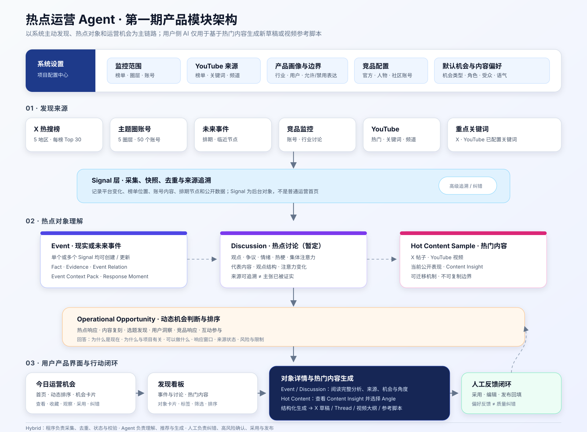

# 热点运营 Agent 第一期产品定义工作文档

## 0. 文档用途

本文档是热点运营 Agent 第一期产品重构的持续工作底稿，由产品负责人主导维护，用于逐步收敛产品目标、业务对象、核心交付物、业务规则、验收标准及开发需求。

本文档当前不直接替代既有 Product Brief 与 PRD。完成十个细化步骤并通过产品负责人确认后，再将收口结论同步至正式需求文档。

### 0.1 项目分工

- 产品负责人：项目主导和产品 DRI，定义产品目标、业务场景、业务对象、产品规则、优先级和验收标准。
- 开发：根据产品定义提出并实现数据、程序、Agent Harness、存储、交互、质量与工程方案。
- 产品内 Agent：在系统已接入的数据、工具、项目上下文和规则范围内，对具体 Event、Discussion、Hot Content Sample 及用户要求进行分析、解释和派生产出。

### 0.2 当前共同前提

- 产品是服务增长运营体系的热点情报与响应策略中心。
- 第一期主要基于 Twitter/X 和 YouTube。
- 第一期以系统主动发现为唯一热点输入路径，不提供用户提交链接即时解析。
- 核心价值集中在“灵感来源”和“承接角度”。
- 核心情报对象包括 Event、Discussion 和 Hot Content Sample；对应交付分别为 Event Context Pack、Discussion 分析和 Content Insight。
- 系统可以基于已形成的热点内容分析，按需生成社媒内容草案和视频参考脚本。
- 第一期用户侧 AI 交互只服务内容生成：用户选择系统已发现的热门内容和承接角度，补充生成要求，获得新的内容草稿；不提供开放式对象对话和深度研究交互。
- 第一阶段可以按官方账号、垂类账号、专家/KOL账号、社区互动账号等账号角色提供承接建议，不以已经确定具体目标账号为前提。
- 社区互动必须真实、合规，不支持伪造身份、虚假共识、刷屏或操纵讨论。

## 0.3 产品定义细化路线

| 步骤 | 主题 | 状态 |
|---|---|---|
| 1 | 第一版产品目标与范围 | 已收口 |
| 2 | 目标用户、使用方与核心场景 | 已收口 |
| 3 | 运营机会与业务对象定义 | 已收口 |
| 4 | 热点事件上下文包 | 已收口 |
| 5 | 爆款视频拆解与参考脚本 | 已收口 |
| 6 | 主动发现与有限内容生成交互 | 已按缩减范围收口 |
| 7 | 监控范围、产品画像与项目配置 | 阶段性收口，资料待补 |
| 8 | 产品大规则和质量标准 | 已收口 |
| 9 | 验收案例、反馈和成功指标 | 已收口 |
| 10 | 整理成开发可执行的第一期需求 | 已形成开发评审稿 |

# 1. 第一版产品目标与范围

## 1.1 产品定位

**热点运营 Agent 是服务于增长运营体系的热点情报与响应策略中心。**系统连接外部内容与社交平台，主动发现热点事件、热点讨论、热门内容和行业变化。系统将分散信息加工为可追溯、持续更新的 Event Context Pack、Discussion 分析或 Content Insight，并结合不同运营场景提供可承接的运营角度、内容方向、行动建议与参考素材；第一期仅在热门内容场景提供 AI 内容生成，按需形成社媒内容草案和视频参考脚本。

## 1.2 第一期目标

第一期基于 Twitter/X 和 YouTube，重点服务热点研究、内容运营和社媒账号矩阵场景，跑通“系统主动发现—形成或更新热点对象及其分析—提供承接角度—基于热门内容按需生成新内容草稿或视频参考脚本—运营人员采用或发布—记录反馈”的闭环，验证系统能否减少运营人员寻找灵感和研究承接角度的时间，并持续提供及时、来源可追溯、可采用的热点机会。

第一期包含四个直接目标：

1. 减少运营人员手动刷榜单、监控账号、搜索内容和查找灵感的时间。
2. 通过完整上下文、来源和必要的事实证据，减少运营人员重复查证和理解热点对象的时间。
3. 帮助运营人员判断热点是否值得承接、可以从哪些角度承接，以及适合形成什么内容。
4. 支持运营人员从系统已发现的热门内容及推荐角度出发，补充受众、账号角色、形式和表达要求，生成可编辑的新内容草稿或视频参考脚本。

## 1.3 第一期核心问题

第一期重点解决增长运营过程中两个高成本环节。

### 1.3.1 灵感来源

帮助运营人员回答：

- 现在发生了什么？
- 哪些事件、讨论、帖子或视频正在升温？
- 哪些变化值得关注？
- 哪些热点对当前运营场景有价值？
- 哪些机会仍处于有效窗口？

### 1.3.2 承接角度

帮助运营人员回答：

- 为什么值得参与？
- 可以从什么角度切入？
- 不同运营场景或账号角色适合如何响应？
- 哪些事实、观点和素材可以使用？
- 可以产出什么内容？
- 有哪些风险和不确定性？

内容生成是承接角度的进一步落地：确认方向后，将选中的角度转化为可编辑、可采用的社媒内容草案或视频参考脚本。

## 1.4 第一版核心闭环

```text
系统主动发现
              ↓
建立或更新 Event / Discussion / Hot Content Sample
              ↓
保存并关联 Signal、来源与可用公开数据
              ↓
生成 Context Pack / Discussion 分析 / Content Insight
              ↓
判断传播阶段、响应窗口和运营价值
              ↓
提供不同运营场景或账号角色的承接角度
              ↓
点击“生成内容”
              ↓
选择角度并补充有限生成要求
              ↓
生成社媒内容草案 / 视频参考脚本
              ↓
运营人员采用、编辑、发布或放弃
              ↓
记录反馈，校准后续推荐和产出
```

闭环终点不只是生成内容，还需要记录：

- 是否采用、编辑或发布；
- 为什么没有采用；
- 发现和产出是否及时；
- 承接角度是否可执行；
- 在数据条件允许时，记录后续内容表现。

第一期不要求完整接入所有发布和效果数据，但至少需要保留采用、拒绝及原因反馈。

## 1.5 第一版功能范围

### 1.5.1 数据与发现

- Twitter/X 热搜榜采集；
- Twitter/X 重点账号监控；
- Twitter/X 相关帖子和讨论分析；
- YouTube 热门视频发现；
- 在平台能力允许时采集字幕、互动数据、评论和原始来源；
- 使用当次公开表现、发布时间校正、榜单位置及可获得的账号历史数据形成候选；
- 重复内容归并，以及 Signal 到 Event、Discussion 或 Hot Content Sample 的语义路由。

当前五地区热搜榜 Top 30 是第一期采集配置，不是永久的运营价值判断。YouTube 第一期只使用实际能够取得的当次公开数据和现有发现入口，不承诺连续增长曲线、爆发预测或精确因果归因。

### 1.5.2 核心分析对象

第一期重点支持：

- 热点事件和话题；
- 热点讨论，包括观点、争议、情绪、用户反应、热梗和集体注意力；
- 热帖子；
- 爆款视频；
- 在数据可得时，与 Event、Discussion 或 Hot Content Sample 相关的代表性评论；
- 初步的行业和竞品讨论。

热评、热梗和 Meme 第一版可以作为 Discussion、Event 或 Content Insight 中的洞察，不单独建设新的产品模块。

### 1.5.3 热点事件上下文包

第一期方向性内容包括：

- 事件定义；
- 背景与前因；
- 关键时间线；
- 当前状态与最新变化；
- 关键参与者；
- 原始证据；
- 已确认和待确认信息；
- 传播阶段；
- 响应窗口；
- 风险与不确定性；
- 相关对象与数据边界。

Event Context Pack 保持事实和事件上下文中立。适用运营目标、运营机会和承接角度在对象详情的派生层相邻展示，不写入 Context Pack 的事实合同；第一期 Event 详情不直接提供 AI 内容生成。

具体字段、必答项、条件项和质量标准在第4步细化。

### 1.5.4 爆款视频拆解包

第一期方向性内容包括：

- 视频内容摘要；
- 内容时间轴；
- 当前公开表现及数据时间；
- 可能的传播机制、依据与限制；
- 选题、结构、表达与互动机制；
- 在数据可得时提供代表性评论或用户反应；
- 可迁移因素；
- 不可复制因素；
- 承接角度；
- 参考视频脚本；
- 证据、风险和置信度。

具体字段、必答项、条件项和质量标准在第5步细化。

### 1.5.5 有限内容生成交互

第一期不建设开放式多轮对话。用户侧 AI 交互仅支持围绕系统已发现的 Hot Content Sample 生成新的内容草稿或视频参考脚本：选择已有承接角度，补充账号角色、目标受众、内容形式、语气、长度及需要保留或避开的信息，并允许基于反馈重新生成。

### 1.5.6 内容生成入口

第一期只有热门帖子或视频的 Content Insight 提供明确的“生成内容”入口；Event Context Pack 和 Discussion 分析只展示系统推荐的机会和角度，不直接生成内容。基本路径为：

```text
选择承接角度
    ↓
选择运营场景或账号角色
    ↓
选择内容形式
    ↓
补充必要要求
    ↓
生成内容草案
```

第一期可优先支持：

- X/Twitter 单条帖子；
- X/Twitter Thread；
- 短视频大纲；
- 短视频参考脚本；
- 评论或互动回复方向。

生成前可由用户选择使用角度、目标受众、账号角色、内容形式、语气、长度及需要保留的事实或观点。生成结果应关联来源事件或视频、使用的承接角度、引用证据、待确认信息与风险提示。

## 1.6 第一版不做清单

第一期提供基于上下文和承接角度的内容生成，但暂不重点建设：

- 自动发布至所有社媒平台；
- 大规模批量生成内容；
- 复杂的富文本或视频编辑器；
- 多角色审批工作流；
- 自动排期和账号调度；
- 完整的素材生产与视频制作；
- 自动运营整个账号矩阵；
- 没有人工确认的品牌内容发布；
- 同时深度接入大量新平台；
- 全自动学习并修改产品业务规则；
- 独立的大规模热梗和 Meme 监控；
- 支持任意任务的通用聊天 Agent；
- 用户提交 X 或 YouTube 链接即时解析；
- 围绕 Event、Discussion 或 Hot Content Sample 的开放式多轮对话、补充研究和自由探索；
- 虚假身份、刷屏、伪造共识或操纵讨论。

第一期内容生产的边界是：让运营人员从热点机会顺利获得一份可继续编辑和使用的内容草案，但不完成从创意、素材制作、审批、排期到自动发布的整套内容生产系统。

## 1.7 第一版核心假设

1. 运营人员最耗时的环节确实是寻找灵感和确定承接角度。
2. Event Context Pack、Discussion 分析和 Content Insight 能够减少人工查证与理解对象的时间。
3. 系统发现的热点机会能够达到及时、相关和可信的基本要求。
4. 按运营场景或账号角色提供的角度具有实际采用价值。
5. 基于系统已形成的热门内容洞察和承接角度生成的草稿与参考脚本可以进入人工编辑或采用。
6. Twitter/X 和 YouTube 能够支撑第一期核心价值验证。
7. 运营反馈能够帮助团队定位推荐和内容产出的问题。

## 1.8 第一版成功表现

第一期成功不等于采集、分析和生成流程可以运行，而是：

- 运营人员愿意持续查看系统推荐；
- 运营人员能够更快理解事件完整背景；
- 运营人员能够从系统获得可用的承接角度；
- 运营人员愿意点击“生成内容”；
- 生成结果能够进入编辑、采用或发布；
- 无用结果有清晰原因可供复盘；
- 系统减少了手工搜索和重复研究时间。

具体指标、口径、样本和验证方式在第9步确定。

# 2. 目标用户、使用方与核心场景

## 2.1 用户角色划分原则

第一期不按固定岗位名称强行区分用户，而是根据其在热点运营链路中承担的职责划分角色。一个人在实际工作中可以同时承担多个角色。

### 2.1.1 热点机会研究者

负责上游的机会发现和研究工作：

- 发现和筛选热点；
- 判断是否值得关注；
- 核实来源与证据；
- 理解事件上下文；
- 拆解热门帖子和视频；
- 形成可承接的运营角度；
- 判断可以产出什么内容。

其核心问题是：发生了什么、为什么值得关注、可以怎样利用？

### 2.1.2 内容响应执行者

负责将热点研究结果转化为实际内容响应：

- 选择适合参与的账号或账号角色；
- 选择承接角度；
- 生成或编辑社媒内容；
- 调整账号语气和表达；
- 安排矩阵账号的差异化参与方式；
- 发布内容并反馈采用和效果。

其核心问题是：哪个账号应该参与、采用什么角度、怎样转化为符合账号定位的内容？

### 2.1.3 运营负责人

负责产品与运营方向管理：

- 确定监控领域和业务重点；
- 管理业务规则、账号角色和内容边界；
- 查看机会、角度和内容的采用情况；
- 复盘系统推荐和产出质量；
- 推动规则、上下文和评估方式持续优化。

## 2.2 第一期主要用户定义

第一期主要服务承担“热点机会研究”和“内容响应执行”工作的运营人员。系统既支持同一名运营人员完成从发现热点、理解上下文、选择角度到形成内容草案的完整流程，也支持热点研究结果由其他内容执行人员继续使用。

运营负责人是管理与评估用户，负责配置关注方向、检查结果质量并推动产品优化。

## 2.3 第一期内容与运营场景边界

第一期优先支持：

- X/Twitter 单条帖子；
- X/Twitter Thread；
- 短视频内容大纲；
- 短视频参考脚本；
- 围绕具体 Event、Discussion 或 Hot Content Sample 的评论互动方向。

第一期重点支持热点研究、内容运营和社媒账号矩阵场景。

对于活动运营和产品运营，第一期只判断某个热点机会是否可能适用，并给出简要的适用理由和方向提示，不要求生成完整活动方案、产品运营方案或执行计划。

## 2.4 核心用户任务

第一期支持四项核心用户任务：

1. 在大量外部信息中发现值得关注的热点机会；
2. 快速理解事件或热门内容的完整上下文；
3. 判断是否值得承接，并找到适合的运营角度；
4. 将选定角度转化为可编辑、可采用的社媒内容或视频参考脚本。

## 2.5 第一版总体用户路径

```text
系统主动发现
      ↓
浏览 Event、Discussion 或 Hot Content Sample
              ↓
判断是否值得承接
              ↓
查看系统推荐的承接角度
              ↓
在热门内容场景按需生成内容草案或视频脚本
              ↓
采用、编辑、发布或放弃
              ↓
反馈结果
```

## 2.6 第一版核心场景

### 2.6.1 查看系统主动发现的热点机会

**触发：**运营人员开始热点研究，或系统产生新的热点候选。

**用户目标：**快速知道当前有哪些值得关注的机会，减少逐个平台刷榜单、账号和内容的时间。

**主要流程：**

```text
打开机会列表
→ 查看新事件、热帖和热视频
→ 阅读推荐原因
→ 过滤无关机会
→ 打开值得进一步研究的对象
```

**列表层核心信息：**机会说明、机会类型、来源平台、发现与更新时间、推荐原因、传播阶段、响应紧迫度、关键证据、可能适用的运营目标及可信度。

**完成标准：**用户不打开所有原始链接，也能选择立即查看、稍后查看、继续观察或忽略。

第一期以系统内机会列表主动刷新为主，复杂的站外推送和通知不属于 P0。

### 2.6.2 用户提交链接即时分析（第一期不做）

第一期不提供粘贴 Twitter/X 或 YouTube 链接后即时获取、解析和建立对象的功能。运营人员只能使用系统主动采集和已经形成的热点对象。该场景进入后续版本，不作为第一期开发、验收或成功指标前提。

### 2.6.3 理解热点事件并判断是否值得承接

**触发：**用户打开系统发现、聚合或提交后形成的热点事件。

**用户目标：**快速理解事件的完整背景，并判断现在是否值得形成内容响应。

**主要流程：**

```text
查看事件定义和背景
→ 阅读关键时间线
→ 检查原始证据
→ 区分已确认与待确认信息
→ 查看传播阶段和响应窗口
→ 查看适用运营场景
→ 决定是否承接
```

**用户决策：**立即承接、准备但继续观察、保存为素材、不适合当前运营，或要求 Agent 补充证据。

**完成标准：**用户不需要重新搜索多个来源，就能理解事件并决定是否进入角度探索和内容生成阶段。

### 2.6.4 拆解热视频并判断如何借鉴

**触发：**系统主动发现一个热门视频。

**用户目标：**判断视频为什么有效、哪些因素能够借鉴，以及怎样转化为新的内容。

**主要流程：**

```text
查看视频内容与数据
→ 查看结构时间轴
→ 理解传播原因
→ 在数据可得时查看评论或用户反应
→ 区分可迁移与不可复制因素
→ 选择借鉴对象
→ 查看或生成参考脚本
```

**用户决策：**借鉴选题、结构、表达或互动方式；只保存为灵感；或不建议借鉴。

**完成标准：**用户明确知道借鉴什么、为什么以及如何改造，而不是只得到视频摘要。

### 2.6.5 基于热门内容生成新草稿

**触发：**用户认可某个热门帖子或视频的 Content Insight，并选择一个系统推荐的承接角度。

**用户目标：**将可迁移的选题、Hook、结构、节奏或互动机制转化为新的社媒内容草稿或视频参考脚本。

第一期支持用户填写有限生成条件，包括账号角色、目标受众、内容形式、语气、长度、需要保留的事实或观点以及需要规避的表达。系统根据这些条件生成草稿，允许用户修改条件后重新生成，但不提供围绕对象的开放式研究对话。

**完成标准：**用户能够从一个系统已发现的热门内容对象直接生成差异化的新草稿，结果关联来源Content Insight、承接角度和生成条件，且不复制原内容独特表达。

### 2.6.6 生成、采用和反馈内容

**触发：**用户已经选定一个承接角度。

**用户目标：**将确定的角度快速转化为可以编辑和使用的内容草案。

**主要流程：**

```text
选定承接角度
→ 点击“生成内容”
→ 选择内容形式
→ 选择账号角色、目标受众、语气和长度
→ 生成草案
→ 与 Agent 修改
→ 保存、复制、采用、发布或放弃
→ 提交反馈
```

第一期优先生成 X/Twitter 单条帖子、Thread、短视频大纲、短视频参考脚本及评论互动方向。

系统记录已采用、编辑后采用、已发布、已收藏、暂不采用及其原因。拒绝原因可以包括不相关、角度空泛、不可执行、不符合账号角色、证据不足、发现太晚或事实判断错误。

**完成标准：**生成结果可以进入人工编辑或使用，系统能够记录是否采用以及未采用原因。

第一期做到系统内保存、复制、标记采用或发布，不直接连接账号自动发布。

## 2.7 场景优先级

| 场景 | 优先级 | 说明 |
|---|---:|---|
| 事件理解与承接判断 | P0 | 热点系统的核心价值 |
| 视频拆解与借鉴 | P0 | 已有 YouTube 能力基础，交付目标明确 |
| 基于热门内容生成草稿与脚本 | P0 | 第一期唯一面向用户的 AI 生成交互 |
| 系统主动发现 | P0，持续优化 | 已有采集基础，动态发现质量需要持续校准 |
| 采用与拒绝反馈 | P0 | 用于验证产品价值和定位问题 |
| 站外实时通知 | P1 | 不影响第一期核心价值验证 |
| 用户提交链接即时分析 | P1 | 第一版先验证主动发现链路 |
| 对象内开放式多轮对话 | P1 | 第一版只保留有限内容生成交互 |
| 多事件或多视频比较 | P1 | 有价值，但不是最短闭环前提 |
| 完整效果归因 | P1 | 依赖发布与账号数据基础 |

## 2.8 已确认的第一期边界

1. 系统主动发现以系统内机会列表主动刷新为主，复杂站外通知不属于 P0；
2. 用户提交链接即时分析不属于第一期；
3. 第一版不提供对象内开放式多轮对话，AI交互仅用于基于热门内容生成新草稿或视频参考脚本；
4. 内容生成后支持保存、复制、修改以及标记采用或发布，第一期不由系统直接连接账号自动发布；
5. 第一版优先支持 X/Twitter 内容与短视频参考脚本；
6. 活动运营、产品运营只保留适用性判断和方向提示，不生成完整方案。

# 3. 运营机会与业务对象定义

## 3.1 建模原则

第一期必须区分五类概念：

- 系统观察到的原始变化；
- 外部世界发生的事件；
- 平台上正在形成注意力的观点、争议或集体讨论；
- 平台上具体传播的内容；
- 这些热点对象对运营人员产生的可行动价值。

Event 是客观、持续演化的业务对象；Discussion 暂时承载不一定对应具体 Event、但已经形成注意力的观点、争议和集体讨论；Operational Opportunity 是相对于监控范围、时间和运营价值形成的建议。Discussion 与热门内容都可以关联 Event，也可以独立形成机会。

## 3.2 核心业务对象

### 3.2.1 Signal（信号）

系统从榜单、监控账号、关键词、视频、评论或其他来源观察到的一次原始变化。Signal 是待处理输入，不等于事实、Event 或运营机会。

示例包括关键词进入热榜、帖子互动突然加速、监控账号发布新内容或视频评论快速增长。

### 3.2.2 Event Discussion Cluster（事件讨论簇）

一组表达方式不同、但可能指向同一现实或未来 Event 的内容信号。它用于判断哪些帖子、视频或评论应被共同处理，仅主题相似或复用关键词不足以构成同一讨论簇。

第一期将其作为系统内部聚合和人工校正对象，默认不建设为普通用户的主要产品模块。

### 3.2.3 Candidate Event（候选事件）

由一个或多个 Signal 或事件讨论簇形成、等待进一步聚合与核验的事件候选。它可以被忽略、拆分、合并或形成正式 Event。

事件讨论簇回答“哪些内容可能在讨论同一件事”，Candidate Event 回答“这些内容可能共同指向什么事件”。

### 3.2.4 Event（事件）

由一个或多个 Signal 明确指向的一件现实或未来事件。单个 Signal 已足以描述具体主体、动作、对象、时间或状态变化时，可以直接创建或匹配 Event，不要求等待多个 Signal 聚合；Event 会随着新信号和证据持续更新。

Event 不等于热搜词、单条帖子、单条视频、上下文包或内容生成任务。

### 3.2.5 Discussion（热点讨论，暂定）

平台上正在形成明显注意力的观点、争议、情绪、用户反应、热梗或集体讨论，但其不一定对应一个可独立陈述和核验的现实 Event。Discussion 可以由单条高传播内容或多条相关 Signal 形成，并可独立产生选题发现、用户洞察、互动参与或竞品响应机会。

Discussion 只证明相关表达和注意力正在出现，不证明讨论中的主张为客观事实。名称与独立实体必要性在第一期真实案例验证后可调整。

### 3.2.6 Fact（事实主张）

关于某个 Event 的一条具体、可被证据支持、质疑或更新的陈述。其状态可以是已确认、待确认、有冲突、已排除或已更新。

### 3.2.7 Evidence Record（证据记录）

支持、质疑或补充某条 Fact 的可追溯来源，记录原始链接、来源主体、时间、内容以及具体支持或质疑的主张。Evidence 不等于 Fact。

### 3.2.8 Event Card（事件卡）

Event 在事件看板中的摘要视图，用于帮助用户快速判断是否值得打开。方向性内容包括事件说明、状态、首次发现和最近更新、最新变化、证据概况、事实状态、传播状态、事件窗口、客观标签及当前机会匹配概况。

Event Card 不承载全部证据和完整分析。

### 3.2.9 Event Context Pack（事件上下文包）

Event 在某个版本下用于阅读、系统分析和机会判断的结构化完整档案，包括背景、时间线、Fact、Evidence、确认状态、传播阶段、事件窗口、表达边界和风险。第一期不将其作为用户开放式对话或直接内容生成入口。

Event 可以持续存在并更新；Event Context Pack 随关键事实和状态变化产生新版本。Event Card 是摘要视图，Event Context Pack 是完整视图。

### 3.2.10 Hot Content Sample（热点内容样本）

一条因榜单、公开表现、重点来源或其他系统主动发现路径进入系统的具体帖子、视频、评论或其他内容。它可以关联 Event 或 Discussion，也可以因选题、结构、表达或互动机制而独立具有借鉴价值。

### 3.2.11 Content Insight（内容洞察）

Agent 对 Hot Content Sample 形成的版本化拆解结果，记录主题、Hook、叙事结构、内容形态、表达与视觉线索、互动反应、传播机制、可迁移因素及不可复制边界。

### 3.2.12 Monitoring Scope（监控范围）

用户选择让系统持续观察的领域、圈层、榜单、账号、竞品、关键词和平台。Monitoring Scope 表达“关注什么”，本身不等于用户已经声明具体运营目标。

### 3.2.13 Operational Opportunity（运营机会）

系统在 Monitoring Scope 内，将一个 Event、Response Moment、Discussion 或 Hot Content Sample，与预设机会类型、当前时效、来源可追溯性和可承接性进行匹配后形成的一项可供运营人员评估和采取行动的建议。

系统可以在用户尚未声明具体运营目标时主动产生候选机会；用户提供明确目标、偏好或反馈后，系统再对机会重新判断、排序和个性化。

一个来源对象可以形成零个或多个不同类型的机会；Event 或热门内容真实存在、受到关注，不代表必然形成运营机会。

### 3.2.13.1 Response Moment（热点响应时点）

一个或多个 Signal 显示某个 Event、话题或内容在当前显著升温，因而必须被及时展示并进入运营响应评估的时点。

同一个 Event 可以在预告、正式发生、争议、官方回应等阶段出现多个 Response Moment。Response Moment 回答“为什么是现在”，Event Context Pack 回答“这件事到底是什么”；进入快速响应评估不等于自动生成或发布内容。

### 3.2.14 Opportunity Type（机会类型）

第一期支持六类运营机会：

- 热点响应：是否值得在当前窗口响应一个 Event；
- 内容复刻：是否值得迁移热门内容的选题、结构、表达或互动机制；
- 选题发现：是否形成值得进一步制作内容的问题或观点；
- 用户洞察：是否出现新的需求、疑问、情绪或反对意见；
- 竞品响应：竞品讨论变化是否构成我方内容机会或风险；
- 互动参与：是否存在适合真实、合规参与讨论的切口。

### 3.2.15 Opportunity Feed（运营机会列表）

以“今日运营机会”为主要形态，集中展示系统认为值得运营人员进一步处理的机会。它根据时效、证据、可承接性和用户相关性排序，不替代完整事件与热门内容看板。

用户打开系统后，应优先看到“现在最值得处理什么”，而不是任务、工作流或全部原始信号。

### 3.2.16 Angle（承接角度）

针对某个 Operational Opportunity，为特定运营目标、运营场景、账号角色、目标受众或内容形式提出的一种切入方式。Angle 描述应该说什么、从哪里切入，不是最终内容文案。

一个机会可以有多个 Angle，一个 Angle 可以生成多个内容形式和版本。

### 3.2.17 Social Content Draft（社媒内容草稿）

基于已选择的 Angle 生成、达到人工可编辑和评审水平、但尚未自动发布的内容草稿。第一期包括 X/Twitter 单帖、Thread、短视频大纲、短视频参考脚本和评论互动方向。

第一期内容草稿必须追溯至来源 Hot Content Sample、使用的 Content Insight 版本、选中的机会与角度、相关来源或证据、账号角色、受众和用户生成要求。Hot Content 可以关联 Event 或 Discussion，但草稿不直接由 Event Context Pack 或 Discussion 分析触发生成。

## 3.3 业务对象关系

事件链路：

```text
外部平台
   ↓
Signal
   ↓
Event Discussion Cluster
   ↓
Candidate Event
   ↓ 聚合与核验
Event
├── Fact
├── Evidence Record
├── Event Card
├── Event Context Pack
└── Response Moment（可有多个）
             ↓ 结合最新上下文
Operational Opportunity
             ↓
Angle
             ↓
Social Content Draft
```

内容链路：

```text
外部平台
   ↓
Hot Content Sample
   ↓
Content Insight
   ↓
Operational Opportunity
   ↓
Angle
   ↓
Social Content Draft / Video Script
```

讨论链路：

```text
一个或多个 Signal / Hot Content Sample
   ↓
Discussion
   ↓
Operational Opportunity
   ↓
Angle
   ↓
Social Content Draft
```

一个 Event 可以关联多个 Discussion、Hot Content Sample 和 Content Insight；Discussion 和热门内容也可以不依附重要 Event，独立形成内容复刻、选题、用户洞察、互动参与或竞品响应机会。

## 3.4 第一版产品视图

第一期产品由三层核心视图组成：

1. **事件与讨论、热门内容看板：**展示系统捕捉和形成的 Event、Discussion、热门帖子和热门视频，追求覆盖和完整；
2. **今日运营机会：**从 Event、Discussion 和热门内容中筛选并排序可能可行动的机会，追求相关性、时效和可承接性；
3. **对象详情与热门内容生成：**Event、Discussion 和热门内容均提供完整分析详情；只有热门内容详情提供结构化 AI 内容生成和反馈能力。

每个正式 Event 都应有 Event Card。所有 Event 和热门内容可以保留在完整看板中，但只有匹配出运营价值的对象进入“今日运营机会”。

## 3.5 用户需求与机会生成

第一期不要求用户先完整配置运营目标。用户首先配置 Monitoring Scope，例如关注领域、圈层、榜单、账号、竞品、关键词和平台；系统在该范围内使用默认机会框架主动提出可能的运营机会。

```text
Monitoring Scope
       ↓
系统采集并形成 Event / Discussion / Hot Content Sample
       ↓
默认机会框架识别候选机会
       ↓
今日运营机会
       ↓
用户选择、忽略、继续观察或选择承接角度
       ↓
系统通过明确要求与反馈逐步校准排序和表达
```

第一期采用“明确监控范围为主、默认机会识别为基础、用户反馈校准为辅”的方式。系统可以自动提出机会，但不得据此自动发布、执行或私自改变用户的核心运营目标。

每项机会应解释其匹配依据，例如来自哪个关注圈层、重点账号或榜单，观察到什么变化，证据是否充分，以及为何仍具备响应窗口。

## 3.6 Story 决策

第一期不引入独立 Story 实体。事件演化先由持续更新的 Event、事件记忆、Event Relation 和版本化 Event Context Pack 表达。

如果未来确实需要将多个独立 Event 组织为一条长期叙事，再单独评估 Story 作为跨事件集合的必要性。

## 3.7 已确认的关键边界

1. Event Discussion Cluster 是内部聚合与人工校正对象，不作为普通用户的主要模块；
2. Event、Discussion 和 Hot Content Sample 都可以独立形成零个或多个 Operational Opportunity；
3. Event Card 是列表摘要，Event Context Pack 是完整、版本化的研究档案；
4. 全部 Event 和热门内容进入完整看板，只有形成运营价值判断的对象进入今日运营机会；
5. 运营机会不要求用户预先声明完整目标，可由 Monitoring Scope 和默认机会框架主动产生；
6. 明确目标、偏好和反馈用于后续重新判断、排序和个性化；
7. Angle 与 Social Content Draft 分开，一个角度可以生成多个内容版本；
8. 第一版不引入 Story；
9. 机会建议不等于执行授权，系统不得未经人工确认自动发布内容。
10. 同一 Event 可以在生命周期中产生多个 Response Moment，并分别形成新的实时运营机会。
11. Discussion 为第一期暂定业务对象，用于承载观点、争议、情绪和集体注意力；它不把相关主张自动认定为事实，名称及独立实体必要性将在真实案例中验证。

# 4. 热点事件上下文包

## 4.1 产品职责

Event Context Pack 是运营人员理解事件、后台 Agent 更新分析和系统识别运营机会共同使用的可信事件底座。第一期不作为用户直接内容生成或开放式对话入口。

它必须回答：

1. 发生了什么；
2. 系统凭什么这样判断；
3. 哪些信息已确认、待确认、冲突或已更正；
4. 事件如何发展到当前状态；
5. 接下来需要观察什么；
6. 相比上一个版本出现了什么实质变化。

Context Pack 保持事实和事件上下文中立。Operational Opportunity、Angle 和 Social Content Draft 作为派生层独立存在；用户目标和偏好可以改变机会排序与内容表达，但不能改写 Event 的事实底座。

## 4.2 实时热点与事件上下文的双链路

第一期同时支持两种时间尺度：

```text
实时热点链路：现在什么突然火了，是否需要立即评估？
事件理解链路：这件事是什么，发展到哪里，有哪些可靠背景？
```

实时快速路径：

```text
Signal 出现可观察的热搜变化、圈层热议、排期临近或内容表现
        ↓
形成 Response Moment
        ↓
立即进入实时热点/今日运营机会评估
        ↓
标明当前来源状态、事实边界与背景完整度
```

事件增强路径：

```text
一个或多个相关 Signal
→ 匹配、创建或更新 Event
→ 补充 Fact 与 Evidence
→ 更新 Event Context Pack
→ 增强机会判断与承接角度
```

实时机会不等待完整 Context Pack 才展示；随着上下文补全，同一机会卡逐步增强，避免重复创建相同机会。

可观察的注意力变化达到候选条件，意味着系统必须及时展示并进入快速响应评估，不等于主张已经被证实，也不等于必须自动生成或发布内容。最终仍需结合相关性、来源状态、事实边界、风险和可承接性判断。

## 4.3 Event 边界与更新规则

Event 是在相对明确的时间范围内，由特定主体发生的一次可独立陈述、可被证据支持的动作、决定、结果或状态变化。

判断新信息是更新已有 Event 还是创建新 Event 时，核心问题是：

> 新信息只是帮助系统更清楚地理解同一次现实变化，还是形成了一个可以独立陈述和核验的新动作、决定、结果或状态变化？

### 4.3.1 更新已有 Event

以下情况通常更新原 Event：

- 同一事实新增来源、转载或重复报道；
- 同一动作的细节被确认、补充或修正；
- 事实确认等级或证据状态变化；
- 热度、排名、讨论焦点或传播阶段变化；
- 同一个已经预告、排期或等待发生的核心结果进入新阶段。

例如，官方预告将在一个月后发布模型，随后按预告正式发布；如果主体、对象和预期结果一致，可以作为同一 Event 从“已预告/已排期”更新为“正式发生”，并产生不同 Response Moment。

### 4.3.2 创建关联 Event

以下情况通常创建新 Event，并与原 Event 建立前置、后续、结果、更正、反转或响应关系：

- 出现新的独立主体动作；
- 出现新的决定、结果或状态变化；
- 出现可以独立陈述和核验的故障、回滚、政策变化或竞品回应；
- 新变化拥有自己的事实时间、证据链或响应窗口。

例如产品发布、发布后大面积故障、官方回滚以及竞品降价分别属于可独立成立的关联 Event。

### 4.3.3 传闻到正式发生

未经确认的具体事件说法可以停留在 Candidate Event；如果传播本身已经形成明显注意力，也可以建立或关联 Discussion。后续出现足以确认现实动作、决定、结果或状态变化的来源时，再创建、匹配或更新正式 Event，并保留此前传播过程与来源。官方来源是重要来源之一，但不是判定事实的唯一来源。

### 4.3.4 独立标题测试

系统可以辅助判断：新信息能否脱离原 Event，独立写成一条清晰、可核验的事件标题。只有新增来源、热度或细节时通常更新原 Event；出现新的动作、结果、事实时间、证据链或独立响应窗口时通常新建关联 Event。

聚合置信度不足或高风险边界不清时，应进入人工合并、拆分或校正，而不是由 Agent 强行决定。

## 4.4 Event 与 Response Moment 的关系

Event 描述事情本身如何发展，Response Moment 描述为什么当前需要运营人员注意。

```text
Event：OpenAI 发布模型 X

Response Moment A：官方首次预告进入热搜
Response Moment B：产品正式发布后再次进入热搜
Response Moment C：免费资格讨论快速升温
```

每个 Response Moment 可以产生新的热点响应、选题或互动机会，并使用当时最新的 Event Context Pack 提供背景和事实边界。

## 4.5 Context Pack 固定结构

### 4.5.1 事件概览

- Event ID；
- 事件标题；
- 一句话事件定义；
- 事件类型；
- 关键参与方；
- 当前业务状态；
- 事实确认等级；
- 首次发现时间；
- 事件事实时间及时间精度；
- 最近更新时间；
- 数据完整度；
- Context Pack 版本。

一句话事件定义应优先表达谁在什么时间对什么对象做了什么、产生了什么结果或变化，避免只写“引发热议”等热度描述。

### 4.5.2 最新变化

“最新变化”是固定必答栏目，说明自上一个有效版本以来新增的实质信息。实质变化包括新事实、官方确认或否认、事实修正、冲突证据、发展状态变化、关键参与者介入、讨论焦点显著转移或响应窗口变化。

如果没有实质变化，显示“暂无实质更新”，不得把重复报道或普通指标波动包装成新进展。

### 4.5.3 背景与关键时间线

- 理解当前 Event 所必需的前置背景；
- 关键节点、动作和结果；
- 每个重要节点对应的 Evidence；
- 与当前 Event 直接相关的前置、后续、更正或反转 Event。

背景只保留理解当前事件必要的信息，不做无边界百科式扩展。

### 4.5.4 事实与不确定性

将事实主张分为：

- 已确认事实；
- 待确认信息；
- 冲突信息；
- 已排除或已更正信息。

每一项均应关联 Evidence Record，并遵守对应的 Expression Boundary。

### 4.5.5 证据地图

Evidence Record 至少说明来源、来源类型、发布时间、采集或核验时间、支持或质疑的 Fact、证据方向、原始链接、摘要和当前有效性。来源可追溯只表示系统能够说明“谁在何时说了什么”，不自动表示其中主张已被证实。

证据应按事实主张组织，帮助用户理解“哪条来源证明了什么”，而不是只展示无关系的一串链接。

### 4.5.6 事件发展与传播状态

事件发展状态描述事情本身发展到哪里，沿用：

- `resolved_result`；
- `evolving_path`；
- `scheduled_decision`；
- `background_context`；
- `insufficient_context`。

传播状态独立描述平台注意力所处阶段：萌芽、起量、加速、峰值、降温、长尾或无法判断。

例如，一个 Event 可以是“已正式发生”，同时传播状态仍在加速。

### 4.5.7 时间与响应窗口

- 事件事实时间；
- 首次发现时间；
- 最近更新时间；
- 传播观察窗口；
- 建议响应窗口；
- 下一关键节点；
- 时间精度和时区；
- 判断依据、置信度和限制。

响应窗口属于基于当前信息的判断，必须说明依据与不确定性，不得伪装成确定事实。

### 4.5.8 相关对象与数据边界

- 关联 Event；
- 相关 Response Moment；
- 相关热门帖子和视频；
- 相关 Discussion；
- 相关 Content Insight；
- 相关竞品或关键实体；
- 来源覆盖范围；
- 缺失数据；
- 最后核验时间。

## 4.6 条件性分析项

讨论、情绪和用户反应不是第一期固定必答项。仅在系统实际取得足够讨论样本时生成，可包括主要讨论主题、支持与反对观点、高频问题、用户需求、争议点、焦点变化和代表性评论。

输出必须说明样本来源、规模和覆盖限制，不得把有限样本描述为全平台舆论。

当前技术无法稳定读取完整评论区时，Context Pack 应明确显示数据不足，例如：

```text
讨论与用户反应：暂不生成
原因：未取得足够评论或讨论样本
当前可用：5 条代表性帖子，不据此推断全平台情绪
```

条件项缺失不阻塞 Context Pack 形成。

## 4.7 Context Pack 版本规则

只有实质变化才生成新的 Context Pack 版本，包括：

- 新增关键事实；
- 官方确认、否认或更正；
- 出现重要冲突证据；
- 事件发展状态变化；
- 下一关键节点变化；
- Expression Boundary 变化；
- 传播阶段或响应窗口发生重要变化；
- 新关联 Event 改变对当前 Event 的理解。

普通互动数字和排名的小幅变化只更新实时指标，不生成新版本。

每个新版本必须展示相对于上一版本的变化摘要。已被用于内容生成或发布的旧版本保持可追溯，不因新版本产生而覆盖历史事实状态。

## 4.8 程序、Agent 与人工分工

### 程序负责

- ID、版本、时间和原始链接；
- 平台、榜单、账号和互动数据；
- 历史快照与数学计算；
- Evidence 采集、关联和数据缺失状态；
- 更新记录和实时指标。

### Agent 负责

- 一句话事件定义；
- 事实拆分与证据支持关系理解；
- 背景、时间线和最新实质变化总结；
- 事件发展状态判断；
- 在数据允许时归纳讨论主题；
- 下一观察节点和响应窗口解释；
- 风险、不确定性和数据限制说明。

### 人工负责

- 校正错误聚合；
- 合并或拆分 Event；
- 纠正关键事实；
- 处理高风险冲突和特殊表达边界；
- 最终决定是否响应、生成和发布内容。

## 4.9 产品呈现边界

Event Card 是事件看板中的摘要视图；Event Context Pack 是 Event 详情中的完整视图。机会和角度可以与 Context Pack 相邻展示，但不写入其中立事实合同；第一期 Event 详情不提供 Agent 对话或直接内容生成。

建议 Event 详情包含概览、时间线、事实与证据、传播与相关内容、版本变化等视图，并在相邻区域展示运营机会和承接角度；第一期不提供与 Agent 讨论或生成内容入口。

## 4.10 已确认的关键规则

1. Context Pack 保持事实和事件上下文中立；
2. 运营机会、承接角度和内容草稿位于派生层；
3. “最新变化”是固定必答栏目，无实质变化时显示“暂无实质更新”；
4. 实质变化生成 Context Pack 新版本，普通指标波动只更新实时数据；
5. 评论、情绪和用户反应只在取得足够样本时生成；
6. 同一 Event 可以在生命周期中产生多个 Response Moment；
7. 实时热点进入快速路径，不等待完整 Context Pack；
8. Context Pack 随后为实时响应补充事实、背景，以及派生层形成承接角度所需的依据；
9. 可观察的热搜、圈层讨论或内容表现达到候选条件，意味着必须快速展示和评估，不等于相关主张已被证实，也不等于自动发布；
10. 预告到正式发生若指向同一明确预期结果，可以作为同一 Event 的阶段更新；
11. 新的独立动作、决定、结果或影响创建关联 Event；
12. 第一版通过 Event Relation 表达事件链，不引入 Story。

# 5. 爆款视频拆解与参考脚本

## 5.1 第一期产品目标

第一期不建设精细视频传播曲线和爆款预测能力。系统基于 YouTube 当前可获得的公开数据说明视频的入选来源与当前表现，重点读取视频内容、字幕、标题、缩略图和必要画面，分析选题、结构、表达及可能传播机制，提取可迁移与不可复制因素，并生成多个差异化承接角度；用户选择角度后，再生成可编辑的视频参考脚本。

该能力的核心用户决策是：

- 这条视频是否值得作为内容参考；
- 真正值得借鉴的是选题、结构、表达还是互动机制；
- 哪些部分可以迁移，哪些部分无法复制；
- 可以怎样转化为新的内容；
- 选择哪个角度生成参考脚本。

## 5.2 第一期视频入口

第一期支持：

- YouTube 官方热门视频；
- 重点关键词搜索结果中的高表现视频；
- 重点频道或账号下的视频；

发现入口只负责形成候选，不直接证明视频因内容而爆。第一期仅处理系统主动发现的视频，并明确标注当前表现和爆款判断边界。

## 5.3 第一期数据能力

### 5.3.1 当前可使用的数据

- 视频 ID、标题、链接和描述；
- 作者、频道和发布时间；
- 视频时长、缩略图和分类；
- 当前播放量、点赞量和评论数；
- 频道公开订阅量及近期视频当前表现；
- 视频入选来源、关键词命中和系统捕获时间；
- 视频内容、字幕或转写及必要画面证据。

频道隐藏订阅量、视频统计缺失或字幕/画面不可得时，必须标记未知，不得推算或补造。

### 5.3.2 第一期不承诺的数据能力

- 小时级或精细增长曲线；
- 增长加速度和精确爆发时点；
- 同发布时间历史表现基线；
- 精确排名变化和传播生命周期预测；
- 完播率、留存曲线和平均观看时长；
- 分享数、点击率和流量来源；
- 推荐流量、搜索流量和订阅流量占比；
- 账号基本盘与内容因素的精确贡献归因；
- 视频未来是否会爆的预测。

一天一次的采集如果持续保存同一视频快照，最多形成粗粒度的日级变化；第一期不以此建设精细传播曲线。

## 5.4 入选与当前表现说明

第一期将原“爆款成立性”降级为“入选与当前表现说明”，至少包括：

- 入选来源；
- 当前公开指标及获取时间；
- 发布后经过时间；
- 是否进入官方热门、关键词结果或重点频道候选；
- 在数据可得时，与频道近期内容的粗略比较；
- 数据缺失和判断边界。

状态可以表达为：

- 当前公开表现较高；
- 当前表现可能超出频道近期常态；
- 数据不足，无法判断是否属于爆款。

系统不得为了满足“爆款拆解”名称而强行认定所有视频都是爆款。

## 5.5 账号基本盘辅助判断

如果频道订阅量和近期视频数据可得，系统可以辅助判断当前视频是否明显高于频道近期常态，并输出：

- 账号基本盘影响可能较强；
- 内容存在超额表现迹象；
- 账号与内容可能共同作用；
- 数据不足，无法排除账号基本盘影响。

该判断是基于公开当前快照的有限推断，不得表达为账号与内容的精确流量贡献或因果结论。

第一期不要求开发建设复杂账号基线系统；后续若积累连续快照，再评估增长速度、持续性、相同发布年龄基线和排名变化。

## 5.6 Content Insight 固定结构

### 5.6.1 视频概览

- 标题、作者、平台和链接；
- 发布时间和时长；
- 当前公开互动数据及获取时间；
- 入选来源；
- 字幕、画面和数据完整度；
- 是否关联 Event；
- 当前表现说明及判断边界。

### 5.6.2 内容主张

- 视频核心在讲什么；
- 向用户承诺什么价值；
- 可能面向什么受众；
- 用户为什么可能愿意继续观看；
- 希望用户最终记住什么。

该部分不是逐字摘要，而是对内容目标和价值主张的提炼。

### 5.6.3 内容时间轴

按视频实际内容标记 Hook、问题建立、核心观点、案例或证据、转折、结尾和互动节点。每一段尽量说明画面或旁白内容、叙事功能及其可能作用。

如果只取得字幕和音频，必须标注为字幕/音频层拆解，不对完整视觉镜头作确定判断。

### 5.6.4 可能传播机制

Agent 可以分析选题时机、信息价值、情绪共鸣、反常识观点、冲突、作者身份、独家素材、叙事结构、视觉表现、剪辑节奏、互动设计或外部热点等因素。

每个核心判断必须引用具体内容证据，并明确属于有边界的推断。没有完播、分享和流量来源数据时，不得将潜在传播机制表述为平台已经验证的爆款原因。

### 5.6.5 可迁移与不可复制

可迁移因素可以包括选题机制、Hook、信息排序、叙事结构、案例呈现、节奏和互动方式。

需要改造的因素可以包括语气、案例、受众、视觉形式、内容长度和争议强度。

不可复制因素可以包括作者身份、独家经历、独家素材、名人效应、首发优势、已经过去的热点时机和强人格依赖表达。

### 5.6.6 评论与用户反应

仅在实际取得足够评论样本时生成高频问题、共鸣点、争议点、用户补充和新选题。没有足够数据时明确显示暂不可用，不得补造用户情绪。

### 5.6.7 运营价值

系统说明该视频在内容复刻、选题借鉴、结构借鉴、互动机制或热点跟进方面的可能价值，并解释适用场景、时效窗口、风险和值得或不值得借鉴的部分。

## 5.7 复刻定义与质量边界

内容复刻不是复制原内容，而是识别原内容中的可迁移传播机制，并基于新的受众、主张、素材和表达重新创作。

合格复刻必须：

1. 保留值得借鉴的传播机制；
2. 提出新的主张、案例或使用场景；
3. 更换具体素材和表达；
4. 适配新的目标受众和账号角色；
5. 脱离原视频后可以独立成立；
6. 避免逐句改写、复制独特表达或搬运素材。

## 5.8 承接角度与脚本生成链路

```text
Content Insight
        ↓
系统提出多个承接角度
        ↓
用户选择一个角度
        ↓
补充账号角色、受众和内容要求
        ↓
生成 Reference Video Script
```

初始拆解默认提供多个承接角度，不默认立即生成完整脚本。

每个 Angle 应说明核心主张、目标受众、适用运营目标、借鉴机制、与原视频的差异、推荐形式、时效、制作难度和风险。

## 5.9 Reference Video Script（视频参考脚本）

第一期脚本目标是达到可以进入人工编辑和拍摄准备的水平，包括：

- 脚本目标和目标受众；
- 核心主张；
- 建议时长；
- 借鉴的可迁移机制；
- 与原视频的差异化说明；
- 分时间段的画面、旁白、字幕和叙事目的；
- 素材、剪辑和视觉建议；
- 结尾 CTA 或互动设计；
- 事实依据；
- 风险和待确认信息。

第一期不承诺自动找齐素材、自动配音、自动剪辑、生成成片、自动发布或保证脚本获得爆款表现。

## 5.10 第一期重点适配的视频类型

第一期重点支持口播、解释、观点和案例类视频。长视频可以先提取关键结构和可复用片段，不承诺逐镜头完整拆解。

对于复杂剧情、纯视觉、音乐舞蹈或高度依赖表演的视频，仅根据实际可获得的画面、音频和字幕提供有限拆解，并明确能力边界。

## 5.11 程序、Agent 与人工分工

### 程序负责

- 系统已发现视频的元数据读取；
- 当前公开互动数据；
- 字幕、转写和必要画面获取；
- 频道公开信息和近期视频样本；
- 入选来源、数据时间和完整度；
- Content Insight 与 Hot Content Sample、Event、Discussion 的关联和版本保存。

### Agent 负责

- 内容主张和时间轴的叙事功能；
- 可能传播机制解释；
- 可迁移和不可复制因素判断；
- 运营机会与承接角度；
- 视频参考脚本；
- 风险、不确定性和证据边界说明。

### 人工负责

- 判断建议是否适合实际业务；
- 选择承接角度；
- 提供账号角色和受众要求；
- 校正错误拆解；
- 编辑和确认参考脚本；
- 决定是否制作和发布。

## 5.12 已确认的关键规则

1. 第一阶段仅处理系统主动发现的视频，用户提交视频链接解析不属于第一期；
2. 初始拆解默认先提供多个承接角度，不立即生成完整脚本；
3. 用户选择角度并补充有限生成要求后，再生成视频参考脚本；
4. 第一阶段重点支持口播、解释、观点和案例类视频；
5. 复刻是迁移传播机制并差异化重创，不允许逐句改写或复制独特表达；
6. 第一阶段不建设精细增长曲线、爆款预测和流量归因；
7. 当前公开数据主要用于说明入选来源、当前表现和有限账号基本盘影响；
8. 评论分析只在取得足够评论样本时生成；
9. 所有传播原因均属于有证据边界的推断，不表达为平台已验证的因果结论。

# 6. 主动发现与有限内容生成交互

## 6.1 统一产品原则

第一期优先验证主动发现和内容生成闭环，不建设用户提交链接即时解析或开放式多轮对话。系统后台仍可使用 Agent 完成对象理解、内容拆解、机会和角度推荐；用户侧 AI 交互只出现在热门内容生成环节。

```text
系统主动发现
→ Event / Discussion / Hot Content Sample
→ 自动分析与角度推荐
→ 用户选择热门内容和Angle
→ 补充有限生成要求
→ 生成新内容草稿或视频参考脚本
```

系统中已存在的同一帖子、视频或 Event 必须复用，不得因不同主动发现来源重复创建对象和分析结果。

## 6.2 主动发现链路

第一期主动发现来源包括：

- Twitter/X 热搜榜；
- Twitter/X 重点监控账号；
- Twitter/X 重点关键词和圈层；
- 未来事件和事件排期；
- 竞品监控账号；
- YouTube 官方热门；
- YouTube 重点关键词；
- YouTube 重点频道。

主动发现流程为：

```text
定时采集
→ 产生 Signal 或 Hot Content Sample
→ 去重和初步筛选
→ 路由至已有或新的 Event / Discussion / Hot Content Sample
→ 必要时形成 Candidate Event 或 Response Moment
→ 使用默认机会框架识别 Operational Opportunity
→ 进入事件与讨论看板、热门内容看板或今日运营机会
```

全部原始采集用于审计、重新处理、漏报检查和人工校正；事件与讨论看板展示 Event、Discussion 和必要的 Candidate Event，热门内容看板展示 X 帖子与 YouTube 视频；今日运营机会只展示值得进一步处理的 Operational Opportunity。

## 6.3 用户提交链接（第一期不做）

第一期界面不提供粘贴 Twitter/X 帖子或 YouTube 视频链接的输入入口，也不建设链接识别、即时抓取、对象匹配、分析状态和补充材料流程。该能力进入后续版本评估，不作为第一期 P0、验收案例或成功指标的一部分。

## 6.4 主动发现分析的降级

系统主动发现的对象存在数据缺失时，应列出已获得和未获得的信息，并说明仍可完成哪些分析、哪些判断不可进行；部分缺失不应让整个对象处理失败。无法处理时记录失败原因和重试状态，不向用户生成伪造的完整分析。

## 6.5 第一期用户侧 AI 交互范围

第一期不提供 Event、Discussion 或 Hot Content Sample 范围内的开放式多轮对话。用户侧只在热门内容详情中使用“生成内容”能力，不提供自由提问、补充研究、解释判断或开放式探索新角度。

用户点击生成后，系统自动继承当前 Hot Content Sample、Content Insight、可迁移机制、不可复制边界、推荐 Angle、相关来源和 Product Profile；用户只需补充有限生成要求。

### 6.5.1 热门内容生成上下文

- 原始帖子或视频及元数据；
- 正文、字幕、可用画面及数据完整度；
- 最新 Content Insight；
- 相关 Event；
- Replicable Mechanism 和不可复制因素；
- 系统推荐的 Operational Opportunity 与 Angle；
- Product Profile 和 Expression Boundary；
- 已生成草稿及其版本。

### 6.5.2 用户生成要求

用户可以选择或填写账号角色、目标受众、内容形式、语气、长度、语言、需要保留的事实或观点、需要规避的表达和其他有限要求。用户可以修改这些字段后重新生成，但这不扩展为开放式聊天。

## 6.6 三层记忆

### 6.6.1 当前生成会话

只服务当前生成操作，包括选中角度、生成条件和对上一个草稿的修改要求。

### 6.6.2 对象记忆

保存在当前 Hot Content Sample 下，包括 Content Insight 版本、选中角度、生成条件、内容草稿、是否采用和拒绝原因。

### 6.6.3 项目长期偏好

跨对象使用，包括关注圈层、常用账号角色、常用内容形式、品牌风险边界和用户明确确认的长期偏好。

临时生成要求默认只影响当前草稿；长期偏好只有在用户明确保存或后续反馈机制达到已定义条件时才更新。系统不得把一次生成要求静默写成永久项目规则。

## 6.7 第一版 Agent 行为

以下“解释、补充、重分析和探索角度”由系统在后台自动分析流程中使用，不作为第一期用户可自由调用的聊天能力。用户可直接触发的 Agent 行为只有基于热门内容生成或重新生成草稿。

### 6.7.1 解释

- 解释为什么形成 Event；
- 解释事实确认和证据关系；
- 解释机会推荐依据；
- 解释视频机制与可迁移判断。

### 6.7.2 补充

- 补充事件背景、相关证据、帖子或视频；
- 使用已接入工具重新读取可用数据；
- 说明仍然缺失的信息。

Agent 只能使用系统已经接入并授权的工具。

### 6.7.3 重分析

- 改变运营目标；
- 改变账号角色或目标受众；
- 只分析选题、结构、表达或互动机制；
- 调整争议和风险程度；
- 重新判断是否值得承接。

### 6.7.4 探索新角度

- 生成与已有结果不重复的 Angle；
- 寻找反方、用户教育、竞品或互动参与方向；
- 将 Event Context Pack 与相关 Content Insight 组合使用。

### 6.7.5 生成派生产出

- X/Twitter 单帖；
- Thread；
- 短视频大纲；
- Reference Video Script；
- 评论互动方向。

用户只能通过结构化生成入口触发本项能力；其他四类行为由系统流程调用。

## 6.8 Agent 行为边界

第一期 Agent 不得：

- 调用未接入或未授权的平台；
- 伪造帖子、评论、指标或其他缺失信息；
- 修改原始 Evidence；
- 将推断改写成事实；
- 静默修改 Event Context Pack；
- 因用户要求突破 Expression Boundary；
- 将一次临时要求静默保存成永久偏好；
- 覆盖历史分析和草稿版本；
- 自动发布内容；
- 伪造身份、制造虚假共识或操纵讨论；
- 承诺内容一定获得爆款表现。

## 6.9 上下文更新与旧产出处理

当用户正在使用旧 Context Pack 或 Content Insight，系统出现实质更新时，应主动提示新增事实、表达边界变化及当前角度或草稿所依据的旧版本。

旧角度和草稿保留历史，但必须重新检查：

- 是否已过时；
- 是否与新事实冲突；
- 是否仍符合最新 Expression Boundary；
- 是否需要基于最新版本重生成。

与新事实冲突或突破最新表达边界的草稿，不得继续标记为可发布。

## 6.10 对象详情与热门内容生成面板

Event 详情汇集 Event Context Pack、时间线、Fact、Evidence、相关内容、版本变化、运营机会和 Angle，第一期不提供 Agent 对话和直接内容生成。

Discussion 详情汇集观点结构、代表内容、注意力变化、相关 Event、运营机会和 Angle，第一期不提供 Agent 对话和直接内容生成。

Hot Content 详情汇集原始帖子或视频、可用字幕和数据、Content Insight、Replicable Mechanism、相关 Event、运营机会和 Angle，并提供结构化“生成内容”面板，生成 Reference Video Script 或社媒内容草稿。

对象详情页用于查看系统已有分析，不承担开放式 AI 研究交互。

## 6.11 第一期范围

### P0

- 主动发现结果进入事件与讨论看板或热门内容看板；
- 今日运营机会；
- 数据完整性和降级说明；
- 系统后台自动完成解释、补充、重分析和角度推荐；
- 热门内容详情中的结构化内容生成或重新生成；
- 对象级分析与草稿版本保存；
- Context Pack 或 Content Insight 更新提醒；
- 采用与拒绝反馈。

### P1

- 无边界全局聊天；
- 用户提交 X/Twitter 或 YouTube 链接即时解析；
- 单对象或多个对象的开放式 Agent 对话；
- 跨项目长期记忆；
- 用户上传本地视频文件；
- 任意网页链接分析；
- 复杂站外通知；
- 自动发布；
- 多人实时协作。

## 6.12 已确认的关键规则

1. 第一版热点输入只来自系统主动发现，不提供用户提交链接即时解析；
2. 第一版不提供开放式多轮对话，用户侧 AI 只用于基于热门内容生成新草稿或视频参考脚本；
3. 生成会话、对象生成历史和项目长期偏好分开管理；
4. Content Insight 实质更新时，系统提醒用户，并重新检查旧角度和草稿是否失效；
5. 后台 Agent 可以自动完成解释、补充、重分析和角度推荐，但用户不能在第一期自由调用这些行为；
6. 第一版不支持自动发布。

## 6.13 第一版信息架构与筛选机制

第一期采用四层产品结构：

```text
Signal 层：系统捕捉到了什么原始变化
Object 层：系统理解出了什么 Event、Discussion 和热门内容
Opportunity 层：哪些对象现在值得运营人员处理
详情与生成层：用户如何查看分析，并从热门内容生成新草稿
```

### 6.13.1 Signal 信号池

Signal 池保存热搜变化、重点账号新帖、视频入选、关键词命中和指标变化等原始输入，用于事件聚合、审计、漏报检查和人工校正，不作为普通运营人员的首页主路径。

系统可以按 Monitoring Scope、重复状态、处理状态、Event 匹配和 Response Moment 进行筛选；高级用户可以按平台、来源、圈层、榜单、账号、关键词、采集时间和处理状态查看。

### 6.13.2 事件与讨论看板、热门内容看板

事件与讨论看板展示已经形成的 Event、Discussion 和必要的 Candidate Event；热门内容看板展示 Hot Content Sample，二者都追求覆盖和完整，不要求每个对象都存在运营机会。

事件与讨论页面通过 Event 和 Discussion 标签页区分。Event 可按监控范围、事件类型、关键实体、业务状态、确认等级、时间、传播阶段、Response Moment、机会状态、来源状态和风险筛选；Discussion 可按主题圈、观点或争议类型、来源平台、时间、讨论状态、机会类型和风险筛选。

热门内容看板可以按平台、内容形式、入选来源、关键词、时间、当前表现、拆解状态、Event 关联、机会类型和收藏状态筛选。

### 6.13.3 今日运营机会

今日运营机会是首页核心板块，只展示系统认为值得进一步处理的 Operational Opportunity，追求相关性、时效、可解释和可行动性，不追求覆盖全部 Event 或内容。

Opportunity Card 重点展示机会类型、来源对象、为什么现在推荐、可能做什么、响应窗口、证据状态、风险和处理操作。

系统根据 Monitoring Scope、Response Moment 或注意力变化、运营价值、来源可追溯性、响应窗口、可承接性、重复状态、风险和用户反馈进行筛选排序；用户可以按机会类型、紧迫度、圈层、来源对象、内容形式、账号角色、来源状态、风险和处理状态筛选。

### 6.13.4 对象详情与热门内容生成

用户点击对象卡片或 Opportunity Card 后进入对象详情。Event 与 Discussion 详情用于阅读系统已形成的分析；Hot Content 详情除展示分析外，还提供结构化内容生成入口。

Event 详情集中展示 Event Context Pack、时间线、Fact、Evidence、Response Moment、相关内容、机会、Angle和历史版本。

Discussion 详情集中展示观点结构、代表内容、注意力变化、相关 Event、机会、Angle和历史版本。

Hot Content 详情集中展示原始帖子或视频、可用字幕与数据、Content Insight、Replicable Mechanism、相关 Event、机会、Angle、草稿或 Reference Video Script 和历史版本。生成面板只接受结构化生成条件，不提供聊天窗口。

对象详情通过标签页、证据和时间线局部筛选及版本切换组织信息，不使用对象列表式筛选。

### 6.13.5 人工在各层的作用

| 层级 | 系统职责 | 人工职责 |
|---|---|---|
| Signal 池 | 采集、去重、匹配 | 校正、忽略、人工关联 |
| 事件/讨论/内容看板 | 建立、更新和展示对象 | 查看、关注、纠错 |
| 今日运营机会 | 推荐、解释和排序 | 处理、观察、忽略 |
| 对象详情 | 展示上下文、分析、机会和角度 | 阅读、选择角度；仅热门内容可生成草稿 |
| 内容产出 | 生成草稿 | 编辑、采用、发布或放弃 |

### 6.13.6 第一版导航方向

```text
首页
└── 今日运营机会

发现
├── 事件与讨论
│   ├── Event
│   └── Discussion
└── 热门内容
    ├── X 帖子
    └── YouTube 视频

关注
├── 已收藏
├── 继续观察
└── 已处理

系统设置
└── 项目配置中心
    ├── 监控范围
    ├── 主题圈与账号
    ├── YouTube 来源
    ├── 产品画像与表达边界
    ├── 竞品
    └── 默认机会与内容偏好
```

Signal 不进入普通用户主导航，只从对象来源与证据区域追溯，或由管理员通过高级入口查看。对象详情通过事件、讨论、内容或机会卡片进入，不作为独立主导航模块。

# 7. 监控范围、产品画像与项目配置

## 7.1 本步骤解决什么

第七步不是重新设计热点判断逻辑，而是把系统运行所依赖的长期项目配置明确下来：

1. **监控范围（Monitoring Scope）**：系统持续去哪里看、看哪些榜单、圈层和账号；
2. **产品画像（Product Profile）**：系统正在为哪个产品的增长服务，该产品是什么、面向谁、属于什么行业、可以怎样表达以及不能怎样表达；
3. **默认机会框架**：系统在未收到临时具体目标时，默认从哪些方向识别运营机会；
4. **内容与账号偏好**：生成角度或内容时可选的账号角色、受众、平台、形式与表达要求；
5. **竞品范围**：后续由产品负责人补充的竞品及其官方账号、重点人物账号和需关注的讨论入口。

产品负责人定义这些业务配置及边界；开发负责将其实现为可维护、可版本化并可被 Agent 调用的配置能力。技术侧的 `project_id` 或产品编号只是关联配置的数据标识，不等于这里所说的产品画像。

## 7.2 第一期项目配置中心

第一期设置一个独立的**项目配置中心**，与日常查看机会、事件和内容的工作区分开。建议包含以下四个版面：

### 7.2.1 监控范围

- X 热搜地区及每榜读取范围；
- 重点主题圈及圈内监控账号；
- YouTube 已接入的榜单、关键词和重点账号；
- 各监控项的启用/停用状态和采集状态；
- 后续新增的竞品账号。

### 7.2.2 产品画像与表达边界

- 产品名称、产品类别和所属行业；
- 核心用户及其主要需求；
- 产品价值主张与差异化；
- 已确认且允许使用的产品事实；
- 不允许使用的表述、承诺和风险边界；
- 需要人工确认后才能使用的信息。

这些信息既用于机会相关性判断，也用于生成承接角度和内容草稿。它不能改变 Event Context Pack 中的客观事实。

### 7.2.3 默认机会框架

第一期开启六类默认机会：

1. 热点响应机会；
2. 内容复刻机会；
3. 选题发现机会；
4. 用户洞察机会；
5. 竞品响应机会；
6. 互动参与机会。

用户无需在系统开始监控前逐次声明具体运营目标。系统先根据监控范围、产品画像和以上默认框架主动提出机会；明确的临时目标、用户选择和反馈再改变机会排序、承接角度及派生产出。

### 7.2.4 内容与账号偏好

- 常用账号角色；
- 目标受众；
- 优先内容平台与形式；
- 常用语气、长度和语言；
- 品牌安全与合规要求。

第一期可先使用角色模板，不要求预先录入每一个实际运营账号。生成内容时仍允许用户临时覆盖这些默认值。

## 7.3 当前已确定的监控范围

以下内容直接作为第一期当前默认配置，不再要求产品负责人重新填写抽象维度。

### 7.3.1 X 热搜榜

系统每小时采集以下 5 个地区的热搜榜，每榜读取 Top 30：

| 地区 | 当前范围 |
|---|---:|
| Worldwide | Top 30 |
| United States | Top 30 |
| United Kingdom | Top 30 |
| Japan | Top 30 |
| Korea | Top 30 |

Top 30 是当前采集范围配置，不等于“只有前 30 才有运营价值”的永久业务判断。后续应允许在配置中心调整，而不通过改代码修改。

### 7.3.2 X 重点主题圈与账号

当前配置 5 个主题圈，每圈 10 个启用账号，共 50 个账号。账号只配置所属主题圈及启停状态，不在此处预设事实可信等级、权重或运营角色。

| 主题圈 | 当前监控账号 |
|---|---|
| 政治与选举 | @Reuters、@AP、@CNNPolitics、@POLITICO、@axios、@thehill、@nprpolitics、@BBCWorld、@DecisionDeskHQ、@NateSilver538 |
| Crypto 与 Web3 | @CoinDesk、@Cointelegraph、@crypto、@WuBlockchain、@tier10k、@WatcherGuru、@lookonchain、@BitcoinMagazine、@DecryptMedia、@DefiLlama |
| AI 与科技 | @OpenAI、@AnthropicAI、@GoogleDeepMind、@AIatMeta、@huggingface、@AndrewYNg、@karpathy、@TechCrunch、@verge、@WIRED |
| 宏观经济与金融 | @business、@ReutersBiz、@CNBC、@FinancialTimes、@WSJ、@TheEconomist、@federalreserve、@BLS_gov、@KobeissiLetter、@DeItaone |
| 预测市场行业 | @Polymarket、@Kalshi、@PolymarketIntel、@OpinionLabsXYZ、@MyriadMarkets、@PredictIt、@ZeitgeistPM、@PredictInsights、@ManifoldMarkets、@metaculus |

体育赛事当前不设置主题圈和主动监控账号；如果体育事件自然进入目标地区 X 热搜，仍按普通热搜内容处理。

### 7.3.3 YouTube 范围

第一期沿用当前已经接入的 YouTube API、官方高热视频入口、重点关键词和重点账号发现能力。当前产品要求是获得视频及当次可见的基础公开数据，完成内容解析、复刻机制提取、承接角度和参考脚本生成；暂不要求细粒度增长曲线、爆发预测或因果归因。

具体榜单、关键词和账号清单由现有实现配置导入项目配置中心；如现有实现中仍以代码常量保存，开发需迁移为可查看、可编辑的项目配置。

### 7.3.4 竞品监控

竞品账号属于监控范围的一部分，但当前清单待产品负责人补充。配置时至少区分竞品名称、平台、官方账号、重点人物账号和启停状态；其帖子既可形成独立热门内容，也可作为 Event、行业热议和竞品响应机会的来源。

## 7.4 当前产品画像基线

第一期当前服务产品为 PredX。现有已确认基线包括：

- PredX 是面向 Polymarket 交易者的新闻情报与研究产品，不是 Polymarket 官方合作方；
- 产品帮助用户理解事件、研究信息和比较人物、组织、行动、结果、时间与条件；
- 产品不代表官方结算判断，不提供个性化投资建议，不承诺收益，不执行自动交易；
- 涉及价格、成交量、流动性和时间等内容时，只能使用带时间戳的实际数据；
- 尚未上线或尚未验证的能力不得作为既有产品事实写入运营内容。

完整的产品介绍、目标用户、价值主张、可用事实、禁用表达和竞品信息仍需由产品负责人在本步骤继续补齐并确认。

## 7.5 产品形态结论

第七步会在产品中形成一个后台配置版面，但不是给运营人员每天处理热点的主看板：

- **项目配置中心**负责定义长期输入和边界；
- **Signal 高级入口、事件与讨论看板、热门内容看板**分别展示原始输入和系统形成的完整对象；
- **今日运营机会**根据这些配置筛出当前值得评估的机会；
- **对象详情**承载 Event、Discussion 或 Hot Content Sample 的完整分析；第一期仅 Hot Content 详情提供结构化内容生成面板。

配置变更只影响后续发现、排序和生成，不应静默改写已经确认的 Event 事实或历史 Context Pack 版本。

# 8. 产品大规则和质量标准

## 8.1 规则设计原则

第一期采用 Hybrid 机制：程序负责采集、去重、存储、字段校验、来源关联、权限和状态等确定性工作；Agent 负责事件理解、内容分析、机会判断、角度推荐和内容生成；人工负责纠错、高风险确认、角度采用和最终发布。

产品负责人定义业务底线、判断维度、输出要求与人工介入条件，不为每类事件和内容逐项写死判断过程。开发应把硬规则落实为数据约束、程序校验、权限或流程，把软标准落实为 Agent 输出协议、评估机制和验收案例。

## 8.2 不可违反的产品硬规则

1. **事实与判断分层**：已确认事实、待确认或冲突信息、Agent 推断、运营机会、承接角度和内容草稿必须明确区分。
2. **关键事实可追溯**：重要事实必须关联 Evidence；无法提供来源时必须标记限制，不得伪造来源。普通用户、创作者和非官方账号也可以成为有效来源，但来源可追溯不等于其主张已经被证实。
3. **热度、真实性与运营价值分开**：正在流行不代表相关主张已经成立，也不代表一定适合产品响应；但观点、争议、情绪和注意力本身可以构成真实的运营观察与机会来源。
4. **事实底座保持中立**：Product Profile 和运营目标可以影响机会、角度及内容，但不能改写 Event Context Pack 中的客观事实。
5. **重要判断可解释**：Agent 对值得响应、响应窗口、可复刻性、风险及适用场景等重要判断，必须说明理由、使用的来源或证据和当前限制。
6. **人工掌握采用权**：机会和角度由 Agent 推荐，是否采用由运营人员决定。
7. **第一期不自动发布**：所有社媒内容和视频脚本只形成草稿，必须经过人工选择或编辑后才能发布。
8. **生成内容不越过证据和产品边界**：不得把待确认信息写成事实，不得虚构产品能力、数据或引用。
9. **只迁移传播机制**：视频复刻可以迁移选题、Hook、结构、节奏和互动机制，不得逐句改写、照搬独特表达或复制创作者身份与素材。
10. **高风险必须提示或确认**：事实冲突、低可信来源、敏感领域、重大产品主张及可能造成误导或操纵的内容，必须提示风险；达到人工确认条件时，不得绕过确认继续进入可采用状态。
11. **允许明确无法判断**：信息不足时，Agent 可以并且应当说明无法判断，同时列出已知信息、缺失信息及可继续采取的研究动作，不得为了完整输出而制造确定结论。
12. **重要变化保留版本**：Event Context Pack、Discussion 分析、Content Insight 和其他重要分析发生实质变化时保留版本及依据，不得静默覆盖历史结论。

## 8.3 Agent 可综合判断的质量标准

以下标准用于评价结果质量，不作为简单的固定阈值或机械打分公式。

### 8.3.1 运营机会

综合考虑当前注意力与变化、产品相关性、响应窗口、来源可追溯性、事实或观点边界、可承接性、差异化空间、潜在价值和风险。机会必须解释“为什么是现在、为什么与我们有关、可以做什么、有什么限制”。

### 8.3.2 承接角度

应与具体对象和受众相关，具有明确主张，能够转化为实际内容，与原内容形成差异，并符合产品表达边界。只说“可以跟进”“可以结合产品”不构成合格角度。

### 8.3.3 Event Context Pack

应使不了解事件的运营人员快速理解发生了什么、最新变化、关键证据、不确定性、事件阶段、传播状态和当前响应窗口。

### 8.3.4 Content Insight 与视频复刻

应识别内容的 Hook、结构、节奏、互动方式、可能的传播机制、可迁移部分和不可复制边界。第一期缺少完整增长曲线时，不得声称已精确证明视频爆火原因。

### 8.3.5 内容草稿

应达到运营人员可以继续编辑和采用的程度：事实、说法和观点的性质表达准确，主张清晰，符合所选角度、平台和受众，不照搬来源、不虚构产品能力，并能追溯来源对象、来源或证据和使用的分析版本。

## 8.4 人工介入原则

系统行为分为三级：

| 等级 | 系统行为 | 典型情况 |
|---|---|---|
| 自动分析 | Agent 可完成后台分析和推荐；仅热门内容允许生成草稿 | 普通事件研究、视频结构拆解、热门内容草稿生成 |
| 风险提示后继续 | 明确展示不确定性，由运营人员决定是否采用 | 证据较少、窗口判断不稳定、存在一般表达风险 |
| 必须人工确认 | 未确认前不得进入可采用或发布状态 | 重大事实冲突、高风险主张、严重合规或误导风险 |

不同风险的具体分级、确认权限和界面状态在第十步转化为开发规格。

## 8.5 信息不足时的最低输出

当 Agent 无法形成可靠判断时，最低应说明：

- 当前能够确认的内容；
- 当前缺失或相互冲突的信息；
- 哪些结论暂时不能成立；
- 建议补充的来源、数据或人工判断；
- 在现有边界内是否仍能提供有限分析或低风险角度。

“无法判断”是允许的正式结果状态，不视为系统失败；编造确定结论才属于质量失败。

## 8.6 向开发规格的转换方式

本章定义产品宪法，不直接穷举技术实现。第十步将每条规则转换为：

```text
产品规则
→ 适用对象与触发条件
→ 程序约束或 Agent 行为
→ 必要数据字段与界面状态
→ 人工介入方式
→ 正向、反向和边界验收案例
```

因此，开发不能仅把本章文字放入 Prompt；必须根据规则性质分别落实到数据模型、程序校验、Agent Harness、权限流程、版本记录和质量评估中。

# 9. 验收案例、反馈和成功指标

## 9.1 验收原则

第一期验收不要求产品负责人预先提供历史成功案例。团队根据已确认的产品规则共同构造正向、反向和边界案例，作为开发、Agent 调优及产品验收使用的标准题；系统上线后，再将真实案例及人工结论持续加入验收案例集。

验收对象不仅包括 Agent 最终文字，还包括采集结果、对象状态、证据关联、界面展示、人工操作、版本记录和权限边界。

## 9.2 验收案例类型

### 9.2.1 正向案例

验证系统能否识别明确、可信且具有运营价值的热点，并形成完整交付。例如官方发布重大产品并进入目标热搜时，系统应形成或更新 Event、关联官方 Evidence、产生 Response Moment、生成 Context Pack，并推荐合适机会和角度；第一期不从 Event 直接生成草稿。

### 9.2.2 反向案例

验证系统能否克制无关或不可承接的推荐。例如一个与 Product Profile 和 Monitoring Scope 缺少实质关联的娱乐热点可以进入完整事件看板，但不应被强行包装成今日运营机会，也不得编造与产品的关系。

### 9.2.3 边界案例

验证系统对传闻、证据冲突、事件合并与拆分、过期热点、高风险表述和数据缺失的处理。例如匿名来源传播重大行业消息但无可靠确认时，系统可以记录其升温，但必须标记待确认、展示证据缺口，不得将其主张自动当作事实。

## 9.3 第一批验收场景框架

第一批案例集至少覆盖：

1. 官方消息形成新 Event 并产生热点响应机会；
2. 同一 Event 出现新的 Response Moment，但不重复创建 Event；
3. 新动作或结果形成关联 Event；
4. 热度很高但与产品无关，不进入今日运营机会；
5. 传闻正在升温，但不能被表达为已确认事实；
6. 多来源冲突，Agent 明确限制并请求人工确认；
7. 系统发现热门视频并形成 Content Insight 与复刻角度；
8. 系统发现但数据不足的视频仍可形成有限 Content Insight，不虚构“爆款成立”；
9. 参考脚本迁移传播机制，不复制原视频独特表达；
10. 信息不足时返回“无法判断”及缺失项；
11. 用户选择热门内容的承接角度并补充结构化条件后，系统生成差异化新草稿；
12. 内容草稿未经人工操作不会自动发布。

每个案例在第十步补充输入数据、前置状态、预期对象、必备输出、禁止输出、人工操作和通过条件。

## 9.4 运营反馈机制

机会、角度和内容产出应提供轻量反馈动作：

- 采用；
- 编辑后采用；
- 收藏；
- 继续观察；
- 暂不采用；
- 判断错误。

选择“暂不采用”或“判断错误”时，可进一步选择原因，包括：

- 与产品无关；
- 热点已经过时；
- 证据不足；
- 角度空泛或不可执行；
- 缺少差异化；
- 不符合账号角色或受众；
- 风险过高；
- 事件识别错误；
- Event 错误合并或重复创建；
- 事实或证据判断错误；
- 其他原因。

## 9.5 偏好反馈与质量纠错分开

系统必须区分：

- **偏好反馈**：机会或角度本身可以成立，但当前团队不想采用；
- **质量纠错**：事实、证据、事件识别、聚合、风险或 Agent 判断存在错误。

两类反馈使用不同记录和处理路径。第一阶段先记录并用于人工复盘、质量统计和后续调优，不允许系统根据少量反馈自动修改核心业务规则或事实底座。

## 9.6 第一期成功定义

第一期验证的核心问题是：

> 系统能否更快地向运营人员提供可信、可理解、可采用的运营机会，并减少寻找灵感和研究承接角度的时间。

### 9.6.1 候选北极星指标

**每周被运营人员有效采用的运营机会数量。**

有效采用至少发生一种实质行为：选用承接角度、生成并保留内容草稿、复制或导出内容、进入发布准备，或记录为已发布。单纯曝光、打开卡片或点击生成不单独计为有效采用。

### 9.6.2 效率指标

- 从进入系统到找到首个可用机会的时间；
- 从打开对象到确定承接角度的时间；
- 完成“发现—理解—确定角度”流程的时间；
- 与原有人工刷榜、搜索和查证方式相比节省的时间。

### 9.6.3 采用指标

- 机会查看率和有效采用率；
- 角度选择率和采用率；
- 草稿生成率及编辑后采用率；
- 收藏、继续观察和明确拒绝的比例；
- 不同机会类型的有效采用分布。

### 9.6.4 可信度指标

- 关键事实 Evidence 关联完整率；
- 事实错误或传闻误写为事实的比例；
- Event 错误合并率和重复创建率；
- Context Pack 与 Content Insight 人工纠正率；
- 因证据不足或判断错误被拒绝的比例。

### 9.6.5 时效指标

- Signal 出现到系统成功发现的时间；
- 系统发现到形成 Event、Discussion 或 Hot Content Sample 的时间；
- 系统发现到产生首个可评估机会的时间；
- 机会展示时仍处于有效响应窗口的比例；
- 因发现太晚而被拒绝的比例。

不同平台、来源和采集周期分别统计，避免用一个统一时效指标错误比较 X 热搜、监控账号和 YouTube。

### 9.6.6 系统健康指标

- 每日成功采集的 Signal、Event 和热门内容数量；
- 形成的机会数量；
- 监控源成功率、数据新鲜度和采集失败率；
- Agent 分析成功率和平均完成时间。

健康指标证明系统是否稳定运行，但采集量和生成量不能单独证明产品成功。

## 9.7 目标值设定方式

当前没有稳定历史基线，因此第一期需求阶段先确认指标定义、事件埋点、统计周期和数据可追溯性，不直接规定缺乏依据的采用率或节时比例。

上线后先完成基线观察，再由产品负责人根据真实使用人数、机会供给量、运营节奏和质量分布设定阶段目标。开发必须在第一期保留计算上述核心指标所需的状态、时间戳和反馈记录。

# 10. 开发可执行的第一期需求

## 10.1 第一期开发表面与信息架构

第一期不为每个业务对象分别建设孤立模块，而是以“发现热点—判断机会—查看分析—从热门内容生成新草稿”为连续体验。产品主导航确定为：



```text
首页
└── 今日运营机会

发现
├── 事件与讨论
│   ├── Event
│   └── Discussion
└── 热门内容
    ├── X 帖子
    └── YouTube 视频

关注
├── 已收藏
├── 继续观察
└── 已处理

系统设置
└── 项目配置中心
    ├── 监控范围
    ├── 主题圈与账号
    ├── YouTube 来源
    ├── 产品画像与表达边界
    ├── 竞品
    └── 默认机会与内容偏好
```

Signal Pool 不进入普通运营用户的主导航。Signal 作为后台原始记录保留，可从对象的来源与证据区域追溯；管理员、研究人员和纠错人员可通过高级入口查看。

## 10.2 首页：今日运营机会

### 10.2.1 页面职责

首页回答“现在最值得处理什么”，混合展示来源于 Event、Discussion 和 Hot Content Sample 的 Operational Opportunity，不展示全部采集对象。

机会列表随新 Signal、Response Moment、对象状态、响应窗口和用户反馈动态更新，不按自然日生成后固定不变。“今日”表示当前工作入口，而不是严格的零点至二十四点数据桶。

### 10.2.2 机会卡片

每张机会卡至少展示：

- 机会类型；
- 来源对象类型及标题；
- 一句话说明；
- “为什么是现在”的 Response Moment 或注意力变化；
- 发现来源和客观变化标签；
- 与当前产品或关注范围的相关性；
- 一个主要推荐角度及其他角度数量；
- 响应窗口、证据或来源状态、风险与限制；
- 首次发现时间和最近更新时间。

主要操作包括查看对象、查看推荐角度、收藏、继续观察、采用、暂不采用和判断错误；只有来源为 Hot Content Sample 的机会提供“生成内容”入口。

### 10.2.3 排序与筛选

系统综合新鲜度、Response Moment、产品相关性、可承接性、响应窗口、来源状态、风险和用户反馈排序，不向用户展示无法解释的统一“热度分”。

用户可以按机会类型、来源对象、主题圈、平台、地区、时间、响应窗口、风险和处理状态筛选。

## 10.3 事件与讨论看板

事件与讨论共用一个一级页面，通过 `Event` 与 `Discussion` 标签页区分。两者都可以进入今日运营机会，但不得将观点热议自动表达为已确认事实。

### 10.3.1 Event Card

Event Card 至少展示：

- 事件标题和一句话事件说明；
- 当前事件状态；
- 当前 Response Moment；
- 首次发现时间和最近更新时间；
- 最多三条代表性 Evidence 或来源；
- 发现来源、实时变化和事实状态标签；
- 当前机会类型与主要承接角度摘要；
- 是否存在实质更新及 Context Pack 版本。

第一期不展示缺乏可靠口径的统一热度分。热度通过可核验标签表达，例如：

- `美国热搜 #3`；
- `1 小时上升 12 位`；
- `空降热搜前 5`；
- `多个地区上榜`；
- `连续 3 次在榜`；
- `AI 圈集中热议`；
- `竞品行业热议`；
- `官方确认`；
- `待确认`；
- `出现重大新进展`。

标签分为发现来源、实时变化和事实状态三组，讨论热度标签不得代替事实确认标签。

主要操作包括查看完整上下文、查看推荐角度、收藏、继续观察和纠错；第一期不提供 Event 对话或直接内容生成。

### 10.3.2 Discussion Card

Discussion Card 至少展示：

- 讨论主题和一句话说明；
- 主要观点、反对观点或争议焦点摘要；
- 代表性帖子或视频；
- 涉及主题圈、账号范围和来源平台；
- 首次发现和最近更新时间；
- 可观察的讨论广度、互动或变化；
- `观点共振`、`争议升温`、`用户集中吐槽`、`行业观点分化`、`新梗扩散`、`未经确认的说法`等标签；
- 当前机会类型和主要承接角度摘要。

Discussion 证明相关表达正在传播，不证明其中主张为客观事实。主要操作与 Event Card 保持一致，详情以观点结构、代表内容、讨论变化和用户反应为核心；第一期不提供 Discussion 对话或直接内容生成。

## 10.4 热门内容看板

热门内容展示、内容拆解、可迁移机制、承接角度和脚本生成属于同一个对象体验，不拆成多个独立产品模块。页面通过 X 帖子和 YouTube 视频标签页区分内容类型。

### 10.4.1 热门内容卡片

每张卡片至少展示：

- 标题或内容摘要、作者、封面、平台和原始链接；
- 发布时间、首次发现时间和最近采集时间；
- 发现来源标签，例如官方热门、关键词发现、主题圈账号、竞品账号或关联 Event；
- 当次可取得的播放、点赞、评论和转发等公开数据及其采集时间；
- 数据充分时的发布时间校正和相对账号历史表现；
- 内容主题、Hook、结构、节奏、互动设计和具体表现摘要；
- 可能的传播原因、依据和限制；
- 可迁移机制与不可复制边界；
- 推荐承接角度。

没有连续快照时，只表达“当前公开表现”，不得伪装成增长曲线或精确爆火归因。

主要操作包括查看完整拆解、选择系统推荐角度、生成视频参考脚本或社媒草稿、收藏、继续观察、监控该账号和反馈。

卡片默认展示关键结论，长内容通过展开或进入对象详情查看，避免单卡信息过载。

## 10.5 对象详情与热门内容生成

用户点击 Event、Discussion、热门内容或机会卡后进入对应对象详情。第一期不把对象详情建设为 Agent 协作工作台。

Event 和 Discussion 详情采用阅读型页面：

```text
完整上下文或讨论分析
→ 来源、证据、时间线和状态
→ 系统推荐的运营机会与承接角度
```

热门内容详情采用“分析 + 结构化生成”布局：

```text
左侧：Content Insight、公开表现、可迁移机制、来源和推荐Angle
右侧：选择Angle与有限生成条件 → 生成草稿或视频参考脚本
```

生成面板自动继承当前 Hot Content Sample、Content Insight、选中Angle、Product Profile和表达边界。用户可修改账号角色、受众、形式、语气、长度及保留或规避信息后重新生成，但不能进行开放式提问或补充研究。

生成结果保存在当前 Hot Content Sample 下，并关联输入分析版本、Angle和生成条件。

## 10.6 项目配置与业务页面快捷入口

项目配置中心是所有长期配置的唯一数据源。业务页面可以提供快捷新增入口，例如新增监控账号、主题圈、关键词或竞品；快捷操作最终写入同一项目配置，不形成页面私有配置。

第一期至少支持：

- 查看当前配置；
- 新增、编辑、启用和停用监控项；
- 显示配置归属和最近采集状态；
- 记录变更人、变更时间和配置版本；
- 配置变更只影响后续采集、判断和生成，不静默改写历史对象。

## 10.7 多来源发现与对象路由规则

X 热搜、主题圈、未来事件、竞品监控和 YouTube 热门内容都是独立、充分的主动发现路径，不要求多个来源共同命中才进入处理。

一个新 Signal 到达后，系统按以下语义路由：

| 情况 | 处理结果 |
|---|---|
| 单个 Signal 已明确描述具体动作、决定、结果或状态变化 | 创建或匹配 Event |
| 新信息补充已有 Event | 更新 Event、Evidence 或 Context Pack |
| 新变化使已有对象现在重新值得响应 | 形成 Response Moment 并重新评估机会优先级 |
| 多条 Signal 指向同一具体事件 | 聚合到同一 Event |
| 形成观点、争议、情绪或集体注意力，但没有具体 Event | 创建或更新 Discussion |
| 具体帖子或视频具有独立内容价值 | 创建 Hot Content Sample 和 Content Insight |
| 信息不足且无法稳定判断 | 保留候选并等待补充或人工处理 |

同一 Signal 可以同时承担发现来源、Evidence、热门内容或 Response Moment 依据，但不同角色必须在数据中明确记录。

## 10.8 开发规格构成

在上述页面和对象结构基础上，本开发评审稿继续包含：

1. 各对象状态机及状态变化条件；
2. 程序、Agent 与人工职责矩阵；
3. Agent 结构化输入输出合同；
4. 字段级数据要求与版本关系；
5. 异常、失败、重试和人工纠错流程；
6. P0/P1 优先级及暂不实现清单；
7. 验收案例的输入、预期输出和通过条件；
8. 开发工作量评估后需要产品负责人最终裁决的范围冲突。

## 10.9 核心对象状态机

状态用于驱动页面、操作和统计，不替代 Agent 的自然语言判断。

### 10.9.1 Signal

```text
collected（已采集）
→ routed（已完成对象路由）
→ linked（已关联对象）

异常分支：collection_failed / routing_failed / needs_review
```

Signal 必须保留来源、原始标识、发生时间、采集时间、原始内容或快照、处理状态及关联对象。重复采集不得重复创建业务对象。

### 10.9.2 Event

```text
candidate（候选）
→ active（正式且活跃）
→ monitoring（持续观察）
→ cooled（当前降温）
→ archived（归档保留）
```

Event 降温或归档后收到实质新 Signal，可以重新进入 `active` 或 `monitoring`，并形成新的 Response Moment。人工可执行确认、合并、拆分、纠错和归档；所有实质操作保留记录。

事件生命周期状态与事实确认状态分开保存。一个 `active` Event 的部分 Fact 仍可以是待确认或有冲突。

### 10.9.3 Discussion

```text
emerging（开始出现）
→ active（集中讨论）
→ cooling（讨论降温）
→ archived（归档保留）
```

Discussion 后续出现明确现实动作时，可以关联或派生 Event，但不得静默把原有观点内容改写成 Event Fact。

### 10.9.4 Hot Content Sample

```text
discovered（已发现）
→ queued（待分析）
→ analyzed（已形成 Content Insight）

异常分支：insufficient_data / analysis_failed / needs_review
```

系统主动发现但数据有限的内容仍可进入有限分析；系统必须将“可分析”与“已证明为爆款”分开。

### 10.9.5 Operational Opportunity

```text
new（新机会）
→ viewed（已查看）
→ watching（继续观察）
→ adopted（已采用）

结束分支：not_adopted / expired / invalid / error_reported
```

机会来源对象发生新 Response Moment 或实质变化时，系统应重新评估机会；已有采用和拒绝记录不得被覆盖。

### 10.9.6 Social Content Draft / Reference Video Script

```text
generated（已生成）
→ edited（已编辑）
→ adopted（已采用）
→ published_recorded（人工记录已发布）

结束分支：abandoned
```

第一期不提供系统自动发布状态。`published_recorded` 仅表示运营人员回填真实发布结果，不代表系统执行发布。

## 10.10 程序、Agent与人工职责矩阵

| 能力 | 程序负责 | Agent负责 | 人工负责 |
|---|---|---|---|
| 数据采集 | 调用已接入平台、保存快照、去重、重试、记录失败 | 不负责虚构或补齐缺失数据 | 配置来源，处理长期失败 |
| Signal路由 | 提供候选匹配、执行对象关联和幂等 | 判断语义对象类型及是否可能属于同一对象 | 纠正、合并、拆分 |
| Event理解 | 保存Fact、Evidence、关系、版本和状态 | 总结事件、识别新变化、解释不确定性 | 确认高风险边界和重大纠错 |
| Discussion理解 | 保存代表内容、来源和变化 | 提炼观点、争议、情绪与讨论结构 | 判断是否有业务价值，纠正过度概括 |
| Response Moment | 计算榜单排名、排名变化、时间和来源命中 | 解释为什么当前值得响应 | 必要时调整优先级或继续观察 |
| 热门内容分析 | 获取公开数据、正文、字幕或可用素材 | 形成Content Insight和可迁移机制 | 判断是否值得采用和是否侵犯表达边界 |
| 运营机会 | 保存机会、排序特征和处理状态 | 推荐机会并解释相关性、窗口、风险和限制 | 采用、观察、拒绝或纠错 |
| 承接角度 | 保存版本和来源关系 | 生成差异化角度 | 选择、修改或提出新要求 |
| 内容生成 | 保存草稿、版本、输入条件和操作记录 | 依据选中角度生成草稿 | 编辑、采用、发布或放弃 |
| 风险控制 | 执行权限、必填字段、拦截状态和审计 | 识别风险并解释原因 | 对必须确认项作最终决定 |
| 反馈闭环 | 记录动作、原因、对象版本和时间 | 在允许范围内参考已确认偏好 | 区分偏好反馈和质量纠错 |

## 10.11 Agent结构化输入输出合同

Agent 可以自由选择分析路径，但关键产出必须满足结构化合同，便于界面展示、版本管理、引用追溯和质量验收。

### 10.11.1 通用输入

- 当前项目及 Product Profile 版本；
- 当前对象ID、类型和版本；
- 相关 Signal、Evidence、公开数据及采集时间；
- 已有关联 Event、Discussion 或 Hot Content；
- 当前机会、角度、草稿和历史反馈；
- 用户生成要求（仅Hot Content内容生成时存在）；
- 账号角色、受众、平台、语言和表达边界；
- 可用工具、数据覆盖和明确限制。

### 10.11.2 通用输出字段

所有重要判断至少返回：

| 字段 | 要求 |
|---|---|
| conclusion | 当前结论，允许为“无法判断” |
| reasons | 形成结论的主要理由 |
| source_refs | 使用的Signal、Evidence或内容来源ID |
| uncertainties | 待确认、冲突和数据缺失 |
| limitations | 当前分析能力和数据边界 |
| risks | 事实、表达、品牌、平台或合规风险 |
| confidence | 定性置信状态及理由，不强制伪精确百分比 |
| generated_at | 生成时间和时区 |
| input_version | 使用的对象、Context Pack或Content Insight版本 |
| human_review | 是否需要人工确认及原因 |

### 10.11.3 Event分析输出

至少包括事件定义、最新变化、关键时间线、Fact及状态、Evidence映射、事件发展状态、传播状态、Response Moment、相关对象、数据限制和版本变化摘要。

### 10.11.4 Discussion分析输出

至少包括讨论主题、主要观点、反对观点或争议焦点、代表内容、参与圈层、可观察变化、与Event或竞品关系、主张真实性边界和可形成的机会。

不得仅凭少量帖子声称“全网都认为”或“用户普遍认为”；必须使用与覆盖范围相符的表达。

### 10.11.5 Content Insight输出

至少包括内容摘要、受众与主张、Hook、结构、节奏、冲突和互动设计、具体表现位置、公开数据及时间、可能传播机制、账号基础影响、可迁移机制、不可复制边界、角度建议和分析限制。

### 10.11.6 机会输出

至少包括机会类型、来源对象、为什么是现在、为什么与项目有关、建议行动、响应窗口、推荐角度、依据、限制、风险和人工决策提示。

### 10.11.7 角度与内容输出

Angle 至少说明目标受众、核心主张、切入方式、可用事实与素材、差异化、适合形式和风险。生成草稿必须关联选中Angle、来源对象、证据或内容版本，并标明待确认内容。

## 10.12 数据关系与版本要求

第一期必须支持以下关系：

```text
Project
├── Monitoring Scope
├── Product Profile
└── Preference / Expression Boundary

Signal
├── Event / Discussion / Hot Content Sample
└── Evidence Record

Event
├── Fact
├── Evidence Record
├── Response Moment
├── Event Context Pack Version
└── Related Event / Discussion / Hot Content

Discussion
├── Representative Content
├── Related Event / Hot Content
└── Discussion Analysis Version

Hot Content Sample
└── Content Insight Version

Event / Discussion / Hot Content Sample
→ Operational Opportunity
→ Angle

Hot Content Sample + Content Insight + Angle
→ Social Content Draft / Reference Video Script
→ Feedback Record
```

以下变化必须生成或保留新版本：

- Event出现新的实质事实、确认状态、冲突、更正或发展阶段；
- Discussion主要观点、争议结构或覆盖范围发生实质变化；
- Content Insight因新增字幕、素材或公开数据发生实质变化；
- Agent基于不同对象版本重新形成重要结论；
- 用户采用的Angle或Draft被编辑。

普通指标刷新可以更新当前展示，但必须保留采集时间；不得用普通指标波动伪造Context Pack实质更新。

## 10.13 失败、限制与人工纠错

### 10.13.1 采集失败

- 单一来源失败不得清空已有成功数据；
- 保存失败步骤、时间、原因和重试结果；
- 达到开发设定的安全重试上限后进入人工处理；
- 页面显示数据最后成功更新时间和当前缺失范围。

### 10.13.2 分析失败或信息不足

- 保留已成功的中间结果；
- 返回明确的 `insufficient_data` 或 `analysis_failed` 状态；
- 说明当前能够确认什么、缺少什么以及能否提供有限分析；
- 不生成伪造的完整结论。

### 10.13.3 聚合和路由错误

人工可以执行：

- 将Signal重新关联至正确对象；
- 合并重复Event或Discussion；
- 拆分错误聚合对象；
- 将Discussion关联或派生为Event；
- 修正Fact状态和Evidence关系。

纠错必须记录操作者、时间、原因、变更前后对象和受影响版本，并触发相关机会重新评估。

### 10.13.4 Agent输出纠错

用户可以标记事实错误、来源错误、过度概括、角度无关、内容照搬、风险遗漏或无法执行。第一期记录反馈并进入复盘，不自动修改核心事实或产品规则。

## 10.14 第一期优先级

### 10.14.1 P0：必须跑通的闭环

1. 导入并读取当前X、主题圈和YouTube监控配置；
2. X热搜、主题圈账号和当前YouTube来源的稳定采集与Signal留存；
3. Event、Discussion和Hot Content Sample的创建、匹配、更新和基础人工纠错；
4. Event/Discussion看板与热门内容看板；
5. 可核验热搜、来源、变化和事实状态标签；
6. Event Context Pack、Discussion分析和Content Insight；
7. Response Moment驱动的动态今日运营机会；
8. 机会理由、承接角度、风险和限制；
9. Event、Discussion和热门内容的阅读型对象详情；
10. 热门内容详情中的结构化内容生成面板；
11. 基于热门内容生成X单帖、Thread、短视频大纲和参考视频脚本草稿；
12. 人工采用、观察、拒绝、纠错和反馈记录；
13. 关键来源追溯、版本记录、权限边界和不自动发布。

### 10.14.2 P0基础实现、后续增强

以下能力第一期先完成基础版本，不要求一次实现全部高级体验：

- 项目配置中心先支持当前配置查看、基础增删改和启停；
- Event合并、拆分和Signal重新关联先支持管理员操作；
- 机会排序先保证可解释，不要求训练专用排序模型；
- 用户侧AI仅提供热门内容的结构化生成，不建设聊天窗口；
- 反馈先记录和统计，不自动学习核心规则；
- Discussion先验证对象价值，不建设复杂长期演化模型；
- 内容发布只记录人工结果，不接自动发布链路。

### 10.14.3 P1或第一期不做

- 复杂站外推送、通知和值班系统；
- 用户提交X/Twitter或YouTube链接即时解析；
- Event、Discussion或Hot Content Sample范围内的开放式多轮Agent对话；
- 自动发布和无人审核执行；
- 细粒度视频增长曲线和爆火预测；
- 无法稳定取得的全量评论、情绪和用户画像分析；
- 自动修改核心规则、阈值或事实状态；
- 跨多个Event的Story实体；
- 自动生成完整活动运营或产品运营方案；
- 精确传播归因、收益归因和爆款保证；
- 多项目、多租户和复杂权限体系，除非现有系统架构已具备且成本很低。

## 10.15 第一批开发验收案例

### AC-01 单一官方Signal直接形成Event

**输入：**监控账号发布一条明确的新产品正式发布信息。

**预期：**无需等待第二来源即可创建或匹配Event；Event Card展示来源和事实状态；Context Pack关联原始帖子；系统可以评估机会，但不自动发布。

### AC-02 热搜变化形成Response Moment

**输入：**已有Event相关词空降美国热搜前5，随后进入多个地区榜单。

**预期：**不重复创建Event；新增Response Moment；卡片展示具体地区、排名和变化标签；今日运营机会重新评估和排序。

### AC-03 主题圈热议形成Event

**输入：**观察窗口内多个AI圈账号讨论同一项具体发布或动作，但未进入热搜。

**预期：**主题圈路径可独立创建或匹配Event；显示讨论范围和代表来源；不等待热搜路径共同命中。

### AC-04 宽泛观点形成Discussion

**输入：**多个AI圈账号集中争论“Agent是否会取代SaaS”，没有具体新动作或结果。

**预期：**形成Discussion而非强行创建Event；提炼主要与反对观点；可形成选题、用户洞察或互动机会；不得把观点写成事实。

### AC-05 未确认说法快速传播

**输入：**匿名账号发布重大行业传闻并快速传播，暂无可靠确认。

**预期：**系统记录传播和来源，标记未经确认；允许形成有限响应或观察机会；内容生成保留不确定表达；高风险使用需要人工确认。

### AC-06 无关热点不过度推荐

**输入：**与Product Profile和关注圈层缺少实质关联的娱乐热点进入榜单。

**预期：**可以进入完整发现看板；不强行编造产品关联；默认不进入今日运营机会，或明确说明不建议响应。

### AC-07 系统发现热门视频

**输入：**YouTube来源发现一条公开视频并取得基础公开数据和可分析内容。

**预期：**创建Hot Content Sample并生成Content Insight；卡片显示来源、数据时间、拆解、传播机制假设、可迁移部分和限制；支持选择角度后生成参考脚本。

### AC-08 系统发现但数据有限的视频

**输入：**系统主动发现一条YouTube视频，但当前数据不足以证明其爆款表现。

**预期：**系统在内容信息足够时可完成有限拆解和角度建议，并明确没有足够数据证明其爆款成立；不伪造增长数据或爆火原因。

### AC-09 基于热门内容生成新草稿

**输入：**用户在热门视频详情选择一个Angle，填写目标受众、账号角色、内容形式、语气和需要规避的表达后点击生成。

**预期：**系统继承当前Content Insight、Replicable Mechanism、Angle、Product Profile和生成条件，形成差异化草稿；结果关联输入版本和来源，不复制原内容独特表达。界面不提供开放式对话。

### AC-10 信息不足

**输入：**视频无法取得字幕且可见信息不足。

**预期：**系统保留已有元数据，说明缺失内容和可完成范围，返回无法完成完整结构拆解，不虚构视频内容。

### AC-11 人工纠错

**输入：**运营人员发现两个Event被错误合并。

**预期：**有权限用户可以拆分和重新关联Signal、Fact及Evidence；保留变更记录；相关Context Pack、机会和卡片重新计算或标记待更新。

### AC-12 不自动发布

**输入：**Agent完成X帖子或参考视频脚本。

**预期：**产物状态为草稿；用户无进一步操作时不会对外发送；只有人工回填后才可记录为已发布。

## 10.16 开发交付与评审要求

开发收到本需求后，应补充并与产品负责人评审：

1. 现有系统能力与上述P0的差距清单；
2. 数据源真实可取得字段、频率和限制；
3. 数据模型、任务调度、Agent Harness和界面技术方案；
4. 各P0项工作量、依赖、风险和建议拆期；
5. 无法实现或成本显著偏高的需求及替代方案；
6. 验收环境、测试数据和质量评估方法；
7. 监控、日志、审计和失败恢复方案。

开发可以提出实现方式和范围调整建议，但不得自行改变业务对象含义、产品硬规则、人工决策权或第一期核心闭环。出现成本与范围冲突时，由产品负责人基于业务价值和开发评估作最终优先级裁决。

## 10.17 非阻塞待补资料

以下资料不阻塞开发需求评估和基础闭环设计，在对应功能联调或内容验收前补齐：

- PredX完整产品画像、允许事实和禁用表达；
- 竞品名称及其官方、人物和社区账号；
- 当前YouTube榜单、关键词和重点账号清单；
- 第一批真实运营账号角色和表达偏好；
- 上线后成功指标的基线与阶段目标值；
- 真实案例沉淀形成的Discussion命名与模型验证结论。
