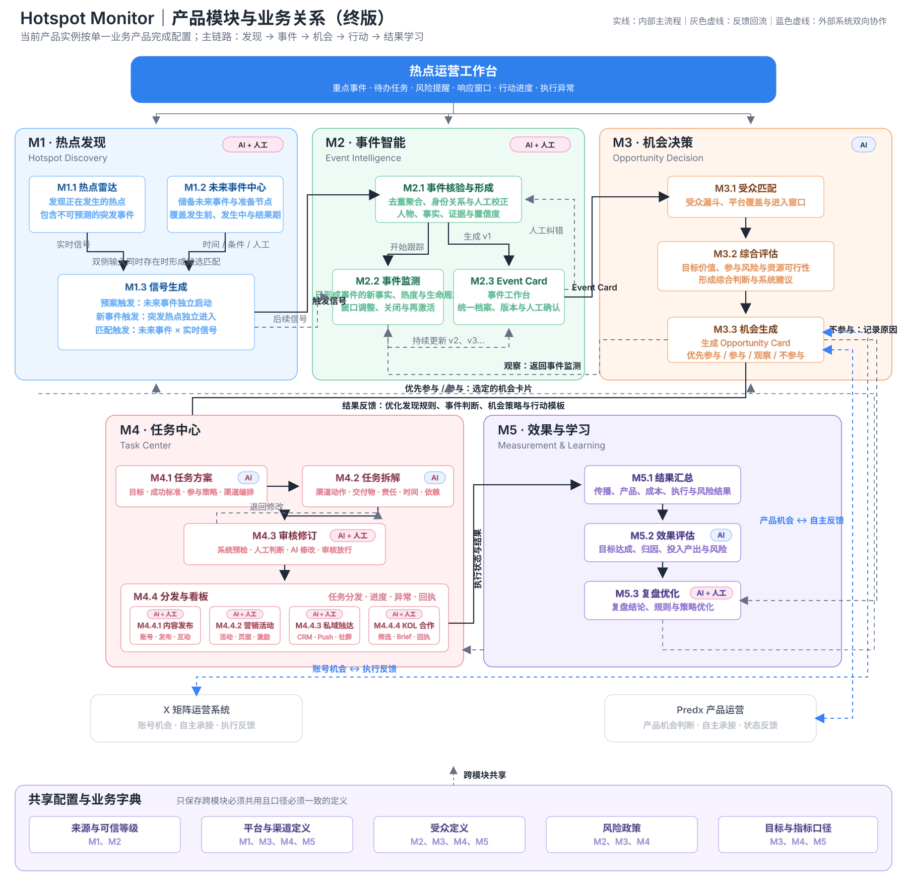

# 03 范围与产品能力

## 3.1 产品范围与非目标

### 完整产品范围

| 模块 | 范围 | 主要产出 |
|---|---|---|
| M1 热点发现 | 实时热点雷达、未来事件中心、事件触发与候选匹配、监控与提醒 | Signal、Candidate Event、监控任务 |
| M2 事件智能 | 事件形成、事件上下文校正、事实与证据、置信度、生命周期、热度监测和版本化 Event Card | Event、Fact、Evidence、Event Card、事件状态与窗口 |
| M3 机会决策 | 平台/受众机会、价值/风险/资源评估、机会排序和四档决策 | Opportunity Card、决策与理由 |
| M4 任务中心 | 统一任务方案与拆解；内容发布、营销活动、私域触达、KOL 合作四类交付物、审核、执行和回执 | Task Plan、Execution Deliverable Draft、Action Task、Task Receipt |
| M5 效果与学习 | 执行、传播和产品结果、成本关联、复盘和策略建议 | Outcome、复盘、策略建议 |
| 跨模块 | 来源可信等级、平台/渠道、受众、风险政策、目标与指标口径 | 共享业务字典 |

### 非目标

- 不要求四类行动采用相同自动化深度，也不在平台能力不可用时伪装为已自动执行；系统可直接完成已接入渠道的动作，并为人工或外部工具承接的动作保留交接与回执。
- 不允许自动化绕过高风险事实、内容或行动的人工审核和授权。
- 不以热度、传播量或模型推断取代事实证据。
- 不在本 PRD 中规定服务、数据库、接口、模型或部署方案。

### Phase 0 验证切片

以 Predx 内容运营的突发热点响应验证 M1 的 X 五地区趋势 Signal、M2 风险分级事件形成与 Event Card、M3 内容类机会判断，以及 M4 的可审核社媒内容草稿最小闭环。Telegram Bot 将草稿投递至管理员批准的审核目标，用于人工审核与结论记录；不直接发送到任何社媒特定账号，实际发布仍由人工筛选与交接。M5 记录投递与审核结果；不服务所有业务线和渠道。

### Phase 0 延期项

以下能力属于完整产品范围，但不纳入 Phase 0；是否启动取决于验证结果与后续业务优先级：

- M1 的 X 以外来源、完整未来事件预案和跨市场监测配置；
- M2 的跨团队实体关系治理、复杂事件再激活策略和完整版本协作；
- M3 的产品/渠道/商业承接路径比较，以及跨团队资源审批矩阵；
- M4 的私域触达、活动方案、KOL 触达、社媒账号 API 直发、营销活动自动上线/投放、KOL 后续全自动对话，以及 Predx 之外的完整多业务线协同；
- M5 的产品、渠道和商业结果连接、跨系统成本关联及策略复用分析。

## 3.2 产品能力架构

产品能力以用户提供的架构图为准：

**正式主链：**M1 形成 Candidate Event → M2 形成 Event，并以 Event Card 作为有版本的统一事件档案 → M3 形成并决定 Opportunity Card → M4 草拟并选定跨渠道 Task Plan，生成并审核各渠道的 Execution Deliverable Draft，再将可交接草稿转为渠道级 Action Task 执行并跟踪 Task Receipt → M5 汇总 Outcome、复盘和 Strategy Recommendation。

**反馈链：**观察的机会回流 M2 事件监测；经批准的 Strategy Recommendation 可反馈优化 M1 Monitoring Scope、M3 Opportunity Card 判断策略和 M4 Task Plan 模板，不自动覆盖现有规则；工作台聚合重点事件、待办、风险提醒、响应窗口、行动进度和执行异常。

## 3.3 模块与外部边界

| 边界对象 | Hotspot Monitor 负责 | 外部系统负责 |
|---|---|---|
| Event 与 Opportunity | 统一上下文、判断、风险、决策与审计 | 提供专业领域的输入或反馈 |
| 内容发布 | 生成可发布社媒内容、预检、审核、人工发布交接与状态跟踪 | 运营人员在当前无直发能力的平台手动筛选并发布；平台提供实际帖子与指标 |
| 私域触达 | 生成私域触达草稿、审核与目标治理 | Telegram 等渠道提供发送与互动回执 |
| 营销活动 | 生成并审核活动方案草稿、拆解任务、跟踪进度/成本/结果 | 活动负责人和已接入工具完成当前未自动化的落地实施 |
| KOL 合作 | 可解释筛选、名单与模板审核、首封私信自动化、回复收件箱 | X 等平台提供发送/回复能力；后续关系和报价由负责人确认 |
| Task Receipt 与 Outcome | 接收、关联、展示异常并触发复盘 | 人工、连接器与平台提供真实执行状态和结果数据 |

## 3.4 能力关系原则

1. Candidate Event 可由未来预案、突发热点或二者匹配形成；候选不等于事实或机会。
2. Event 是 M2—M5 共享的根上下文；Event Card 是 M3 的直接决策输入，Opportunity Card 是 M4 Task Plan 的唯一业务起点。
3. M3 的“优先参与/参与”可进入 M4；“观察”回流 M2；“不参与”必须记录原因并进入 M5 复盘。
4. Hotspot Monitor 拥有内容发布、营销活动、私域触达和 KOL 合作的业务工作流；具体动作可由系统连接器直接执行或由人工/外部工具承接，但权威任务、审核、状态与结果保留在系统内。
