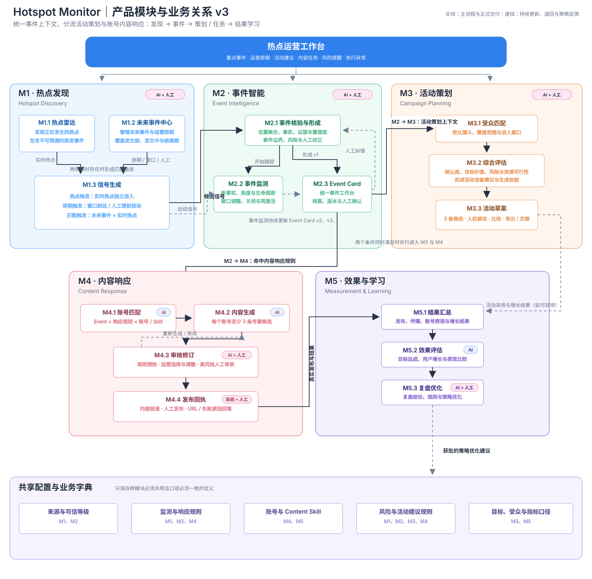

# 03 范围与产品能力

## 3.1 完整产品范围

| 模块 | 范围 | 主要产出 |
|---|---|---|
| M1 热点发现 | 热点雷达、热搜榜、重点主题、Future Event 与信号生成；预留热点内容/爆款拆解入口 | Signal、Future Event、Candidate Event；预留 Hot Content Sample、Content Insight |
| M2 事件智能 | 事件形成、地区来源聚合、事实/证据状态、事件监测、热度/生命周期、Event Card 版本与人工校正 | Event、Fact、Evidence、Event Card |
| M3 活动策划 | 受众匹配、活动准备综合评估、活动建议与三套活动方案草稿 | Marketing Recommendation、Campaign Proposal Draft |
| M4 内容响应 | 账号匹配、账号专属内容生成、预检/审核修订、人工发布与回填 | Account Response Task、Content Candidate、Publication Record |
| M5 效果与学习 | 发布/传播/账号表现与增长结果汇总、效果评估、复盘与策略优化 | Performance Result、Evaluation Report、Optimisation Proposal |
| 未来能力 | 由已核验 Event 生成私域话题讨论建议 | Private Discussion Topic Suggestion |
| 跨模块 | 来源/可信等级、监测/响应规则、账号/Content Skill、风险/活动建议规则、目标/受众/指标口径 | 共享配置与业务字典 |

## 3.2 模块命名与能力边界

- **热点发现**回答“什么正在发生、什么选题火、什么具体内容火”；它不负责宣布事实，也不直接发布内容。
- **事件智能**回答“这到底是不是同一个事件、哪些事实可确认、窗口与风险如何变化”；Event Card 是下游策划和内容响应的统一上下文。
- **活动策划**回答“是否建议为这个已核验 Event 做活动准备，以及有哪些方案选择”；它不是“是否参与热点”的资源决策，不自动立项或执行活动。
- **内容响应**回答“哪个账号此刻应如何快速产出、审阅、发布和回填内容”；这是 Phase 0 的核心闭环。
- **效果与学习**回答“哪些内容/洞察/规则带来了更快或更好的结果，以及下一次应调整什么”。

**终稿原型页面命名：**产品能力 M1—M5 不变；页面入口分别使用“热点监测”“运营排期”“事件管理”“内容发布”“复盘优化”。其中“事件管理”是 M2 的运营页面，“内容发布”是 M4 的运营页面，不是新增产品模块。

## 3.3 非目标与明确边界

- 不设置 Opportunity Card、参与/不参与热点决策或 Task Plan；通过核验且命中内容响应规则的 Event 直接进入 M4。
- 热点内容不是热搜 Topic 或 Event。它可以关联 Event，但不因“爆款”被写成已确认事实，也不直接触发账号任务。
- 不做 KOL 筛选、名单、邀约、私信、合作审批、执行或回执。活动方案可提及 KOL 扩散资源建议，但不产生 KOL 工作流。
- 不做私域触达、发送、审批、回执或社群管理；私域仅作为未来话题讨论建议保留。
- 不做营销活动立项、预算审批、落地页创建、投放、上线或实施；M3 交付方案草稿与外部交接记录。
- 不在 PRD 中规定数据库、模型、接口、服务或部署实现。

## 3.4 Phase 0 验证切片

Phase 0 验证 M1 的 X 五地区热搜与重点主题、M2 的候选事件和地区来源聚合、M4 的普通社媒内容响应闭环，以及 M5 的发布链接与基础结果记录。X 热搜每小时采集一次；合格热搜进入详情后，每个出现地区采集快照前三条推文并形成 Event 上下文。系统对三个预配置 Predx X 账号分别创建至多一个任务；每个可用账号生成至少 3 条预检通过的账号专属候选。内容运营在系统工作台选择、复制或调整后，在 X 手动发布并回填链接；某账号或 Skill 不可用时仅记录该账号异常，不阻塞其他账号。系统记录实际耗时，不设置固定分钟级交付 SLA。

热点内容采集、爆款拆解、活动策划、私域话题建议、多平台数据源、超过三个账号的复杂容量策略和跨平台结果追踪属于完整产品方向，是否启动取决于 Phase 0 验证和后续业务优先级。KOL 工作流不在延期项中，因为它不属于本系统范围。

## 3.5 产品模块架构

**事件主链：**M1 的实时热点、Future Event 或两者匹配形成候选信号 → M2 核验、形成并持续更新 Event Card。Event Card 是 M3 活动策划和 M4 内容响应的共同上下文；两个下游能力可以并行，不互为门禁。

**热点内容支线：**M1 的热点内容入口发现的是具体内容样本与传播线索。它产出的 Content Insight 可作为 M4 生成时的可选参考上下文，帮助复刻有效的内容结构；它不绕过 M2 的事实核验。

**活动策划支线：**M3 对 Event Card 进行受众匹配和综合评估，生成可解释的活动准备建议。首版优先关联 Future Event 的 Event；用户主动启动后才产生三套活动方案草稿。

**反馈链：**M5 的获批建议可以优化 M1 的发现/热点内容规则、M3 的活动建议规则与 M4 的账号/Skill/生成规则，不能自动覆盖生产配置。

## 3.6 外部边界

| 边界对象 | Hotspot Monitor 负责 | 外部团队/系统负责 |
|---|---|---|
| 社媒发布 | 候选生成、规则预检、系统内直接复制/选择/链接回填、内容洞察引用和任务状态 | 内容运营人工发布；平台提供实际帖子及可用指标 |
| 热点内容样本 | 发现、聚合、拆解、可复刻要素提取与引用记录 | 外部平台提供内容与互动数据；任何版权/授权使用由运营和合规流程处理 |
| 营销活动 | 活动建议、三套方案草稿、选择/导出/交接记录 | 活动立项、预算、落地、投放、上线和实际效果 |
| 私域 | 未来可输出话题讨论建议 | 私域策略、发送、互动、审核和回执 |
| KOL | 仅可在方案文本中给出资源建议 | 所有 KOL 识别、联系、合作与管理；本系统不接入 |
| Telegram | 当前不在 Phase 0 内容响应链中承担投递、审核或离线分流。 | 后续如启用，须另行定义入口、状态、审计和异常规则。 |
