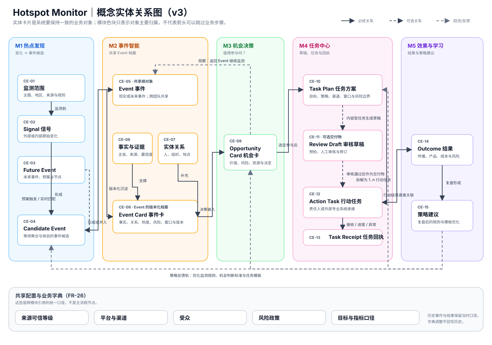

# 05 概念领域模型

本章以业务语言定义 Hotspot Monitor 的共享对象及其关系，供 UX/UI、架构和 Story 复用。它不定义数据库表、字段、存储、接口或技术实现。

## 5.1 核心实体与职责

| ID | 实体 | 业务职责 | 生命周期摘要 |
|---|---|---|---|
| CE-01 | Monitoring Scope（监测范围） | 定义关注主题、地区、来源、阈值、负责人和提醒规则。 | 草拟 → 生效 → 暂停/关闭。 |
| CE-02 | Signal（信号） | 记录外部或内部的原始变化及其来源状态。 | 接收 → 待处理 → 被关联/已忽略。 |
| CE-03 | Future Event（未来事件） | 记录将发生的业务、行业或公共事件及其预案。 | 草拟 → 已排程 → 窗口中 → 已结束/已取消。 |
| CE-04 | Candidate Event（候选事件） | 承载突发、预案或匹配触发后的事件候选。 | 新建 → 待形成 → 已形成/已忽略/已合并。 |
| CE-05 | Event（事件） | 作为跨团队共享的现实或未来事件根对象。 | 待核验 → 监测中/待决策 → 已关闭；可再激活。 |
| CE-06 | Fact Item / Source Evidence（事实与证据） | 表示事实主张、来源、性质和置信度。 | 待确认 → 已确认/已排除；证据可补充。 |
| CE-07 | Entity Relation（实体关系） | 表示人物、组织、地点、话题与 Event 的业务关系。 | 待确认 → 已确认/已更正/已失效。 |
| CE-08 | Event Card（事件卡） | 将 Event 的边界、事实、关系、热度、风险、窗口和状态沉淀为有版本档案。 | v1 → 更新版本 → 已关闭；可再激活更新。 |
| CE-09 | Opportunity Card（机会卡） | 记录 Event 的目标、受众、价值、风险、资源、路径与机会决策。 | 待评估 → 优先参与/参与/观察/不参与。 |
| CE-10 | Task Plan（任务方案） | 表达 Opportunity 的目标、参与策略、渠道、成功标准、资源、窗口与风险边界。 | 草拟 → 已选定 → 已撤销/已关闭。 |
| CE-11 | Review Draft（审核草稿） | 基于已核验事实和任务方案形成、等待审核或修订的内容或其他交付物版本。 | 草拟 → 待审核 → 已通过/需修改/已驳回。 |
| CE-12 | Action Task（行动任务） | 从已选定任务方案拆解出的、由责任人或外部专业系统承接的交付单元。 | 待交接 → 已接收 → 进行中 → 已完成/已暂停/异常/已取消。 |
| CE-13 | Task Receipt（任务回执） | 记录责任人或外部专业系统回传的接收、进度、异常和完成信息。 | 已接收 → 已关联 → 已处理/待人工处理。 |
| CE-14 | Outcome（结果） | 记录与行动任务关联的传播、产品、商业、成本或风险结果及口径。 | 待收集 → 已记录 → 已解释/数据缺失。 |
| CE-15 | Strategy Recommendation（策略建议） | 沉淀复盘后对发现、判断、机会或任务模板的优化。 | 草拟 → 待批准 → 已批准/已拒绝/已归档。 |

### 5.1.1 共享参照对象与使用关系

以下对象由 `FR-26` 的共享业务字典统一维护。它们是跨模块一致使用的业务参照，而不是独立的执行流程；每次引用均应保留当时适用的定义，后续字典调整不改写历史行动与结果。

| 共享参照对象 | 业务职责 | 主要使用关系 |
|---|---|---|
| 来源可信等级 | 定义来源/证据的可信判断口径。 | Signal、Fact Item / Source Evidence 引用。 |
| 平台/渠道 | 定义事件传播、承接或执行所处的平台与渠道。 | Opportunity Card 分析平台机会；Task Plan 与 Action Task 选择交接渠道。 |
| 受众 | 定义行动面向的人群、市场或业务对象。 | Opportunity Card 选择目标受众；Task Plan 与 Action Task 继承并细化。 |
| 风险政策 | 定义需要审核、限制或升级的风险边界。 | Event Card 标记风险；Opportunity Card、Review Draft 与 Action Task 继承适用约束。 |
| 目标 | 定义一次机会或行动希望达成的传播、产品、商业、成本或风险结果。 | Opportunity Card 选择目标；Task Plan 为每项任务关联目标。 |
| 指标口径 | 定义 Outcome 的结果类型、来源、时间和衡量含义。 | Task Plan 预先选择结果维度；Outcome 按选定口径记录。 |

## 5.2 概念实体关系图

关系规则：一个 Event 可聚合多个 Signal、事实、证据和实体关系；一个 Event 可产生多个 Opportunity Card；一个 Opportunity 可比较多个 Task Plan；一个选定 Task Plan 可产生多个 Review Draft 与 Action Task。Review Draft 经人工审核通过后可作为任务交付物；Action Task 由责任人或外部专业系统自主执行。所有 Outcome 与 Strategy Recommendation 都保留其根 Event 引用。

## 5.3 关键业务事件

| ID | 业务事件 | 触发者 | 影响的概念实体 |
|---|---|---|---|
| BE-01 | Signal 被接收或人工录入 | 数据来源、授权用户 | CE-02 |
| BE-02 | 未来事件、突发 Signal 或二者匹配形成 Candidate Event | 规则、热点/研究运营 | CE-03、CE-04 |
| BE-03 | Candidate Event 被形成、合并、拆分或忽略 | 热点/研究运营 | CE-04、CE-05 |
| BE-04 | 事实、证据或关系被确认/排除/校正 | 热点/研究运营、内容运营 | CE-05、CE-06、CE-07、CE-08 |
| BE-05 | Event 被更新、关闭或再激活 | 规则、热点/研究运营 | CE-05、CE-08 |
| BE-06 | Opportunity 被评估并作出四档决策 | 增长负责人、业务所有者 | CE-09 |
| BE-07 | Task Plan 被生成、选定、撤销或关闭 | 系统、行动责任人 | CE-10 |
| BE-08 | Review Draft 被生成、审核、修订或驳回 | 系统、审核者、行动责任人 | CE-11 |
| BE-09 | Action Task 被交接、接收、暂停、完成或取消 | 行动责任人、外部专业系统 | CE-12 |
| BE-10 | 任务接收、进度、异常或完成被回传 | 行动责任人、外部专业系统 | CE-13、CE-12 |
| BE-11 | Outcome 被记录、解释或标记缺失 | 系统、数据团队 | CE-14 |
| BE-12 | 策略建议被提出、批准或回写 | 增长负责人、策略所有者 | CE-15、CE-01、CE-09、CE-10 |

## 5.4 能力、旅程与需求映射

| 概念实体 | 主要产品能力 | 关联旅程 | 覆盖功能需求 |
|---|---|---|---|
| CE-01—CE-04 | M1 热点发现 | UJ-1、UJ-2 | FR-01—FR-05 |
| CE-05—CE-08 | M2 事件智能 | UJ-3、UJ-5 | FR-06—FR-10 |
| CE-09 | M3 机会决策 | UJ-3 | FR-11—FR-14 |
| CE-10—CE-13 | M4 任务中心 | UJ-4 | FR-15—FR-20 |
| CE-14—CE-15 | M5 效果与学习 | UJ-5 | FR-21—FR-25 |
| 共享参照对象 | 跨模块共享字典 | UJ-1—UJ-5 | FR-26 |
