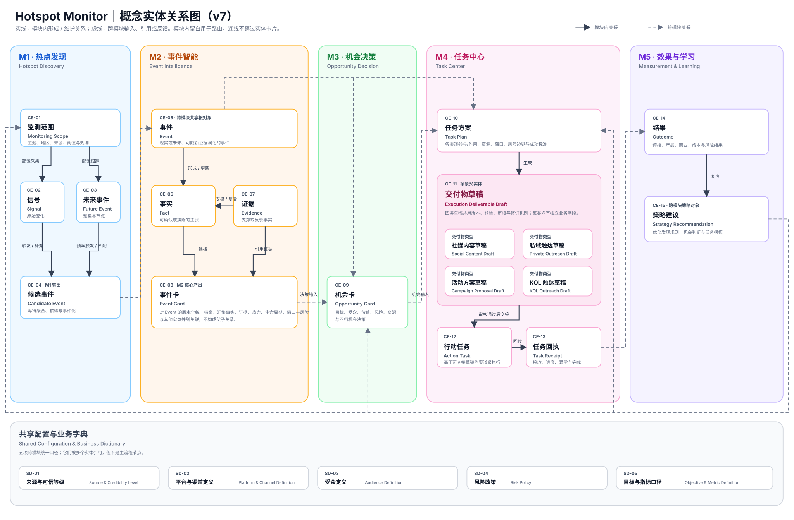

# 05 概念领域模型

本章以业务语言定义 Hotspot Monitor 的共享对象及其关系，供 UX/UI、架构和 Story 复用。它不定义数据库表、字段、存储、接口或技术实现。

## 5.1 核心实体与职责

| ID | 实体 | 业务职责 | 生命周期摘要 |
|---|---|---|---|
| CE-01 | Monitoring Scope（监测范围） | 定义关注主题、地区、来源、阈值、负责人和提醒规则。 | 草拟 → 生效 → 暂停/关闭。 |
| CE-02 | Signal（信号） | 记录外部或内部的原始变化及其来源状态。 | 接收 → 待处理 → 被关联/已忽略。 |
| CE-03 | Future Event（未来事件） | 记录将发生的业务、行业或公共事件及其预案。 | 草拟 → 已排程 → 窗口中 → 已结束/已取消。 |
| CE-04 | Candidate Event（候选事件） | 承载突发、预案或匹配触发后的事件候选。 | 新建 → 待形成 → 已形成/已忽略/已合并。 |
| CE-05 | Event（事件） | 作为跨团队共享的现实或未来事件根对象。 | 待核验 → 监测中/待决策 → 已关闭；可再激活。 |
| CE-06 | Fact（事实） | 表示可核验的事实声明及其确认状态；一个 Event 可包含多条 Fact。 | 待确认 → 已确认/已排除。 |
| CE-07 | Evidence（证据） | 表示支持、质疑或排除 Fact 的来源材料、可信等级与可访问引用。 | 已采集 → 待核验 → 已采用/已排除；可补充。 |
| CE-08 | Event Card（事件卡） | 有版本的统一事件档案，引用并呈现 Event、Fact、Evidence、热度、风险、窗口和状态；它不是这些实体的父对象。 | v1 → 更新版本 → 已关闭；可再激活更新。 |
| CE-09 | Opportunity Card（机会卡） | 记录 Event 的目标、受众、价值、风险、资源、路径与机会决策。 | 待评估 → 优先参与/参与/观察/不参与。 |
| CE-10 | Task Plan（任务方案） | 系统针对 Opportunity 自动生成的跨渠道大方案和行动选项：目标、参与策略、各渠道参与/不参与及其作用、成功标准、资源、窗口与风险边界；人负责选择、拒绝或例外修改。 | 系统生成 → 待选定 → 已选定 → 已撤销/已关闭。 |
| CE-11 | Execution Deliverable Draft（交付物草稿） | 行动交付物父实体。类型为 Social Content Draft、Private Outreach Draft、Campaign Proposal Draft、KOL Outreach Draft；普通社媒内容可经规则预检后供选择，高风险或其他类型按适用门禁审核；类型不另列概念实体编号。 | 系统生成/草拟 → 预检完成 → 已通过/待审核/需修改/已驳回。 |
| CE-12 | Action Task（行动任务） | 基于已选定 Task Plan 与可交接交付物草稿，为每个需要响应的渠道分配的独立具体规划与执行单元；由责任人或外部专业系统承接。 | 待交接 → 已接收 → 进行中 → 已完成/已暂停/异常/已取消。 |
| CE-13 | Task Receipt（任务回执） | 记录责任人或外部专业系统对 Action Task 的接收、进度、异常和完成信息。 | 已接收 → 已关联 → 已处理/待人工处理。 |
| CE-14 | Outcome（结果） | 记录与行动任务关联的传播、产品、商业、成本或风险结果及口径。 | 待收集 → 已记录 → 已解释/数据缺失。 |
| CE-15 | Strategy Recommendation（策略建议） | 沉淀复盘后对 Monitoring Scope、Opportunity Card 判断策略或 Task Plan 模板的优化；经批准后才可反馈。 | 草拟 → 待批准 → 已批准/已拒绝/已归档。 |

### 5.1.1 共享参照对象与使用关系

以下对象由 `FR-26` 的共享业务字典统一维护。它们是跨模块一致使用的业务参照，而不是独立的执行流程；每次引用均应保留当时适用的定义，后续字典调整不改写历史行动与结果。

| 共享参照对象 | 业务职责 | 主要使用关系 |
|---|---|---|
| SD-01 来源与可信等级（Source & Credibility Level） | 定义来源/证据的可信判断口径。 | Signal、Evidence 引用。 |
| SD-02 平台与渠道定义（Platform & Channel Definition） | 定义事件传播、承接或执行所处的平台与渠道，并区分内部审核目标与外部运营目标。 | Opportunity Card 分析平台机会；Task Plan、交付物草稿与 Action Task 选择协作或执行渠道。 |
| SD-03 受众定义（Audience Definition） | 定义行动面向的人群、市场或业务对象。 | Opportunity Card 选择目标受众；Task Plan 与 Action Task 继承并细化。 |
| SD-04 风险政策（Risk Policy） | 定义需要审核、限制或升级的风险边界。 | Event Card 标记风险；Opportunity Card、交付物草稿与 Action Task 继承适用约束。 |
| SD-05 目标与指标口径（Objective & Metric Definition） | 定义一次机会或行动希望达成的结果，以及 Outcome 的类型、来源、时间和衡量含义。 | Opportunity Card 选择目标；Task Plan 预先选择结果维度；Outcome 按选定口径记录。 |

## 5.2 概念实体关系图

关系规则：Monitoring Scope 配置 Signal 与 Future Event 的发现边界；Future Event 的自动窗口、授权用户手动提前启动、Signal 和/或二者匹配都可触发 Candidate Event，候选被形成后关联同一 Event。一个 Event 可包含多个 Fact；Evidence 支持、质疑或排除相应 Fact。Event Card 引用并汇集这些对象及热度、风险、窗口、状态，而不是把它们变为其子实体。Event Card 是 Opportunity Card 的直接决策输入；Opportunity Card 是系统生成 Task Plan 的业务起点。Task Plan 提供各渠道参与/不参与及作用边界的行动选项；普通社媒内容默认生成候选，私域、活动和 KOL 仅在推荐被选择推进或按需请求后生成草稿。草稿满足适用预检、审核和授权门禁后，才可据以创建渠道级 Action Task。Action Task 由系统连接器执行或由人工承接，Task Receipt 回传实际执行状态，Outcome 汇总结果。Event 是 M2—M5 的共享根上下文；经批准的 Strategy Recommendation 才可反馈到 Monitoring Scope、Opportunity Card 判断策略和 Task Plan 模板，不自动覆盖现有规则。

## 5.3 关键业务事件

| ID | 业务事件 | 触发主体 | 触发条件 | 影响的概念实体 |
|---|---|---|---|---|
| BE-01 | Signal 被接收或人工录入 | 数据来源、授权用户 | 外部来源提供原始变化，或授权用户提交内部输入。 | CE-02 |
| BE-02 | Candidate Event 被形成或更新 | 系统、热点/研究运营 | Future Event 自动窗口到达、授权用户手动提前启动、出现突发 Signal，或二者满足已配置的匹配条件；后续触发更新既有 Event。 | CE-03、CE-04、CE-05 |
| BE-03 | Candidate Event 被处置，并形成或更新 Event | 热点/研究运营 | 候选进入人工处理，或发现重复、粒度不当、无效等处置依据。 | CE-04、CE-05 |
| BE-04 | Fact 或 Evidence 被确认、质疑、排除或校正 | 热点/研究运营、内容运营 | 出现新增材料、来源冲突、人工核验结论或上下文校正需求。 | CE-05、CE-06、CE-07、CE-08 |
| BE-05 | Event 与 Event Card 被更新、关闭或再激活 | 系统、热点/研究运营 | 新 Evidence、热度或生命周期变化、窗口到期，或授权用户基于明确依据作出状态更新。 | CE-05、CE-08 |
| BE-06 | Opportunity Card 被评估并作出四档决策 | 增长负责人、业务所有者 | Event Card 已具备足以评估目标、受众、价值、风险与资源的上下文。 | CE-09 |
| BE-07 | Task Plan 被生成、选定、撤销或关闭 | 系统、增长负责人 | Opportunity Card 决定为“优先参与”或“参与”时，系统生成跨渠道行动选项；增长负责人选择推进、拒绝或例外要求修改。 | CE-10 |
| BE-08 | Execution Deliverable Draft 被生成、预检、审核、修订或驳回 | 系统、类型审核者、品牌/风控 | 合格内容事件默认生成普通社媒内容候选；私域、活动和 KOL 在推荐被选定或按需请求后生成。草稿提交预检、收到修改意见或形成审核结论时更新。 | CE-11 |
| BE-09 | 渠道级 Action Task 被创建、交接、执行、暂停、完成或取消 | 行动责任人、连接器、平台 | 已选定 Task Plan 的渠道有可交接交付物草稿，并满足适用授权门禁；或执行中出现状态变化。 | CE-12 |
| BE-10 | Task Receipt 被回传、关联或升级处理 | 行动责任人、连接器、平台 | 接收到发布、发送、回复、进度、异常或完成等真实执行信息。 | CE-13、CE-12 |
| BE-11 | Outcome 被记录、解释或标记缺失 | 系统、数据团队 | 结果数据可获得、需要补充解释，或到达结果观察窗口但数据缺失/冲突。 | CE-14 |
| BE-12 | Strategy Recommendation 被提出、批准或回写 | 增长负责人、策略所有者 | Outcome 与复盘证据已形成，或已批准建议进入其明确的反馈范围。 | CE-15、CE-01、CE-09、CE-10 |

## 5.4 能力、旅程与需求映射

| 概念实体 | 主要产品能力 | 关联旅程 | 覆盖功能需求 |
|---|---|---|---|
| CE-01—CE-04 | M1 热点发现 | UJ-1、UJ-2 | FR-01—FR-05 |
| CE-05—CE-08 | M2 事件智能 | UJ-3、UJ-5 | FR-06—FR-10 |
| CE-09 | M3 机会决策 | UJ-3 | FR-11—FR-14 |
| CE-10—CE-13 | M4 任务中心 | UJ-4 | FR-15—FR-20 |
| CE-14—CE-15 | M5 效果与学习 | UJ-5 | FR-21—FR-25 |
| 共享参照对象 | 跨模块共享字典 | UJ-1—UJ-5 | FR-26 |
