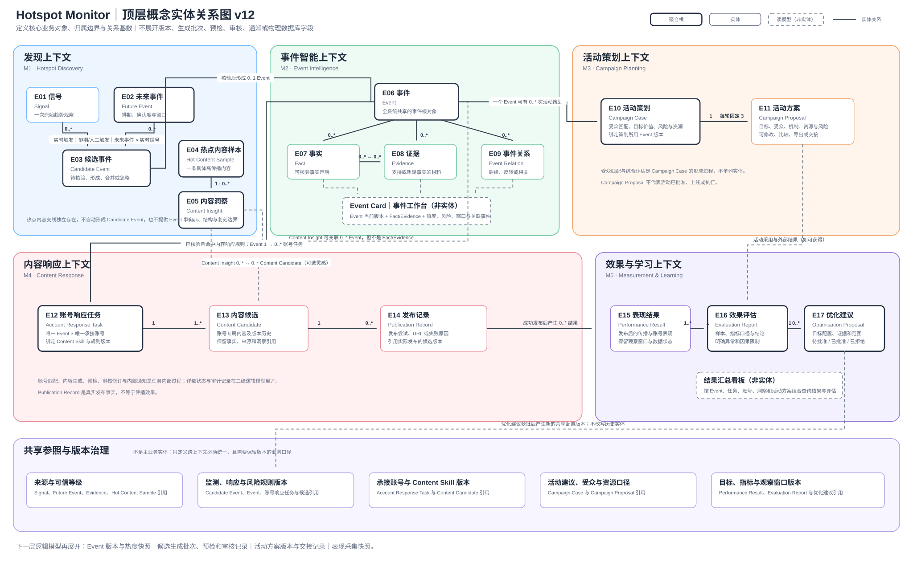

# 05 概念领域模型

本章以业务语言定义 Hotspot Monitor 的共享对象与关系，供 UX/UI、架构和 Story 复用；不定义数据库表、字段、存储、接口或技术实现。当前权威图为 v12：它表达顶层对象、归属边界和关系基数；候选生成、预检、审核、通知和版本细节由业务规则展开。

## 5.1 核心实体与职责

| ID | 实体 | 业务职责 | 生命周期摘要 |
|---|---|---|---|
| E01 | Signal（信号） | 记录一次原始趋势观察及其地区、排名、热度、快照和来源状态。 | 接收 → 待处理 → 已关联/已忽略。 |
| E02 | Future Event（未来事件） | 记录将发生或预期发生的事件、排期、确认度、窗口与准备上下文。 | 草拟 → 已排期/观察中 → 窗口中 → 已结束/已取消。 |
| E03 | Candidate Event（候选事件） | 承载实时 Signal、Future Event 或两者匹配后形成的事件候选。 | 新建 → 待聚合 → 已形成/已忽略/已合并。 |
| E04 | Hot Content Sample（热点内容样本） | 为未来热点内容与爆款拆解支线预留的具体内容样本对象；当前不定义来源或采集逻辑。 | 后续启用时：已采集 → 可分析/已归档。 |
| E05 | Content Insight（内容洞察） | 为未来热点内容拆解和内容生成上下文预留的分析对象；当前只定义复刻边界。 | 后续启用时：已分析 → 可引用/已归档。 |
| E06 | Event（事件） | 全系统共享的现实或未来事件根对象；它承载来源聚合后的当前运营判断，而非权威事实认证。 | 已形成 → 响应中/观察中 → 已关闭；可再激活。 |
| E07 | Fact（事实） | 记录关于 Event 的具体陈述及其确认、冲突或未知状态。 | 待确认/有冲突 → 已确认/已排除/已更新。 |
| E08 | Evidence（证据） | 记录支持、质疑或补充 Event/Fact 的来源材料、地区、快照时间与排序上下文。 | 已采集 → 已关联/已排除。 |
| E09 | Event Relation（事件关系） | 记录 Event 之间的前置、后续、反转或其他关联。 | 已建立 → 已更新/已解除。 |
| E10 | Campaign Case（活动策划） | 记录针对某个 Event 版本的受众、价值、风险、资源和活动准备上下文。 | 已形成 → 待运营决定 → 已启动/已忽略/已过期。 |
| E11 | Campaign Proposal（活动方案） | 记录一套可比较、修改、导出或交接的活动方案。 | 已生成 → 已调整/已导出/已归档。 |
| E12 | Account Response Task（账号响应任务） | 一个承接账号对一个 Event 的最小内容响应单元，绑定 Content Skill 与响应规则版本。 | 待生成 → 生成中 → 待选择 → 待发布/待回填 → 已完成/异常/已取消。 |
| E13 | Content Candidate（内容候选） | 记录账号专属候选及其版本、来源、事实状态和可选 Content Insight 引用。 | 已生成 → 预检完成 → 已选择/需修改/已放弃。 |
| E14 | Publication Record（发布记录） | 记录一次人工发布尝试及其实际 URL 或失败原因；它是发布事实，不是传播效果。 | 待回填 → 已发布/发布失败。 |
| E15 | Performance Result（表现结果） | 记录发布后的传播、账号表现、观察窗口和数据状态。 | 待收集 → 已记录/数据缺失。 |
| E16 | Evaluation Report（效果评估） | 记录样本、指标口径、异常和因果限制下的评估结论。 | 草拟 → 已完成/待补数据。 |
| E17 | Optimisation Proposal（优化建议） | 记录基于结果提出的配置优化建议及其批准状态。 | 草拟 → 待批准 → 已批准/已拒绝/已归档。 |

## 5.1.1 共享参照与版本治理

| 共享参照对象 | 业务职责 | 主要使用关系 |
|---|---|---|
| 来源与可信等级 | 定义 Signal、Future Event、Evidence 和热点内容样本的来源、时间和状态口径。 | E01、E02、E04、E08 引用。 |
| 监测、响应与风险规则版本 | 定义关键词、排名、跨区、窗口、内容响应和风险预检规则。 | E03、E06、E12、E13 引用。 |
| 承接账号与 Content Skill 版本 | 定义账号身份、可用状态、内容角色与表达边界。 | E12、E13 引用。 |
| 活动建议、受众与资源口径 | 定义活动策划使用的受众、价值、风险与资源判断。 | E10、E11 引用。 |
| 目标、指标与观察窗口版本 | 定义表现采集和效果评估的目标、指标、窗口和比较口径。 | E15、E16、E17 引用。 |

## 5.2 概念实体关系图

关系规则：一个或多个 Signal、Future Event 或两者匹配可形成 Candidate Event；Candidate Event 经来源聚合后形成 0 或 1 个 Event。Event 可以有多条 Fact、Evidence 和 Event Relation；Event Card 是这些对象及热度、风险、窗口的统一读模型，不是独立实体。

热点内容样本产生 Content Insight。Content Insight 可以关联 Event，也可以独立作为内容灵感；它不等于 Fact 或 Evidence。已形成的 Event 可以并行进入活动策划和内容响应：活动策划产生 Campaign Case 与每轮固定 3 个 Campaign Proposal；内容响应为一个 Event × 一个承接账号形成 Account Response Task，任务产生一个或多个 Content Candidate，人工发布后形成 Publication Record，再进入表现、评估与优化建议。

## 5.3 关键业务事件

| ID | 业务事件 | 触发主体 | 触发条件 | 影响实体 |
|---|---|---|---|---|
| BE-01 | Signal 被接收 | 数据来源、授权用户 | X 榜单成功采集、手动刷新或人工输入。 | E01 |
| BE-02 | Candidate Event 被形成/更新 | 系统、热点运营 | Signal 命中触发、Future Event 窗口到达、手动启动或事件匹配。 | E02、E03、E06 |
| BE-03 | 热搜来源被聚合 | 系统 | 合格热搜进入详情；每个出现地区采集快照前三条推文。 | E03、E06、E08 |
| BE-04 | Event 上下文被更新 | 系统、热点运营 | 新来源、来源冲突、热度/窗口变化或人工校正。 | E06—E09 |
| BE-05 | 账号响应任务被创建或异常 | 系统、内容运营 | Event 命中响应规则；Predx X 主账号或 Skill 不可用时标记异常。 | E06、E12 |
| BE-06 | 内容候选被生成、预检、选择或修订 | 系统、内容运营、品牌/风控 | 账号任务创建、规则预检、洞察引用或用户调整。 | E05、E12、E13 |
| BE-07 | 发布记录被回填 | 内容运营 | 运营在 X 平台手动发布，或记录失败原因。 | E13、E14 |
| BE-08 | 活动方案被生成/调整/交接 | 活动运营、系统 | 用户主动启动、选择、调整或导出方案。 | E10、E11 |
| BE-09 | 表现和优化建议被记录 | 系统、运营负责人 | 发布结果可得或复盘形成建议。 | E14—E17 |

## 5.4 能力、旅程与需求映射

| 概念实体 | 主要产品能力 | 关联旅程 | 覆盖功能需求 |
|---|---|---|---|
| E01—E05 | M1 热点发现 | UJ-1、UJ-2 | FR-01—FR-06 |
| E06—E09 | M2 事件智能 | UJ-2—UJ-4 | FR-07—FR-11 |
| E10—E11 | M3 活动策划 | UJ-4 | FR-12—FR-15 |
| E12—E14 | M4 内容响应 | UJ-3 | FR-16—FR-20 |
| E15—E17 | M5 效果与学习 | UJ-5 | FR-21—FR-25 |
| 共享参照与版本治理 | 跨模块配置 | UJ-1—UJ-5 | FR-02、FR-04、FR-06、FR-16、FR-19、FR-24 |
