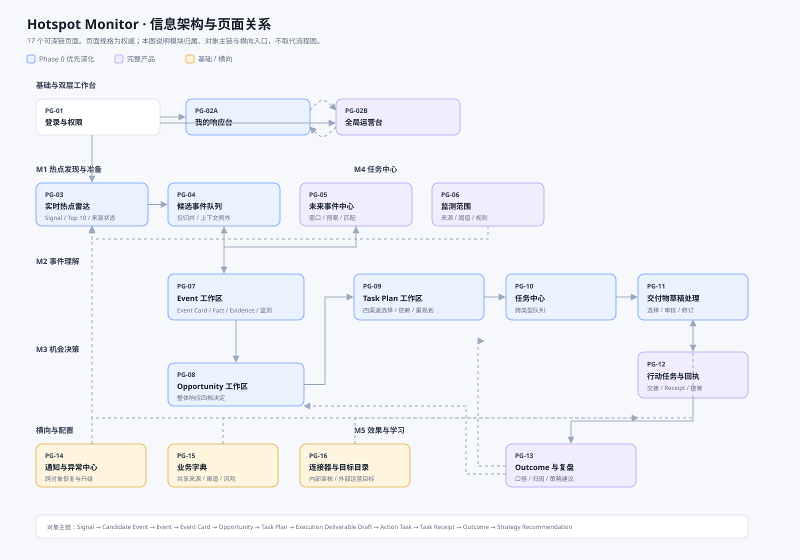
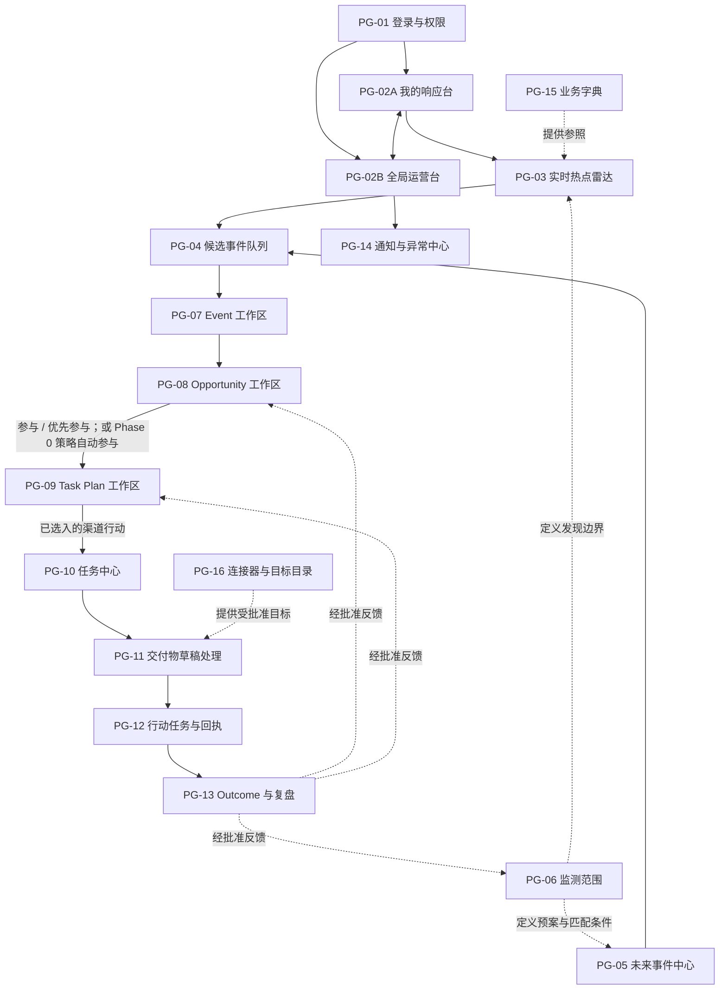

# 02 信息架构

## 2.1 信息架构原则

1. **产品全貌与 Phase 0 优先级分开表达。** 全局运营台始终呈现 M1—M5 和四类行动；我的响应台把 Phase 0 的内容运营突发响应放在第一优先级，不能把完整产品缩成内容工具。
2. **一个可深链的工作目标，才是一张页面。** 对同一根对象的不同阅读或处理方式采用页面内视图；短暂确认、筛选和来源查看采用弹层/抽屉；重复呈现采用组件。
3. **Event 是跨模块根上下文。** 从 Candidate、Future Event、Opportunity、Task Plan、交付物草稿、Action Task、Receipt 到 Outcome 的跳转均保留根 Event 与所引用版本；后续 Future Event 或 Signal 触发更新既有 Event，不重复创建下游行动。
4. **四类行动不是四套产品。** 内容发布、私域触达、营销活动、KOL 合作在任务中心共享队列、对象链、审计与回执；渠道选择、专属状态、审核和执行差异只在相应行动卡、视图、表单和规则中出现。

## 2.2 顶层导航

| 导航 | 可到达的页面 | 说明 |
|---|---|---|
| 工作台 | PG-02A 我的响应台、PG-02B 全局运营台 | 两个层次的首页；记忆用户选择，不改变权限。 |
| 热点与事件 | PG-03 实时热点雷达、PG-04 候选事件队列、PG-05 未来事件中心、PG-07 Event 工作区 | M1 发现与 M2 理解的主入口。 |
| 机会 | PG-08 Opportunity 工作区 | 含观察队列和四档决策，不另设“机会列表页”。 |
| 任务中心 | PG-09 Task Plan、PG-10 任务中心、PG-11 交付物草稿处理、PG-12 行动任务与回执 | 一个模块；四类行动为其内部类型视图。 |
| 效果与学习 | PG-13 Outcome 与复盘 | 含 Strategy Recommendation，不另拆页面。 |
| 系统配置 | PG-06 监测范围、PG-15 业务字典、PG-16 连接器与目标目录 | 仅有相应配置权限的用户可进入。 |
| 通知 | PG-14 通知与异常中心 | 全局入口；从任何页面可打开。 |

## 2.3 页面、视图、弹层与组件的边界

| 层级 | 标记 | 用于 | 不应用于 |
|---|---|---|---|
| 页面 | `PG` | 可收藏/深链、独立权限、拥有完整主任务或可从工作台直接进入的工作区 | 同一对象的普通筛选、单个字段编辑或短暂确认。 |
| 页面内视图 | `VW` | 同一根对象的不同工作角度；切换后 URL/浏览历史保持在该对象页面内 | 需要完全不同权限、根对象或独立待办队列的能力。 |
| 弹层或抽屉 | `OV` | Evidence 来源、快速预览、筛选、确认、分配和投递/重试等短操作 | 承担完整审核、复杂编辑、批量治理或长期状态。 |
| 组件 | `CP` | 跨页面复用的卡片、表格、状态、图表、时间线、操作条 | 用来暗示新的信息架构入口。 |

这一定义解决两类常见混淆：Evidence 不是独立页面，而是 Event 工作区中的 `OV-07A`；Telegram 普通内容候选投递不是独立产品模块或页面，而是交付物草稿处理中的 `OV-11C` 操作。连接器和可投递目标的配置才是独立页面（PG-16）。

## 2.4 页面地图

下图是当前版本的可视化信息架构图；它与下方 Mermaid 页面地图表达同一套 `PG` 编号和对象主链，SVG 便于在文档预览、评审和交接时直接查看。

## 2.5 可深链页面清单

| ID | 页面 | 模块 | 页面级主任务 | Phase 0 | 关键页面内视图 |
|---|---|---|---|---|---|
| PG-01 | 登录与权限 | 基础 | 建立身份、选择工作空间、处理权限受限 | 必需 | 会话、权限申请 |
| PG-02A | 我的响应台 | 工作台 | 内容运营优先处理已投递内容候选、选择/发布时限和例外 | 默认首页 | 5 分钟投递进度、15 分钟选择/发布、我的待办、窗口/异常 |
| PG-02B | 全局运营台 | 工作台 | 查看 M1—M5、四类行动、风险和异常全貌 | 完整产品 | 运营全貌、按团队、窗口/异常 |
| PG-03 | 实时热点雷达 | M1 | 从 Signal 中理解热度、扩散、来源健康度、成功采集时间与触发依据 | 必需 | Top 10、趋势/区域、来源状态、触发日志 |
| PG-04 | 候选事件队列 | M1 | 处理自动形成/更新后的重复、异常和人工校正；正常路径不需要人工逐条放行 | 必需 | 例外待处理、疑似重复、已处置 |
| PG-05 | 未来事件中心 | M1 | 管理预定事件、前/中/后窗口、预案、负责人和与实时 Signal 的匹配 | 完整产品 | 日历、列表、自动窗口、手动提前启动、已改期/取消 |
| PG-06 | 监测范围 | M1 配置 | 定义来源、地区、主题、重点领域关键词、普通阈值、提醒和未来事件匹配边界 | 后续启用 | 范围规则、触发阈值、提醒、匹配规则 |
| PG-07 | Event 工作区 | M2 | 核验和维护一个 Event 的边界、事实、证据、状态、热度、风险与窗口 | 必需 | Event Card、Fact/Evidence、事件监测、版本/审计 |
| PG-08 | Opportunity 工作区 | M3 | 评估并作出优先参与/参与/观察/不参与的热点整体响应决定；查看自动参与的普通内容决策依据 | 必需 | 机会档案、比较/排序、决策记录、自动参与依据 |
| PG-09 | Task Plan 工作区 | M4 | 查看系统生成的完整响应计划，选择四类渠道行动组合并确认影响分析/重规划版本 | 必需 | 方案比较、渠道组合、依赖/影响、资源/风险/预期结果、系统生成依据 |
| PG-10 | 任务中心 | M4 | 跨类型聚合行动进度、待办和窗口，进入具体草稿或任务 | 内容类型启用 | 总览、内容发布、私域触达、营销活动、KOL 合作；响应倒计时 |
| PG-11 | 交付物草稿处理工作区 | M4 | 处理一个 Execution Deliverable Draft：普通社媒内容为选择/发布交接，高风险及其他类型为审核/修订 | 社媒内容类型启用 | 社媒内容、私域触达、活动方案、KOL 触达；预检/版本/选择/审核意见 |
| PG-12 | 行动任务与回执工作区 | M4 | 交接、跟踪、人工接管 Action Task 及其 Task Receipt | 后续启用 | 任务详情、回执时间线、依赖/异常 |
| PG-13 | Outcome 与复盘工作区 | M5 | 汇总结果、标注口径与归因、提出策略建议 | 完整产品 | 结果、复盘、策略建议 |
| PG-14 | 通知与异常中心 | 横向 | 处理高风险、窗口、投递、回执、退订等需恢复事项 | 内容链异常必需 | 我的待办、团队升级、已解决 |
| PG-15 | 业务字典 | 配置 | 维护来源、渠道、受众、风险、指标等共享参照 | 后续启用 | 各字典类型、变更记录 |
| PG-16 | 连接器与目标目录 | 配置 | 管理连接器、内部审核目标、外部运营目标及授权状态 | Telegram 审核目标必需 | 连接器状态、内部审核目标、外部运营目标、投递记录 |

## 2.6 对象工作区

Event、Opportunity、Task Plan 和各行动详情采用一致框架：对象头部、根对象链、主任务区、可收起上下文栏和状态动作栏。根对象链为：

`Event → Event Card → Opportunity → Task Plan → Execution Deliverable Draft → Action Task → Task Receipt → Outcome`

下游保存所引用 Event Card 版本；上游重大变化触发过期提示和适用审核门禁，不静默替换。

## 2.7 Opportunity、Task Plan 与行动类型

Opportunity 的四档状态只决定这个热点是否启动整体响应：`优先参与 / 参与 / 观察 / 不参与`。观察与不参与不进入 Task Plan；优先参与和参与才由系统生成完整响应计划。Phase 0 的合格普通内容由策略在 Opportunity 上自动写入“参与”及依据，随后同样进入 Task Plan；它不是第五种 Opportunity 状态，也不是一条脱离信息架构的捷径。

一个 Task Plan 可同时包含四类行动卡：`内容发布 / 私域触达 / 营销活动 / KOL 合作`。每张卡必须显示系统建议（建议启用/未建议启用）、计划选择（待选择/已选入/未选入/已取消）、与其他渠道的依赖、共享的核心信息/受众/CTA、预期贡献、风险、窗口、责任角色与交付进展。PG-10、PG-11 与 PG-12 提供相同的行动类型切换；用户可跨类型查看共同时间线，也可进入类型专属视图。

小周在 Task Plan 内选入、取消或修改具体渠道行动，而不重复判断热点是否参与。取消任一行动后，系统展示对其他已选行动的影响：无影响时更新当前版本；需要重规划时生成新的计划版本和草稿差异；存在阻塞冲突时要求恢复行动、选择替代承接方式或关闭受影响行动。只有已选入的渠道才进入 PG-10—12 生成草稿、任务和回执。

Phase 0 中，内容发布行动由策略直接选入，系统生成至少 3 条普通社媒内容候选，小陈选择一条并人工发布；该路径不等待私域、活动或 KOL 被选择。其他三类行动仍在同一份 Task Plan 中以“待选择”或“未选入”呈现；全局运营台按完整产品形态展示四类行动的真实进度，不显示伪造状态。

## 2.8 协作与执行目标

| 目标类别 | 用途 | 规则 |
|---|---|---|
| 系统内部 | 权威编辑、审核、状态和版本 | 永远存在 |
| 内部审核目标 | Telegram 工作群、Google Docs 等协作出口 | 不得作为外部发布目标 |
| 外部运营社群 | Telegram 用户群/频道 | Private Outreach Draft 审核后发送 |
| 社媒平台 | X 等内容平台 | 当前人工发布；未来可接直发连接器 |
| KOL 私信平台 | 首版 X | 仅在名单/模板/频率获批后发送首封 |

## 2.9 术语规范

规范术语以 PRD v2.5 的概念领域模型为准。界面使用“任务方案、渠道行动、交付物草稿、行动任务、任务回执”；四类名称是 Task Plan 内的渠道行动类型，不是独立核心实体。普通社媒内容使用“规则预检通过”“待选择”“已选择/待发布”“已回填链接”，不误称为“已审核通过”或“已自动发布”。Telegram 只称“连接器/目标”，不称产品模块。

## 2.10 本次编号迁移

旧版的页面编号把“雷达/候选”、“未来事件/配置”以及“四类行动工作区”混在一起。本次调整后，旧编号只可用于历史资产定位，不再作为后续页面规格的依据。

| 旧编号 | 新定位 |
|---|---|
| PG-03 实时雷达与候选 | 分为 PG-03 实时热点雷达、PG-04 候选事件队列 |
| PG-04 Event | PG-07 Event 工作区 |
| PG-05 Opportunity | PG-08 Opportunity 工作区 |
| PG-06 Task Plan | PG-09 Task Plan 工作区 |
| PG-07 审核中心、PG-08—12 四类行动页、PG-13 任务看板 | 重组为 PG-10 任务中心、PG-11 交付物草稿审核、PG-12 行动任务与回执；四类行动成为类型视图 |
| PG-14 效果与复盘 | PG-13 Outcome 与复盘工作区 |
| PG-15 通知与异常 | PG-14 通知与异常中心 |
| PG-16 未来事件与配置 | 分为 PG-05 未来事件中心、PG-06 监测范围、PG-15 业务字典、PG-16 连接器与目标目录 |
| PG-17 Telegram 审核投递 | `OV-11C` 普通内容候选投递/重试操作；连接器与目标配置归 PG-16 |
