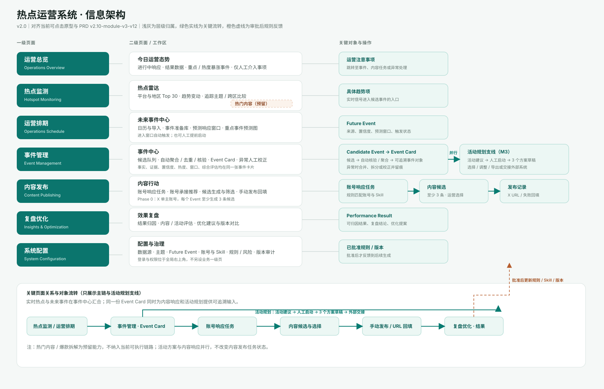

# 02 信息架构



> 图例：浅灰线表示页面与工作区的归属；绿色实线表示关键对象的主流转；橙色虚线表示复盘提案经审批后，对规则、账号 Skill 或版本配置产生的反馈。登录与权限位于全局右上角，不作为独立业务页面。

## 2.1 一级与二级页面

| 一级页面 | 主要二级视图/工作区 | 页面回答的问题 |
|---|---|---|
| 运营总览 | 结果趋势、账号表现、人工待办、链路异常、进行中的任务组、榜单重点 | 运营结果怎样？现在需要我处理什么？ |
| 热点监测 | 热搜排行榜、重点主题追踪、跨区聚合、热点内容（预留） | 什么选题正在上升？哪些条目已形成/更新 Event？ |
| 运营排期 | 月历、筛选、Future Event 详情、来源/确认度、预测窗口、预热/活动入口 | 哪些未来事件值得持续观察或提前准备？ |
| 事件管理 | Event 列表、Event Card、来源与事实、关系、校正/合并/拆分、活动建议 | 当前 Event 的来源、上下文、响应和异常是什么？ |
| 内容发布 | 账号响应任务列表、任务详情、候选比较、选择/调整/复制、发布回填、异常恢复 | 这个账号应该发布哪条内容，发布后如何留痕？ |
| 复盘优化 | 结果汇总、账号表现、异常复盘、优化建议 | 哪些内容和规则更有效，下一轮改什么？ |
| 系统设置 | 数据源、监控/触发、主题、账号/Skill、产品资料、风险预检、追踪、排期源、权限/版本、审计 | 规则和依赖如何受控配置？ |

## 2.2 关键对象路径

```text
热点监测的具体趋势项 ─┐
Future Event ──────────┼→ Candidate Event → Event / Event Card
人工录入 ──────────────┘                  ├→ 账号响应任务 → 内容候选 → 发布记录 → 表现/复盘
                                          └→ 活动准备建议 → 人工启动 → 3 套活动方案 → 导出/外部交接
```

### 跳转规则

- 排行榜/主题中的具体趋势项可进入事件管理；宽泛主题只能打开主题内条目，不能直接当作 Event。
- Future Event 的窗口、提前启动或实时热点匹配均进入同一 Event；不重复创建任务。
- Event Card 的“查看账号任务”只进入该 Event 已存在的账号响应任务；不创建临时任务。
- Future Event 或 Event Card 的“查看活动建议/生成活动方案”进入 M3 工作区；活动流程不改变 M4 状态。
- 内容发布的“查看依据”回到同一 Event Card；发布完成后进入复盘优化的结果链路。

## 2.3 页面层级原则

- 左侧导航只承载一级页面，不把对象详情塞进导航。
- Event、Future Event、账号响应任务和活动方案是工作区/详情，不额外增加一级页面。
- 热点内容当前以“预留入口”出现；未定义来源、爆款判定或字段前不建立可操作详情流。
- 复杂校正、方案比较和设置变更使用抽屉或对话框；只有需要长期对比的账号任务、Event 和日历使用完整工作区。
