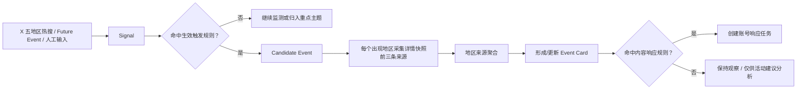
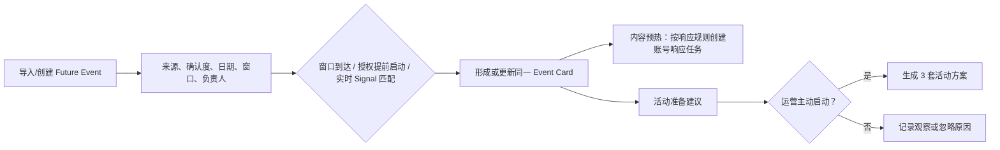
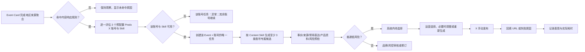
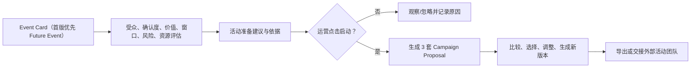

# 03 用户流程

## 3.1 UX-F01 热点发现、候选形成与 Event 聚合（UJ-1、UJ-2）



规则：重点领域关键词进入热搜即触发；普通主题首次排名 1—5 或相邻成功小时快照上升至少 10 位触发。每个出现地区应采集前三条来源；不足时保留实际数量、地区、时间和失败原因。来源冲突显示在 Event Card，不自动改写为确认事实。

## 3.2 UX-F02 主题与热点内容的分流（UJ-1）

```text
热搜排行榜 → 具体趋势项 → Candidate/Event 形成
重点主题 → 主题内具体上升话题 → 对应 Candidate/Event
热点内容（预留）→ 具体内容样本 → Content Insight（后续）→ 可选内容灵感
```

热点内容不是 Topic 或 Event；当前只显示能力边界和后续模块规划。启用后，Content Insight 只能复刻结构、叙事方法、格式或节奏，不能复制原文、素材、未经授权资产或未经核验事实。

## 3.3 UX-F03 未来事件与运营排期（UJ-2、UJ-4）



未确认日期/事件不能用确定倒计时或确定口径表述。内容预热与活动方案是两条独立后续动作：一个失败或未启动，不阻塞另一个。

## 3.4 UX-F04 Event 的账号内容响应（UJ-3）



来源冲突/未知是候选上下文和预检输入，不是普通候选生成的默认阻断门槛。系统不得通过 Telegram 将候选移出权威工作台，也不得自动发布 X。

## 3.5 UX-F05 活动策划支线（UJ-4）



活动方案必须标示 Event 确认度、假设、资源缺口与外部执行前提。交接不等于活动已立项、投放或上线；方案中的 KOL 仅为资源建议，不创建 KOL 工作流。

## 3.6 UX-F06 效果学习与受控回写（UJ-5）

```text
发布 URL / 失败原因 → Performance Result（来源、时间、观察窗口、数据状态）
    → Evaluation Report（样本、口径、异常、因果限制）
    → Optimisation Proposal（适用范围、证据、影响）
    → 人工批准 → 仅在明确范围发布新规则版本
```

缺失、延迟、不可比或样本不足的数据必须显示限制；相关性不能写成因果。新规则不改写历史任务、候选或发布记录。

## 3.7 恢复路径

| 场景 | 系统行为 | 人工入口 |
|---|---|---|
| 地区来源不足 | 保留已成功来源、实际数量与失败原因 | 重试采集、补充来源、标记例外 |
| 误聚合/误拆分 | 预览对象、原始输入和下游影响 | 校正、合并、拆分、管理关系 |
| 账号或 Skill 不可用 | 仅该账号创建异常任务，不生成替代账号候选；其他可用账号继续 | 修复配置、取消该账号任务或继续处理其他账号 |
| 候选生成/预检失败 | 保留失败步骤、规则命中和旧版本 | 重试、补充条件、修订或风险审核 |
| URL 回填失败 | 不关闭任务，保留发布状态未知 | 重新回填或记录失败原因 |
| 追踪数据缺失 | 保留发布记录，结果标为缺失/延迟 | 重试追踪、人工补录、复盘限制 |
