# 03 用户流程

## 3.1 UX-F01 Phase 0 自动内容响应黄金主链（UJ-1、UJ-3、UJ-4）

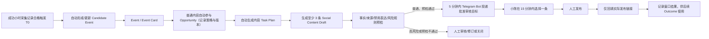

`T0` 是成功采集首次记录合格触发的时间，而不是外部热搜首次出现的时间。普通候选的 Telegram 投递是协作出口，不是“审核通过”或社媒发布；投递后第 10 分钟提醒小陈，第 15 分钟未选择、发布并回填链接即标记错过窗口并升级。高风险内容不可走自动参与或规则预检自动通过路径。

## 3.2 UX-F02 完整产品行动主链（UJ-4）

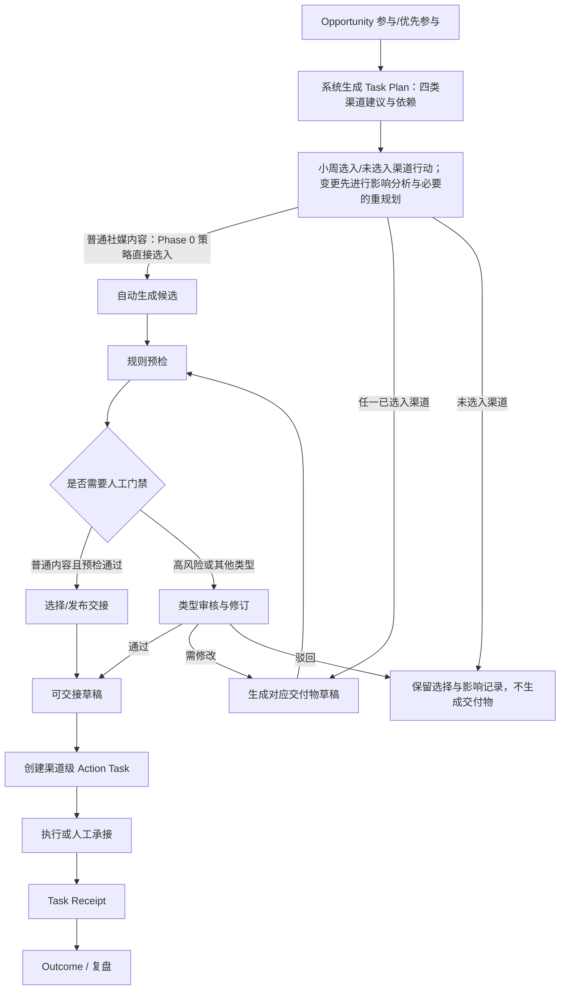

完整产品允许四类行动并行；全局运营台展示真实进度和异常。Phase 0 只激活内容发布，另外三类仅显示建议和“本阶段未启用”。

## 3.3 UX-F03 未来事件准备（UJ-2）

创建日期、范围、预案和前/中/后监测窗口；系统在窗口到达时自动启动，授权用户可手动提前启动，也可与实时 Signal 匹配并行触发。三类路径均汇入同一 Event/Event Card；后续触发只更新既有上下文，不重复创建下游行动。改期、取消、匹配不足均保留原因。

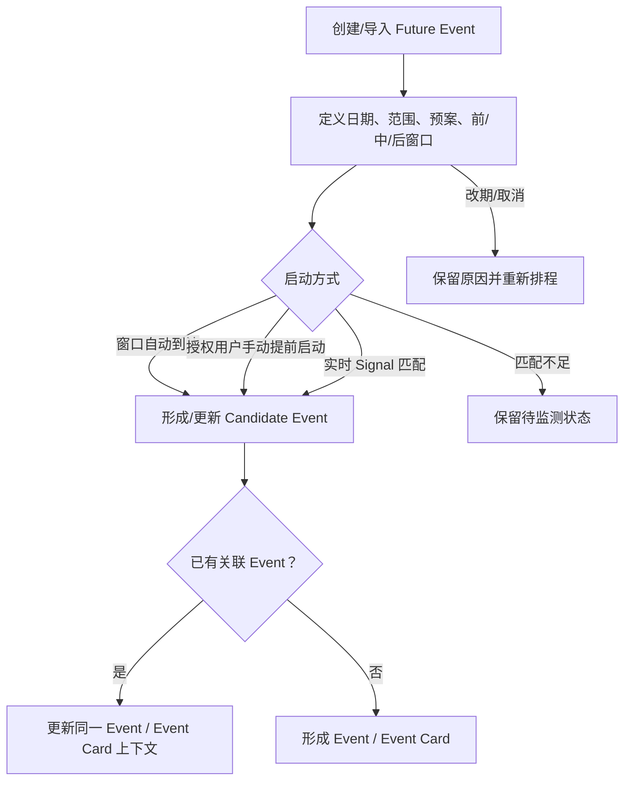

## 3.4 UX-F04 雷达、候选与 Event 形成（UJ-1、UJ-3）

热点雷达按平台、地区、主题、时间范围与来源健康度展示趋势榜单；默认可见“Top 10”、热度变化、跨区域扩散、数据新鲜度、最近成功采集时间与触发原因。系统根据重点领域关键词、普通主题排名 1—5 或相邻成功小时快照上升至少 10 位自动形成/更新 Candidate Event；系统自动完成常规归并，小林仅处理系统标记的归并或上下文例外。

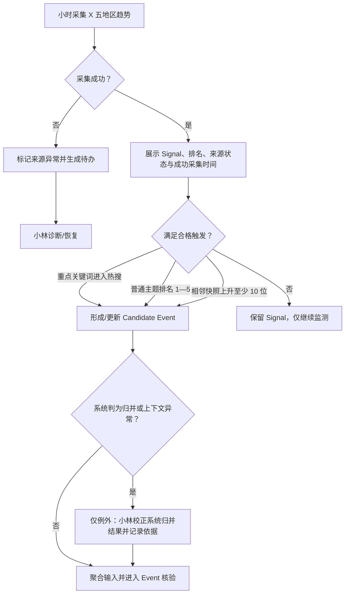

这里的人工校正不是逐条确认热点或手动创建 Event。系统先给出疑似重复的依据和建议结果；小林仅在误合并、误拆分或关联上下文错误时处理例外。原始 Signal 永不删除，处理前后的对象关系、影响范围、处理人、时间和理由必须可追溯。

Event Card 作为版本化档案引用独立的 Fact 与 Evidence。工作区按“Fact → 支持/质疑/排除它的 Evidence”组织，并另外显示：事件一句话定义、置信度、可点击证据来源、动态热度/阶段可视化、风险、响应窗口和 AI 分析。热度变化只提供监测信息，不自动改变窗口。

## 3.5 UX-F05 Opportunity 与 Task Plan（UJ-3、UJ-4）

Opportunity Card 只回答“是否值得为这个热点启动响应”：系统展示受众、价值、风险、资源和窗口依据，小周仅在此处作优先参与、参与、观察或不参与四档决定。Phase 0 的合格普通内容不是额外的一条主决策路径：系统按生效策略在 Opportunity 上自动写入“参与”及其依据，然后和人工选择“参与 / 优先参与”一样进入 Task Plan。Task Plan 才回答“既然响应，四个渠道如何协同”：系统生成包含内容发布、私域触达、营销活动与 KOL 合作的完整响应计划，并明确每一渠道的建议、依赖、预期贡献与不启用后果。渠道行动使用“建议启用 / 未建议启用 → 已选入 / 未选入”的状态，不复用 Opportunity 的四档状态。小周在计划内选择、取消或要求修改具体渠道动作；取消某一渠道时，系统必须评估并呈现对其余渠道的影响，不得把四个渠道当作独立开关。

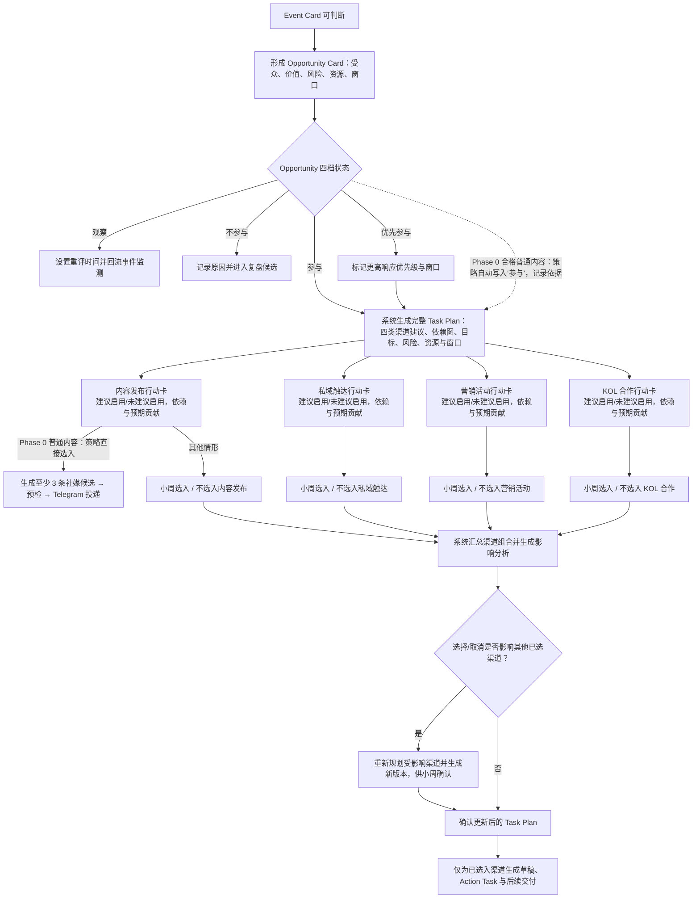

## 3.6 UX-F06 预检、选择与分类型审核（UJ-4）

Execution Deliverable Draft 先完成适用预检。普通社媒内容通过事实/来源/禁用表达/风险规则预检后直接成为“待选择”候选；它不需要人工“通过”才能投递。高风险社媒内容、私域触达、活动方案和 KOL 触达进入分类型审核表单；小改可直接编辑并生成新版本，结构性修改可由意见驱动 AI 重写。高风险项自动拆出给品牌/风控。只有可交接草稿才能据以创建 Action Task。

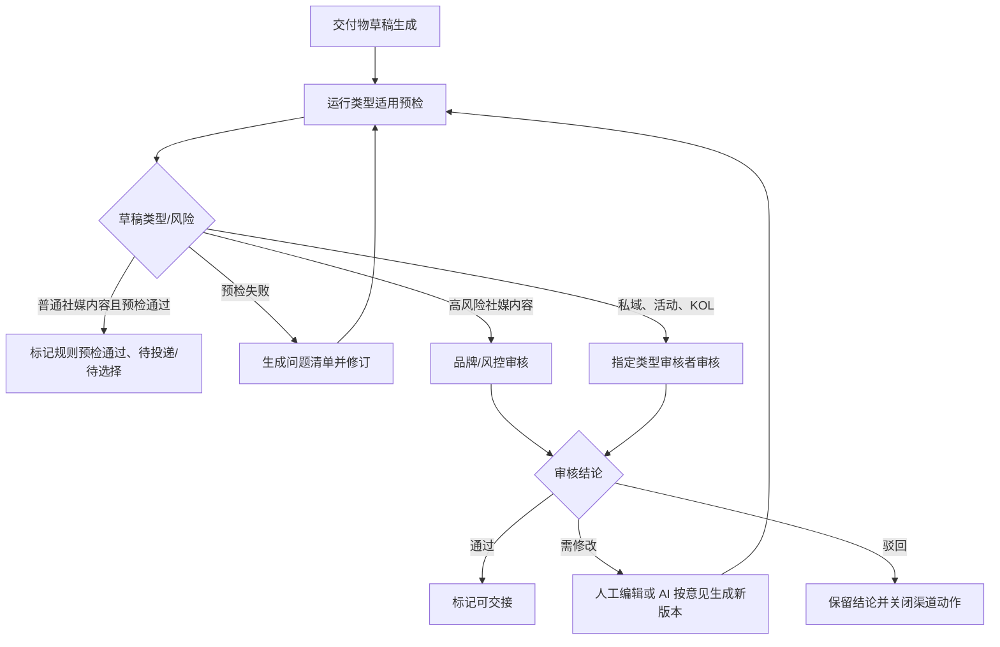

## 3.7 UX-F07 内容发布（UJ-4，Phase 0）

`至少 3 条规则预检通过的 Social Content Draft → Telegram 投递 → 内容运营选择一条 → 复制/打开平台 → 人工发布 → 仅回填实际发布链接`。选择、人工发布和链接回填都必须回写系统；系统不得显示为自动发布，也不得要求额外填写渠道、账号或发布时间。

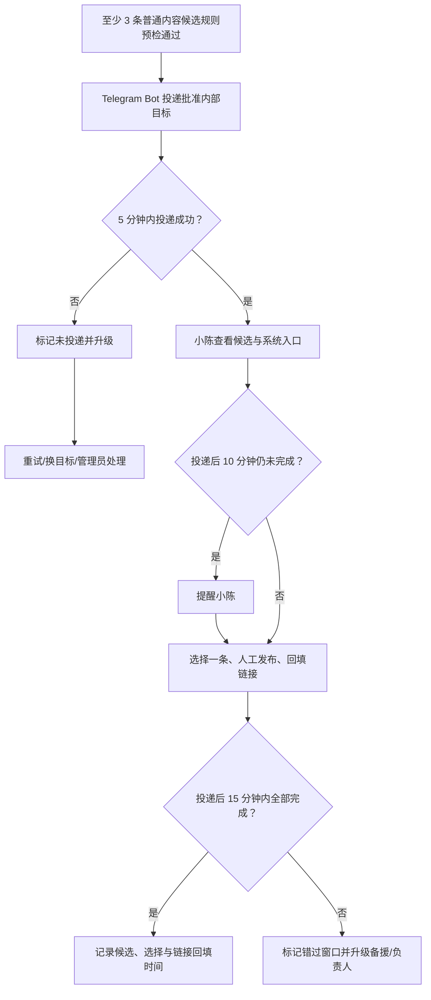

## 3.8 UX-F08 私域触达（完整产品，UJ-4）

`Private Outreach Draft → 社群运营审核 → 选择批准的外部运营目标 → Telegram Bot 发送 → 发送/互动回执`。内部审核目标与外部运营目标使用不同目录和视觉标识。此流程不属于 Phase 0。

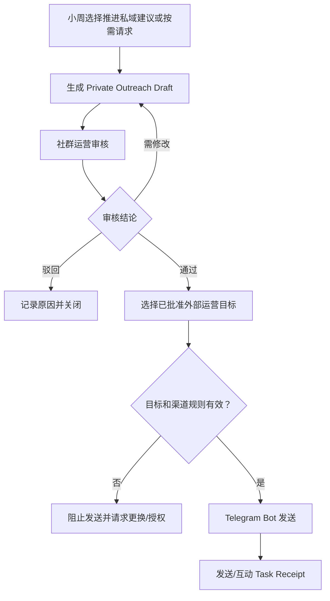

## 3.9 UX-F09 营销活动（完整产品，UJ-4）

系统生成目标、受众、创意、渠道、预算、时间、资源、风险和指标完整方案；增长/活动负责人通过、修改或驳回。通过后形成执行清单并交负责人实施；当前不自动创建落地页、投放预算或上线活动。

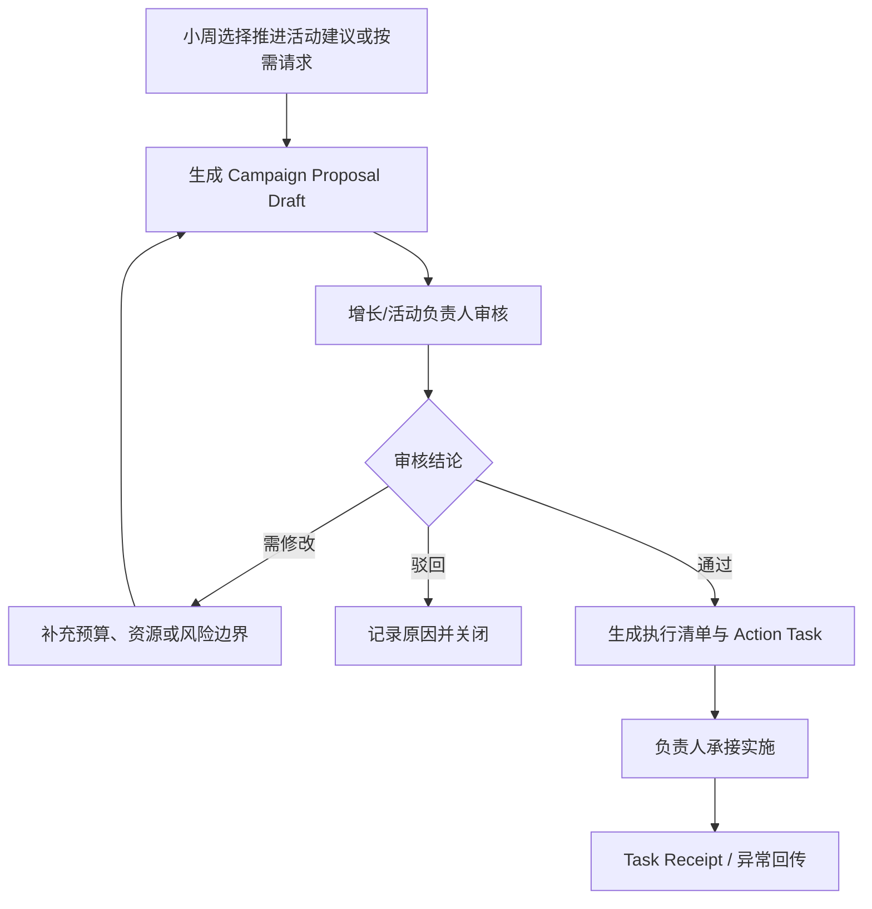

## 3.10 UX-F10 KOL 合作（完整产品，UJ-4）

系统按受众匹配、真实互动、预估结果、报价、风险、响应概率和数据新鲜度给出可解释排序。负责人批准名单/规则、首封模板、账号、时间和频率后，通过 X 自动发送首封；能力不可用时降级人工发送。回复进入收件箱，AI 判断意向并生成建议，后续发送由人工确认。

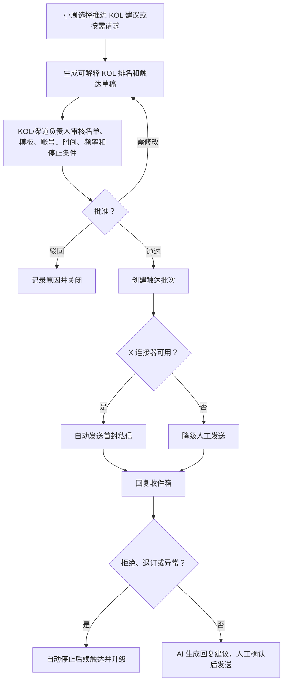

## 3.11 UX-F11 结果学习（UJ-5）

按 Event、Opportunity、Task Plan 和 Action Task 汇总真实回执与结果。缺失或冲突数据不显示为完整结果；策略建议获批后才可回写规则或模板。

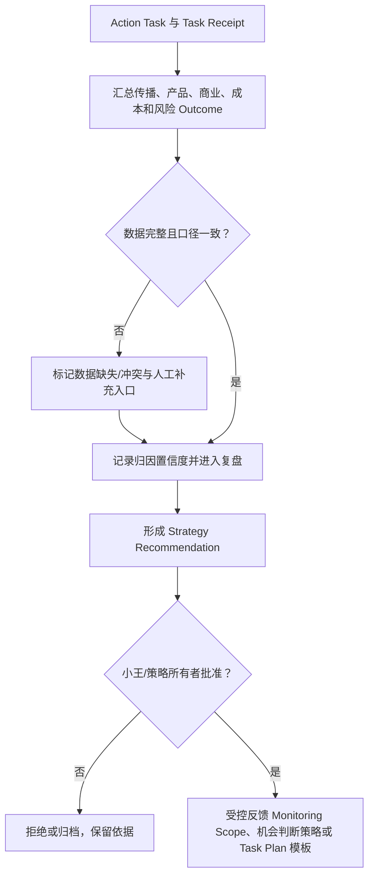

## 3.12 恢复路径

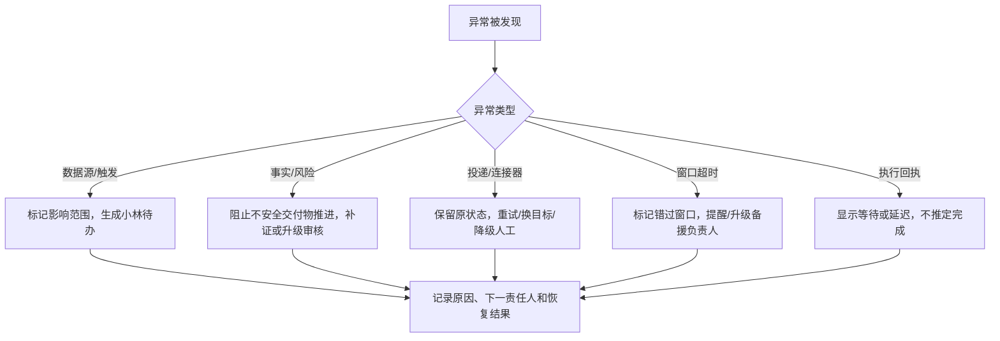

| ID | 场景 | 系统行为 | 人工入口 |
|---|---|---|---|
| UX-R01 | 重复候选 | 建议合并并保留 Signal | 查看差异/拆分 |
| UX-R02 | 事实冲突 | 阻止相关交付物通过 | 补证/确认边界 |
| UX-R03 | 审核需修改/驳回 | 保留版本和意见 | 直接编辑/AI 重写 |
| UX-R04 | 15 分钟内未选择、发布或回填链接 | 第 10 分钟提醒；第 15 分钟标记错过窗口并升级 | 选择候选 / 回填链接 / 记录错过原因 |
| UX-R05 | Phase 0 Telegram 投递失败 | 候选保持“规则预检通过、未投递”；5 分钟目标失败明确可见 | 重试投递 / 更换批准目标 / 升级管理员 |
| UX-R06 | 活动无人承接 | 显示阻塞与窗口影响 | 指派/降级/取消 |
| UX-R07 | X 私信不可用 | 明确降级人工发送 | 导出/复制/记录 |
| UX-R08 | KOL 拒绝/退订 | 自动停止后续触达 | 归档/风险复核 |
| UX-R09 | 回执延迟 | 不推定完成或失败 | 提醒/人工更新/升级 |
