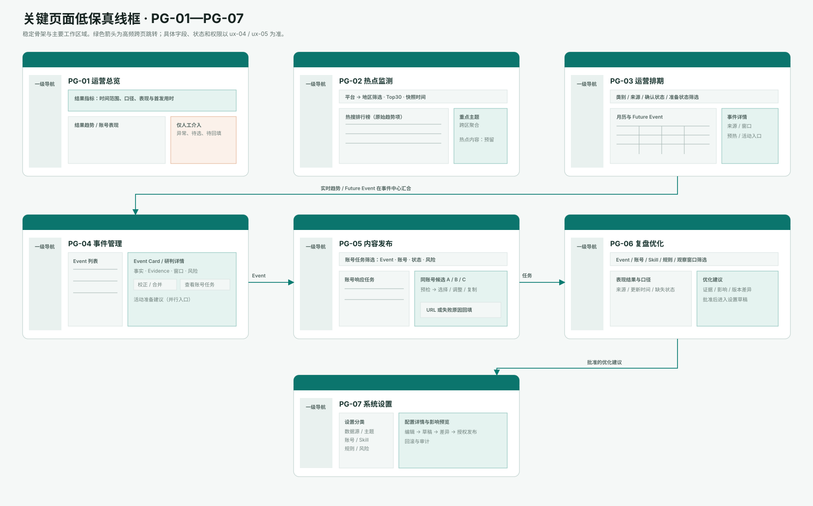

# 04 页面与线框规格

当前可点击的高保真参考为：[HTML 原型终稿 v13](./prototype/hotspot-operations-system-final-prototype.html)。它用于呈现完整产品链路，页面或演示数据出现不代表一期已经接通该能力；本章的 Phase 0 标记才是一期交付边界。原型的示例数值、临时评分和演示按钮不得取代 PRD 业务规则。

## 4.0 页面资产、跳转与状态覆盖

线框图定义七个一级页面的稳定区域；HTML 原型验证页面内的交互演示；`ux-05` 是所有状态的权威行为合同。实现不能只交付默认态。

| 页面 ID | 稳定线框区域 | 原型锚点 | 主要进入 / 离开 | 必须实现的状态 |
|---|---|---|---|---|
| PG-01 | 指标、趋势、人工介入、任务组、榜单摘要 | `overview` | 顶部待办→PG-05；榜单摘要→PG-02；Event/任务组→PG-04/05 | 默认、无可处理事项、追踪延迟、指标缺失、受限指标 |
| PG-02 | 平台地区筛选、Top30、主题、跨区聚合、预留入口 | `monitor` | 具体趋势项→PG-04；主题→具体趋势项；预留入口不跳转 | 默认、采集中、筛选无结果、来源延迟/失败、未启用 |
| PG-03 | 日历、筛选、Future Event 列表、详情、窗口与准备动作 | `future` | 进入预热→PG-05；活动建议→方案对话框；关联信号→PG-04 | 默认、导入中、无匹配事件、日期/来源冲突、操作受限 |
| PG-04 | Event 列表、Event Card、Evidence、校正预览、并行活动入口 | `events` | 查看账号任务→PG-05；来源外链→外部；活动建议→方案对话框 | 默认、聚合中、无 Event、来源不足/冲突、校正权限不足 |
| PG-05 | 任务统计、筛选列表、账号任务详情、候选比较、回填 | `tasks` | 查看依据→PG-04；复制候选→X；回填后→PG-06 | 默认、生成/预检中、无任务、生成/回填失败、高风险审核/账号不可用 |
| PG-06 | 结果筛选、表现与口径、异常复盘、优化建议 | `insights` | 查看来源对象→PG-04/05；接受建议→PG-07 草稿 | 默认、追踪中、无可比样本、数据延迟/失败、无批准权限 |
| PG-07 | 设置分类、配置详情、影响预览、版本差异、审计 | `settings` | 发布草稿→影响预览→当前页；审计来源→相关对象 | 默认、草稿保存中、无配置项、保存/发布失败、只读/无发布权限 |

> 原型锚点为 HTML 内部的稳定页面键，不是 URL 路由；前端实现时应将其映射为可深链的路由或查询状态。对话框的行为和焦点管理见 `ux-05`、`ux-07`。

当前高保真页面资产统一保存在 `assets/`，不再使用 `versions/` 中间目录：

- [PG-01 运营总览](assets/hifi-01-operations-overview.svg)
- [PG-02 热点监测](assets/hifi-02-hotspot-monitoring.svg)
- [PG-03 运营排期](assets/hifi-03-operations-schedule.svg)
- [PG-04 事件管理](assets/hifi-04-event-management.svg)
- [PG-05 内容发布](assets/hifi-05-content-publishing.svg)
- [PG-06 复盘优化](assets/hifi-06-insights-optimization.svg)
- [PG-07 系统设置](assets/hifi-07-system-configuration.svg)

## 4.1 PG-01 运营总览

**回答：**运营结果如何？哪些人工事项、异常和账号任务最值得优先处理？

- 顶部结果指标：表现良好率、总浏览、互动、已发布内容、平均首发用时；必须显示时间范围和口径。
- 结果趋势与账号表现：用于识别结果变化和账号负载，不将单次内容表现写成因果结论。
- 人工待办：只显示生成失败、候选待选择、待 URL 回填、高风险审核、来源/追踪异常等自动链路无法完成的事项。
- 进行中的任务组：按 Event 汇总账号响应任务；一个 Event 与任务数量需明确区分。
- 当前榜单重点：只显示摘要，完整 Top30 跳转热点监测。

不承担 Event 校正、候选编辑或活动方案比较。

## 4.2 PG-02 热点监测

### VW-02A 热搜排行榜

- 先选平台，再选该平台支持的地区；Phase 0 为 X 五地区，每地区完整显示 Top30。
- 每行显示排名、原始趋势项、排名变化、热度量级、聚合状态和“查看聚合”。
- “已触发”仅表示命中 Candidate/Event 触发规则，不表示事实已确认或必然生成内容。
- 热度指标必须说明口径；不可用无解释的彩色进度条代替数据。

### VW-02B 重点主题追踪与跨区聚合

- 主题卡展示主题内具体上升话题、地区扩散和热度变化。
- 主题详情列出具体趋势项；只允许具体项进入 Event，宽泛主题不直接创建 Event。

### VW-02C 热点内容（预留）

- 以明确“后续模块”状态展示叙事与口径、热门内容拆解、传播网络三个入口。
- 当前不展示模拟 Content Insight、样本、爆款分数或可执行任务。

## 4.3 PG-03 运营排期

**回答：**未来事件的确认度、窗口、准备状态和下一步是什么？

- 月历为主，支持类别、确认状态、来源和准备状态筛选；列表/卡片须显示筛选结果数量。
- Future Event 详情显示事件摘要、重要性、监测范围、负责人、来源、确认状态、预测响应窗口、建议准备动作、最近更新时间。
- 重要性、监测范围和负责人必须区分“已配置”“待补充”“无权限查看”；缺失时不能因窗口临近被伪装为已准备完成。
- “进入预热任务”只在规则满足且账号/Skill 可用时创建对应账号响应任务；否则展示阻塞原因。
- “查看 3 个营销活动候选”先显示活动准备建议和限制，再由运营主动确认生成；不得因打开详情自动生成方案。

## 4.4 PG-04 事件管理

**回答：**这个 Event 的边界、来源状态、当前响应和异常是什么？

- 左侧列表：Event 名称、状态、地区、来源一致/冲突状态；筛选包括内容生成中、待发布、处理异常、已完成。
- Event Card：版本、事件摘要、地区、触发原因、来源数量、账号任务状态、热度/窗口、风险、关联 Event。
- Evidence 必须保留地区、排名、快照时间、原始链接和采集状态；来源冲突以可读状态标识，不能自动改为确认事实。
- 校正、合并、拆分和关系管理打开预览：对象、理由、操作前后结构和下游账号任务影响必须可见，确认后留审计记录。
- 活动准备建议位于 Event Card 的并行入口；不得出现 Opportunity、参与决定或 Task Plan。

## 4.5 PG-05 内容发布

**回答：**当前账号对该 Event 应该选、调、发哪条候选，并如何回填发布结果？

- 顶部按账号响应任务统计进行中、待选择、待发布/回填、异常、追踪中和今日完成。
- 列表一行一个账号响应任务，显示任务 ID、账号、关联 Event、状态、风险、创建/更新时刻；支持 Event、账号类型、状态和风险筛选。
- 详情固定显示 Event、账号、Content Skill 版本、触发/响应规则版本、来源状态和风险边界。
- 至少三条同账号候选可比较；候选显示版本、预检结果、引用事实/洞察状态和差异化目的。不同账号候选不能混在同一选择组。
- 普通低风险候选：选择 → 可调整/重新生成 → 复制 → X 手动发布 → 回填实际 URL 或失败原因。
- 高风险候选：审核通过前不可显示“可发布”或进入回填。
- 任务完成需要真实 URL 或明确终止/失败原因；toast 不能是唯一成功凭据。

## 4.6 PG-06 复盘优化

- 效果追踪按 Event、账号、Skill、触发规则、内容洞察引用和时间窗口筛选；显示数据来源、更新时间、口径和缺失状态。
- 评估报告必须分别展示响应时效、候选采用、账号表现、活动建议采用；内容洞察采用在该能力未启用时显示“未启用”，不能显示为 0 或纳入比较分母。
- 评估报告必须写明样本和因果限制；比较条件不一致时不能并列做“优劣”结论。
- 优化建议展示证据、适用范围、影响对象、版本差异和审批状态；接受建议进入系统设置草稿，不直接覆盖生产规则。

## 4.7 PG-07 系统设置

设置视图包括：接口与数据源、监控与触发规则、重点主题、Event 归并阈值、账号与 Skills、产品资料、风险与预检、发布与数据追踪、排期事件源、权限与版本、审计记录。

所有配置修改遵循：编辑 → 保存草稿 → 查看影响范围/版本差异 → 授权发布 → 可回滚。历史任务继续引用创建时的规则、账号和 Skill 版本。

活动方案或后续热点内容样本的导出，需先显示对象范围、敏感性提示和用途输入；确认后记录导出者、时间、对象范围、用途与导出版本。无导出权限时显示受限状态，不隐藏已存在的方案摘要。
